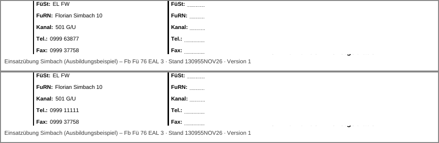
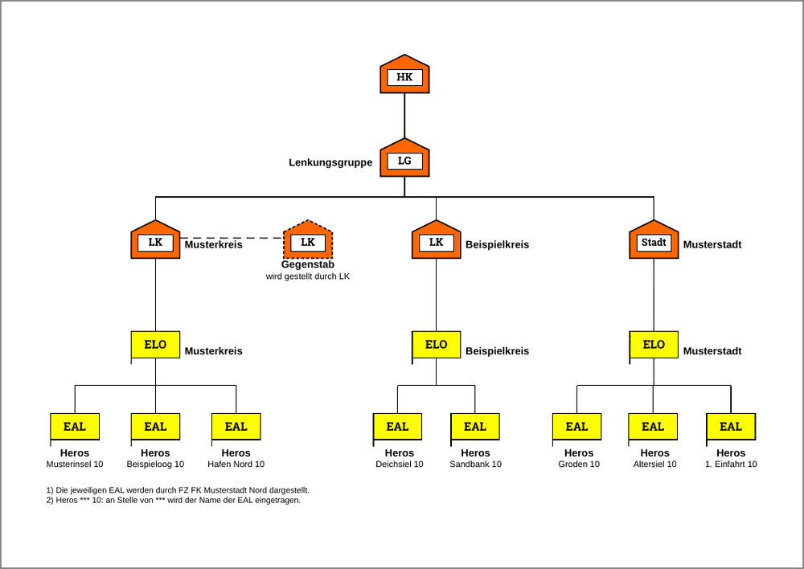
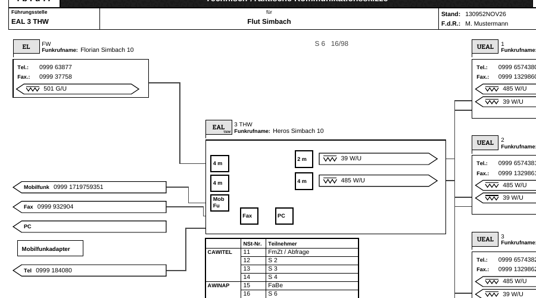
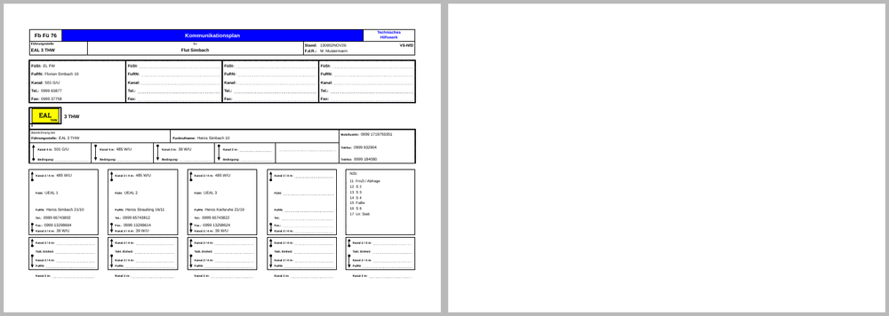
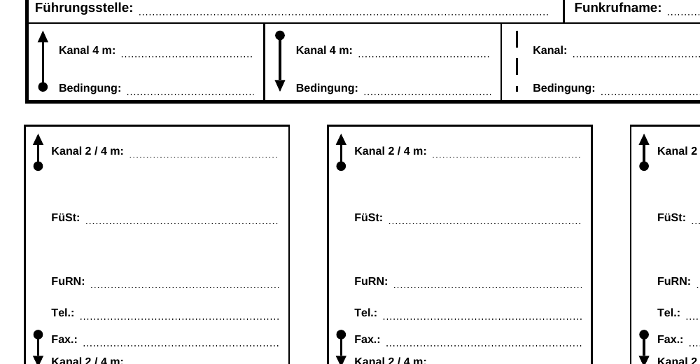

# Review-Runde 1: Papier-Rückfallebene (Analog first)

- **Reviewer-Skill:** `thw-analog-first-reviewer` (IT-skeptischer, praktisch erfahrener Helfer; Kürzel AF)
- **Prüfgegenstand:** komplan.app, main b37b468, lokal per vite preview
- **Datum:** 2026-11-13
- **Viewports/Modi:** Desktop 1440×900; Anzeigemodi Standard, Feld, Dunkel, Nacht (nur für das Druckbild)
- **Durchgespielte Abläufe:**
  - Druckbild über „Export ▾ → Drucken“ (Print-CSS, per `page.emulateMedia({media:'print'})` + `page.pdf()`) und PDF über „Export ▾ → PDF…“ für alle Reiter der Vorlagen „Schadstoffunfall an der Küste“, „Kommunikationsplan THW Fb Fü 76“ (inkl. Skizzen FGr FK/ZTr), „Kommunikationsplan FwDV 800 Anlage 1“, „Fb Fü 77 Skizze 1“, „Fb Fü 77 Skizze 2“ und „Leer“. Alle PDFs mit `pdftoppm` gerendert (farbig und Graustufen) und angesehen.
  - Leerformulare: Plan „Leer“ → „+ Kommunikationsplan“ → Darstellung Organigramm / Fb Fü 76 / FwDV 800, jeweils gedruckt und als PDF exportiert.
  - PDF „in Originalgröße auf Seiten teilen“ (Kommunikationsplan Schadstoffunfall, A4).
  - Nachvollziehbarkeit: PDF exportiert, eine Telefonnummer geändert, erneut exportiert, Seitenfuß verglichen.
  - Rückübernahme: Klick in das leere Fb-Fü-76-Formular, Stände-Dialog (Bemerkung, Vergleich) im Code nachgesehen.

## Urteil aus Sicht der Rolle

Das PDF aus „Export → PDF…“ ist brauchbar: Vektor, A4/A3, Seitenfuß mit Titel, Stand und Version, VS-Vermerk oben und unten, Fb Fü 76/77 und FwDV 800 sehen wie der Vordruck aus, und leere Felder haben gepunktete Schreiblinien. Leere Fb Fü 77 Skizzen 1–5 gibt es als Vorlage. Damit kann man vor dem Einsatz einen Satz Papier vorbereiten.

Reibung entsteht an drei Stellen. Erstens zeigt der Stand auf dem Papier nicht zuverlässig, welcher Inhalt gilt: Änderungen ohne „Neuen Stand anlegen“ ergeben ein anderes Blatt mit gleichem Stand und gleicher Version. Zweitens ist der Weg über „Drucken“ schwächer als das PDF: kein Seitenfuß, kein Stand bei der Führungsorganisation, eine leere zweite Seite. Drittens fehlt der Rückweg vom Papier in die App: Ein handschriftlich ergänztes Formular lässt sich nicht im Formular nachtragen, sondern nur über Gliederung und Eigenschaften. Ohne Einweisung schafft man das Drucken allein, die Nacherfassung nur mit Umwegen.

## P0 – Einsatzkritisch

Keine Befunde.

## P1 – Hoch

### AF-01 Gleicher Stand und gleiche Version auf Blättern mit unterschiedlichem Inhalt

- **Fundstelle / Aufgabe:** Ablauf 2 (Fb Fü 76): PDF exportieren, Telefonnummer ändern, wieder exportieren.
- **Beobachtung:** Ich habe die Tel. der EL FW von 0999 63877 auf 0999 11111 geändert. Beide PDFs tragen im Kopf „Stand: 130955NOV26“ und im Fuß „Stand 130955NOV26 · Version 1“. Auch der Dateiname ist gleich. Der Stand-Knopf in der Werkzeugleiste bleibt bei „V1“. Stand und Version ändern sich nur über „Neuen Stand anlegen“. Den Zeitpunkt der letzten Änderung (`geaendert`) druckt die App nicht.
- **Erwartung der Rolle:** Zwei Blätter mit gleichem Stand haben den gleichen Inhalt. Liegt das Blatt am Funktisch, muss ich an Stand/Version sehen, ob es das aktuelle ist.
- **Auswirkung im Einsatz:** Am Fernmeldetisch und in der Führungsstelle liegen zwei Ausdrucke mit gleichem Stand. Am einen wird die alte Nummer angerufen. Beim Abgleich nach einem Ausfall sieht niemand, welches Blatt maßgeblich war.
- **Empfehlung:** Ungesicherte Änderungen seit dem letzten Stand auf dem Papier kenntlich machen, z. B. „Version 1 + Änderungen, gedruckt 131012NOV26“. Alternativ beim Drucken oder Export vorschlagen, einen neuen Stand anzulegen. Den Druckzeitpunkt immer in den Fuß setzen.
- **Verifikation:** Änderung ohne neuen Stand, zweimal exportieren: die Fußzeilen der beiden Blätter müssen sich unterscheiden.

### AF-02 „Drucken“ liefert Blätter ohne Stand, Version und Vermerk; die Führungsorganisation hat gar keinen Kopf

- **Fundstelle / Aufgabe:** „Export ▾ → Drucken“ bei allen Ansichten; besonders Reiter „Führungsorganisation“ (Schadstoffunfall, Leer).
- **Beobachtung:** Das Druckbild über das Print-CSS hat keinen Seitenfuß: kein Titel, kein Stand, keine Version, keine Seitenzahl. Der Vermerk „VS – Nur für den Dienstgebrauch“ steht nur verkürzt im Kopffeld der Formulare (Fb Fü 76), nicht oben und unten auf der Seite wie im PDF. Die Ansicht Führungsorganisation hat keine Kopfleiste. Ihr Ausdruck enthält nur das Organigramm, ohne jeden Hinweis auf Plan, Stand oder Datum. Beim Plan „Leer“ ist das gedruckte Blatt ganz weiß.
- **Erwartung der Rolle:** Wer „Drucken“ wählt, bekommt dasselbe Blatt wie im PDF. Jede Seite trägt mindestens Plan, Stand und Version, damit das Blatt allein an der Wand verständlich ist.
- **Auswirkung im Einsatz:** Ein ausgedrucktes Organigramm an der Lagekarte lässt sich keinem Stand zuordnen. Nach Lagewechsel hängt das alte Blatt weiter. VS-Material wird ohne vollständigen Vermerk gedruckt.
- **Empfehlung:** „Drucken“ entweder auf das PDF umleiten (PDF erzeugen und im Druckdialog öffnen) oder im Print-CSS dieselbe Fußzeile und denselben Vermerk ausgeben. Die Führungsorganisation bekommt wenigstens eine Kopfzeile mit Plan, Stand und Version.
- **Verifikation:** Jede Ansicht drucken: auf jeder Seite stehen Plan, Stand, Version und gegebenenfalls der VS-Vermerk.

### AF-03 Schwarzweiß: Funk und Draht in der Skizze nicht unterscheidbar

- **Fundstelle / Aufgabe:** Vorlage „Kommunikationsplan THW Fb Fü 76“, Reiter „Skizze FGr FK“ (gleiche Grundlage wie „Beispiel Kommunikationsskizze FGr FK“), PDF in Graustufen gerendert.
- **Beobachtung:** Funkverbindungen sind rot, Drahtverbindungen blau, beide durchgezogen und gleich stark. Im Graustufen-Rendering sind beide gleich dunkelgrau und nicht zu unterscheiden. Die Linienart ist pro Verbinder wählbar (DECISIONS), die Vorlage nutzt das aber nicht, und neue Verbinder bekommen standardmäßig nur eine Farbe.
- **Erwartung der Rolle:** Ein Kopierer oder Laserdrucker in der Führungsstelle druckt schwarzweiß. Der Unterschied Funk/Draht muss auch dann zu sehen sein. Der AUFTRAG verlangt das ausdrücklich.
- **Auswirkung im Einsatz:** Auf der schwarzweißen Kopie sieht man nicht mehr, welche Gegenstelle über Funk und welche über Draht angebunden ist. Fällt eine Verbindungsart aus, wird das falsche Ausweichmittel gewählt.
- **Empfehlung:** Funk und Draht zusätzlich über die Linienart unterscheiden (z. B. Draht durchgezogen, Funk gestrichelt oder mit Blitz-/Antennenmarke). Das gilt als Voreinstellung in „auto“ und in den Vorlagen. Eine kleine Legende auf dem Blatt hilft zusätzlich.
- **Verifikation:** PDF der Skizze in Graustufen drucken: jede Verbindung ist ohne Farbe einer Art zuzuordnen.

### AF-04 Kein direkter Weg vom ausgefüllten Papierformular zurück in die App

- **Fundstelle / Aufgabe:** Leeres Fb Fü 76 (Plan „Leer“ → „+ Kommunikationsplan“ → Darstellung „Formular THW Fb Fü 76“), Klick in ein Formularfeld.
- **Beobachtung:** Ein Klick in das Formular (z. B. in das Feld „FüSt:“ oben links) wählt nichts aus und öffnet kein Eingabefeld. Die linke Spalte meldet „Noch keine Stellen. ‚+ Stelle‘ legt die oberste Führungsstelle an.“ Um ein von Hand ausgefülltes Fb Fü 76 nachzutragen, muss man die Stellen in der Gliederung als Baum anlegen (übergeordnet, eigene, unterstellt) und die Kontakte je Stelle in der rechten Spalte eintragen. Der Hilfetext in den Ansicht-Eigenschaften erklärt, welche Stelle wo im Formular landet. Eine Markierung „aus Papier nachgetragen“ gibt es nur indirekt über die Bemerkung beim Anlegen eines Stands.
- **Erwartung der Rolle:** Nach Netz- oder Geräteausfall nehme ich das handschriftlich ergänzte Blatt, tippe Feld für Feld ab, wie es auf dem Papier steht, und sehe danach im Vergleich, was sich gegenüber dem letzten digitalen Stand geändert hat.
- **Auswirkung im Einsatz:** Die Nacherfassung dauert lange. Man muss die Logik Formular → Baum verstanden haben, und dabei entstehen Fehler: eine Stelle wird doppelt angelegt oder landet am falschen Platz. Bis dahin bleiben Papier und App auseinander.
- **Empfehlung:** In der Formularansicht ein Feld anklicken können, das die zugehörige Stelle oder den Kontakt auswählt und das Eingabefeld rechts fokussiert. Bei leeren Plätzen fragen: „Stelle hier anlegen?“. Dazu ein Ablauf „Papierstand übernehmen“: neuen Stand mit Bemerkung „nach Papier vom …“ anlegen und danach den Vergleich zeigen.
- **Verifikation:** Ein handschriftlich ausgefülltes Fb Fü 76 mit 1 übergeordneten, 1 eigenen und 3 unterstellten Stellen von einer ungeschulten Person ohne Hilfe nacherfassen lassen; Zeit und Fehler zählen.

## P2 – Mittel

### AF-05 „Drucken“ erzeugt eine leere zweite Seite und ignoriert das Papierformat der Ansicht

- **Fundstelle / Aufgabe:** „Export ▾ → Drucken“ bei Fb Fü 76, FwDV 800, Fb Fü 77 Skizze 1/2, Skizzen FGr FK/ZTr.
- **Beobachtung:** Das Druckbild hat bei allen Formularansichten zwei Seiten, und die zweite ist leer. Das Print-CSS legt immer A4 quer fest. Ansichten mit A3 als Voreinstellung (Kommunikationsplan Schadstoffunfall 399 × 226 mm, FwDV 800) werden deshalb auf A4 verkleinert, die Kontaktblöcke werden sehr klein.
- **Erwartung der Rolle:** Ein Blatt pro Formular, im Format, das in der Ansicht eingestellt ist.
- **Auswirkung im Einsatz:** Papier wird verschwendet, und der Stapel am Drucker ist unübersichtlich. Auf dem verkleinerten A4-Plan sind Telefonnummern schwer zu lesen.
- **Empfehlung:** Leere Folgeseite vermeiden (Blatthöhe im Druck begrenzen). Format und Ausrichtung im Druck aus der Ansicht übernehmen oder „Drucken“ über das PDF laufen lassen (siehe AF-02).
- **Verifikation:** Drucken von Fb Fü 76 ergibt genau eine Seite; der A3-Kommunikationsplan wird auf A3 gedruckt.

### AF-06 Leervordrucke Fb Fü 76 und FwDV 800 nur über einen Umweg

- **Fundstelle / Aufgabe:** „Neuer Plan“ → Vorlagenauswahl.
- **Beobachtung:** Die Vorlagen „Kommunikationsplan THW Fb Fü 76“ und „FwDV 800 Anlage 1“ sind ausgefüllte Beispiele (Simbach bzw. Musterstadt). Einen leeren Vordruck bekommt man nur über Plan „Leer“ → „+ Kommunikationsplan“ → Darstellung umstellen. Das Ergebnis ist gut: gepunktete Linien, alle Felder da. Für Fb Fü 77 gibt es dagegen leere Skizzen 1–5 direkt in der Auswahl.
- **Erwartung der Rolle:** In der Vorlagenauswahl gibt es einen Eintrag „Fb Fü 76 leer (zum Ausfüllen von Hand)“ und „FwDV 800 leer“, damit ich vor dem Einsatz einen Stapel Leerformulare drucken kann.
- **Auswirkung im Einsatz:** Wer den Umweg nicht kennt, druckt das Beispiel aus und streicht durch. Oder er arbeitet weiter mit alten Kopien.
- **Empfehlung:** Leere Vorlagen für Fb Fü 76 und FwDV 800 in der Gruppe „Kommunikationsplan“ anbieten, eventuell mit direktem Knopf „Leervordruck als PDF“.
- **Verifikation:** Ein neuer Nutzer findet in der Vorlagenauswahl ohne Hilfe einen leeren Fb Fü 76 und druckt ihn.

### AF-07 Leervordruck trägt schon einen Stand

- **Fundstelle / Aufgabe:** Leeres Fb Fü 76, FwDV 800 und Fb Fü 77 Skizze 1/2, PDF und Druck.
- **Beobachtung:** Auf dem leeren Formular stehen schon „Stand: 130954NOV26“ (Fb Fü 76/77) bzw. „Stand (Datum/Uhrzeit): 13.11.2026 09:54“ (FwDV 800), also der Zeitpunkt, zu dem der Plan angelegt wurde. Dazu kommt der Fuß „Stand … · Version 1“. Ein leeres Stand-Feld zum Eintragen von Hand gibt es nicht.
- **Erwartung der Rolle:** Auf einem Leervordruck ist das Stand-Feld leer, mit Schreiblinie. Den Stand trage ich ein, wenn ich das Blatt ausfülle.
- **Auswirkung im Einsatz:** Auf dem von Hand ausgefüllten Blatt steht ein gedruckter Stand, der nicht stimmt. Wer zwei Blätter vergleicht, glaubt dem gedruckten Wert.
- **Empfehlung:** Für Leervordrucke eine Option „Stand leer lassen“: Kopf mit Schreiblinie, im Fuß „Leervordruck, gedruckt …“ statt Stand/Version.
- **Verifikation:** Leervordruck drucken: im Stand-Feld steht kein Datum, nur eine Linie.

### AF-08 Fb Fü 76 im PDF verkleinert; enge Schreibzeilen auf A4

- **Fundstelle / Aufgabe:** PDF der Ansicht Fb Fü 76 (A4 und A3).
- **Beobachtung:** Das Formular ist als 297 × 210 mm mit eigenem 10-mm-Rand angelegt. Der PDF-Export setzt noch einmal 10 mm Rand und 7 mm Fuß dazu (mit VS-Vermerk 5 mm mehr) und passt ein. Auf A4 kommt das Formular so auf etwa 85–87 % (berechnet aus `pdf.ts`/`fbfue76.ts`, im Rendering sichtbar). Feldbeschriftungen mit 6 pt werden dadurch etwa 5 pt groß. Die Zeilen in den Kästen „Takt. Einheit“ (Kanal/FuRN, 4 mm Abstand im Layout) liegen auf A4 nur noch etwa 3,4 mm auseinander. Eine neue Kommunikationsplan-Ansicht steht dagegen auf A3. Dort wird das Formular auf etwa 129 % vergrößert und lässt sich gut beschreiben (siehe Bild). Der Vordruck ist A4.
- **Erwartung der Rolle:** Formular in Originalgröße 1:1 auf A4, so wie der Papiervordruck. Zeilen, in die man mit Kugelschreiber im Stehen schreiben kann.
- **Auswirkung im Einsatz:** Auf A4 schreibt man in die unteren Kästen nur noch in Kleinschrift, mit Handschuh gar nicht. Die Einträge sind schwer zu lesen und werden beim Nacherfassen falsch abgeschrieben.
- **Empfehlung:** Formulare mit fester Seitengröße auf A4 in 1:1 ausgeben (Fuß und Vermerk in den Formularrand legen statt zusätzlich). Für Leervordrucke etwas größere Zeilenabstände in den Takt.-Einheit-Kästen erwägen. A4 als Voreinstellung für Fb Fü 76.
- **Verifikation:** Fb-Fü-76-PDF auf A4 drucken und mit dem Lineal messen: Kästen und Zeilen wie im Vordruck, kleinster Zeilenabstand ≥ 5 mm.

## P3 – Niedrig

### AF-09 Seitenteilung ohne Klebe- und Schnittmarken

- **Fundstelle / Aufgabe:** PDF, A4, „in Originalgröße auf Seiten teilen“, Kommunikationsplan Schadstoffunfall.
- **Beobachtung:** 4 Seiten, der Fuß nennt „Teil 1/1 (Zeile/Spalte von 2×2)“. Auf dem Blatt selbst gibt es keine Markierung für die 10 mm Überlappung und keine Pass- oder Schnittmarken. Kopfleiste und Kontaktblöcke werden mitten durchgeschnitten.
- **Erwartung der Rolle:** Zum Zusammenkleben an der Wand sind Überlappung und Passkreuze zu sehen.
- **Auswirkung im Einsatz:** Das Zusammenkleben dauert länger, und Zeilen werden verdeckt oder doppelt geklebt.
- **Empfehlung:** Überlappungsbereich schwach schraffieren oder mit Strichlinie und Passmarke kennzeichnen.
- **Verifikation:** Geteilten Plan von einer zweiten Person ohne Erklärung zusammenkleben lassen.

### AF-10 Druck aus Dunkel/Nacht-Modus mit schwarzem Rand

- **Fundstelle / Aufgabe:** Anzeigemodus Dunkel oder Nacht, dann „Drucken“.
- **Beobachtung:** Mit eingeschalteter Option „Hintergrundgrafiken drucken“ hat die Seite einen breiten schwarzen Rand um das Blatt. Ohne diese Option (Voreinstellung im Browser) ist sie weiß. Im Modus Feld tritt das nicht auf.
- **Erwartung der Rolle:** Der Ausdruck ist immer schwarz auf weiß, egal welcher Anzeigemodus gerade an ist (nachts im Fahrzeug ist Nacht-Modus an).
- **Auswirkung im Einsatz:** Viel Toner wird verbraucht, und der Druck dauert in der Führungsstelle länger.
- **Empfehlung:** Im Print-CSS auch den Seitenrand/Wurzelhintergrund auf Weiß setzen.
- **Verifikation:** In jedem Modus mit Hintergrundgrafiken drucken: kein dunkler Rand.

### AF-11 Kleinigkeiten am Leervordruck der Skizze und am Papierbezug

- **Fundstelle / Aufgabe:** Fb Fü 77 Skizze 1 leer, PDF; Stände-Dialog.
- **Beobachtung:** Neben „Funkrufname:“ an den Zeichen-Kästen steht keine Schreiblinie (anders als bei Tel./Fax.). Die Bemerkung zum Stand (z. B. „Lagewechsel“) erscheint nicht auf dem Papier. Das Blatt hat keine Kennung, die Plan und Gerät eindeutig zuordnet: nur Plantitel, und der kann gleich sein.
- **Erwartung der Rolle:** Jedes Feld zum Ausfüllen hat eine Linie. Auf dem Papier steht, warum dieser Stand gilt, und das Blatt lässt sich eindeutig seinem Plan zuordnen.
- **Auswirkung im Einsatz:** Funkrufnamen werden irgendwo in den Kasten geschrieben. Beim Abgleich nach einem Ausfall ist nicht klar, zu welchem Plan ein Blatt gehört.
- **Empfehlung:** Schreiblinie bei „Funkrufname:“. Bemerkung des Stands in den Fuß. Kurze Plankennung im Fuß, etwa die ersten Zeichen der Plan-ID.
- **Verifikation:** Leere Skizze 1 von Hand ausfüllen lassen; ausgedrucktes Blatt ohne App dem richtigen Plan zuordnen.

## Analog-/Digital-Übergabematrix

| Prozessschritt | Digitaler Nutzen | Analoger Fallback | Sauberer Wiedereinstieg in Digital |
|---|---|---|---|
| Kommunikationsplan Fb Fü 76 / FwDV 800 führen | Kontaktdaten einmal pflegen, Formular wird aus dem Modell erzeugt, Hinweise zu fehlenden Angaben | Leervordruck oder letzter PDF-Stand, von Hand ergänzt | Fehlt: kein Eintrag im Formular selbst (AF-04); Stand-Vergleich vorhanden, aber Papierstand nicht markierbar |
| Kommunikationsskizze Fb Fü 77 | Gegenstellen aus der FüOrg übernehmen, sauberes Zeichnen, PPTX/PDF | Leere Skizze 1–5 als PDF, mit Bleistift ergänzt | Nur Neuzeichnen in der App; Funk/Draht muss auf der SW-Kopie erkennbar sein (AF-03) |
| Führungsorganisation an der Wand | Umhängen und neu drucken in Sekunden | Ausdruck plus Whiteboard-Ergänzungen | Ausdruck braucht Stand/Version (AF-02), sonst kein sicherer Abgleich |
| Stand festschreiben und verteilen | Versionierung, Vergleich, Schnappschuss | Ausgedruckte, abgezeichnete Blätter (F.d.R.) | Nur verlässlich, wenn Stand/Version den Inhalt eindeutig bezeichnen (AF-01) |

## Würde ich dafür das Papier weglegen?

Für die Vorbereitung ja, im laufenden Einsatz noch nicht. Die App erzeugt saubere Vordrucke und hält Kontaktdaten an einer Stelle, und das spart Abschreibfehler. Solange aber ein Ausdruck nicht sicher zeigt, welcher Inhalt gilt (AF-01, AF-02), und der Rückweg vom Papier nur über die Baumstruktur führt (AF-04), bleibt das von Hand geführte Blatt am Funktisch maßgeblich.

## Abschluss

- **Aufgabe geschafft:** mit Umwegen (Drucken und PDF: ja; Leervordruck Fb Fü 76/FwDV 800 und Nacherfassung vom Papier: mit Umwegen)
- **Fremde Hilfe nötig:** nein (Hilfetext zur Formularbelegung reicht knapp)
- **Größtes Missverständnis:** „Stand/Version“ auf dem Blatt wirkt wie eine eindeutige Fassung, bezeichnet aber nur den letzten bewusst angelegten Stand.
- **Größtes Einsatzrisiko:** Zwei Ausdrucke mit gleichem Stand und unterschiedlichen Rufnummern liegen gleichzeitig in Gebrauch.
- **Top-Priorität für die nächste Iteration:** Jedes Papier (PDF und Drucken) trägt einen Stand, der Änderungen seit dem letzten Stand erkennbar macht, plus Druckzeitpunkt.

## Was gut funktioniert

- PDF-Export: echte Vektoren, A4/A3 quer/hoch, Seitenfuß mit Titel, Stand, Version, Seite x von y; VS-Vermerk oben und unten.
- Leere Felder im Kommunikationsplan und in den Formularen haben gepunktete Schreiblinien; leere Fb Fü 77 Skizzen 1–5 sind direkt als Vorlage da.
- Fb Fü 76 und FwDV 800 sind dem Vordruck nah. Die Führungsorganisation bleibt in Graustufen lesbar, weil Zeichen und Beschriftung die Unterscheidung tragen.
- Stände-Dialog mit Bemerkung, Vergleich und „Als Kopie öffnen“ ist eine gute Grundlage für den Abgleich nach einer Papierphase.

## Nicht geprüft

- Tatsächlicher Ausdruck auf einem Gerät (nur PDF-Rendering mit pdftoppm/Chromium); der Druckdialog echter Browser (Firefox, Safari) und das Verhalten der Option „Hintergrundgrafiken“ dort.
- Druck vom Tablet/Telefon; PPTX-Ausgabe; Fb Fü 77 Skizzen 3–5 im Einzelnen (nur 1 und 2 sowie die Simbach-Skizzen angesehen).
- Teil-Link und JSON-Einlesen als Weg der Rückübernahme (nicht Papier-relevant, von anderen Reviewern abgedeckt).
