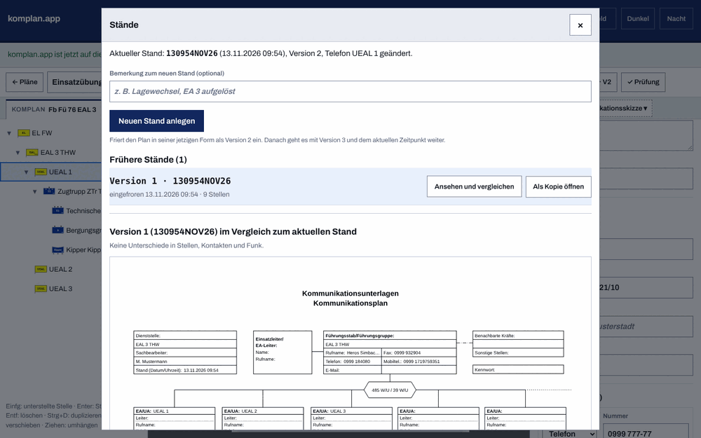
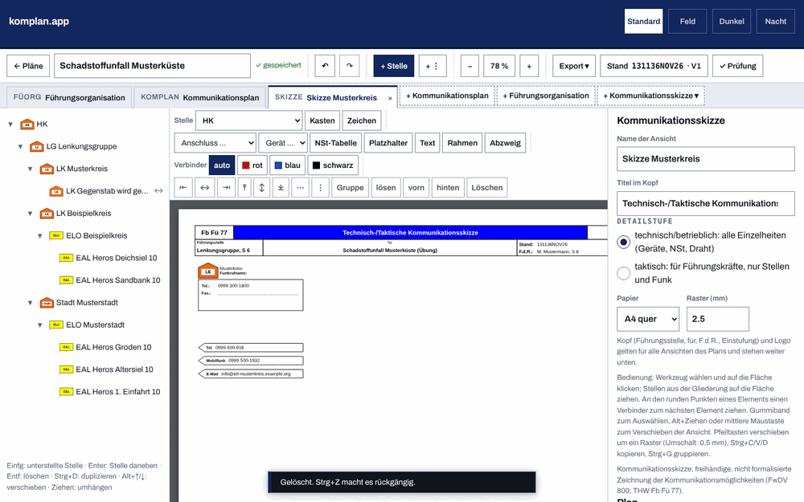
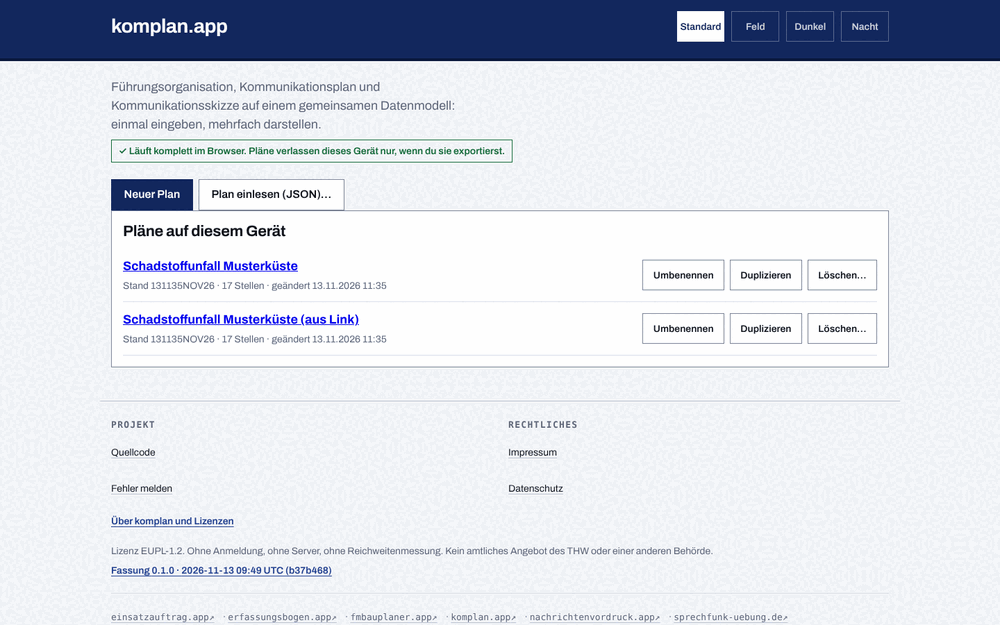
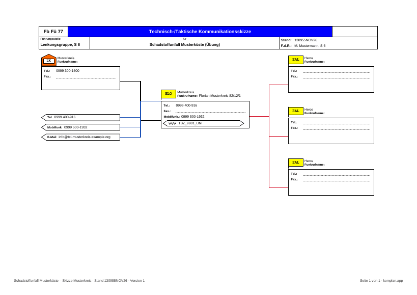
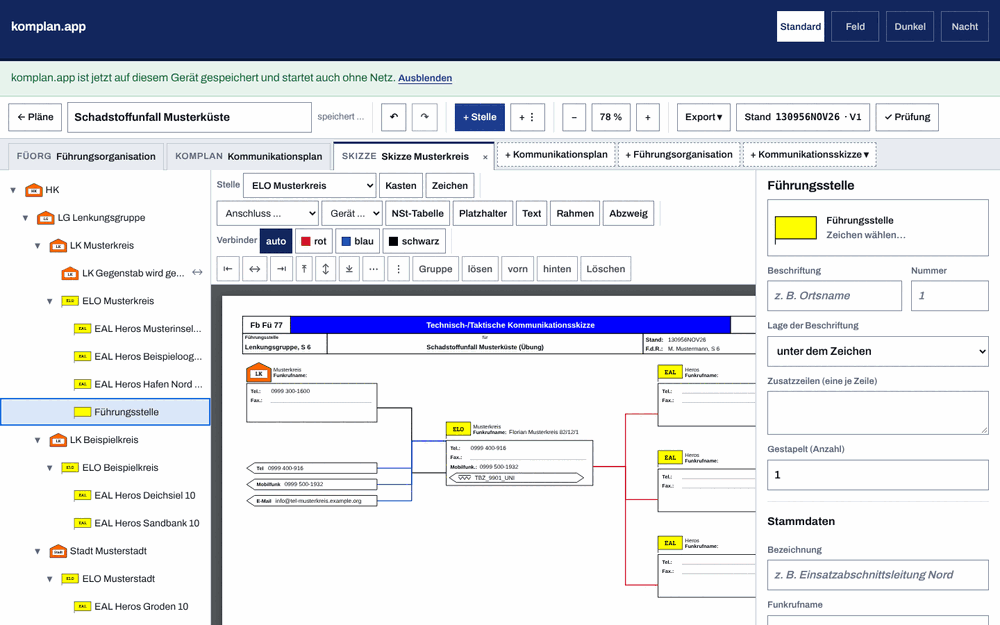
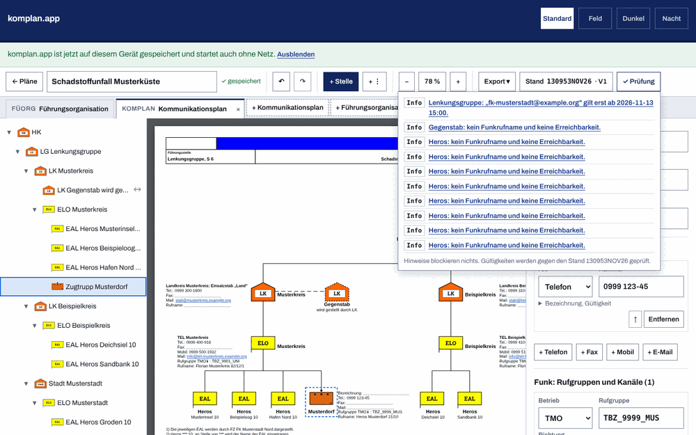

# Review-Runde 1: Arbeitsablauf

- Reviewer-Skill: `thw-workflow-reviewer` (vollständige Arbeitsabläufe statt einzelner Ansichten), Kürzel AA
- Prüfgegenstand: komplan.app, main b37b468, lokal per vite preview
- Datum: 2026-11-13
- Viewports/Modi: Desktop 1440×900, Standard. Andere Viewports und Modi nur über die Basis-Screenshots.
- Durchgespielte Abläufe (Playwright, frische Kontexte, nur Vorlagen- und Musterdaten):
  1. Schadstoffunfall: Stelle unter ELO anlegen, Zeichen suchen (UEAL, Zugtrupp), Beschriftung, Funkrufname, Telefon und Rufgruppe eintragen, Wechsel in den Reiter Kommunikationsplan, Prüfung, PDF (A3) erzeugt und gelesen.
  2. Fb Fü 76 (Simbach): auf FwDV 800 umgeschaltet, Telefon der UEAL 1 geändert, Stand angelegt, Stände verglichen, noch einmal geändert und wieder verglichen.
  3. Skizze per Rechtsklick „Kommunikationsskizze erzeugen“ an ELO Musterkreis, danach in der FüOrg eine Stelle ergänzt, „+ Stelle“ im Skizzen-Reiter, PPTX und PDF exportiert (PDF gerendert).
  4. Teil-Link für V1 und V2 erzeugt, beide in einem zweiten Browser-Kontext übernommen, JSON exportiert, Druckbild (`page.pdf`).
  5. Neu laden mitten in der Arbeit, Plan über „← Pläne“ wieder geöffnet, ELO Musterkreis mit Unterstellten gelöscht, Folgen in der Skizze angesehen.

## Urteil aus Sicht der Rolle

Der Kern hält, was die Startseite verspricht („einmal eingeben, mehrfach darstellen“): Eine Telefonnummer oder Rufgruppe, die ich in der Führungsorganisation eintrage, steht ohne weiteren Schritt im Kommunikationsplan und in der Skizze. Die Auswahl bleibt beim Reiterwechsel erhalten, Rückgängig funktioniert über alle Ansichten. Reibung entsteht an den Übergaben: Die Versionierung arbeitet in der Reihenfolge, in der man im Stab natürlich arbeitet („erst ändern, dann neuen Stand“), gegen den Nutzer. Wer einen Plan zweimal per Link bekommt, hat danach zwei Pläne mit gleichem Namen und gleichem Stand. Und die Skizze ist nach dem Erzeugen von der FüOrg abgekoppelt, ohne dass das irgendwo steht. Die Aufgaben lassen sich ohne fremde Hilfe erledigen, aber an drei Stellen entsteht unbemerkt ein falscher Stand.

## P0

Keine Befunde.

## P1

### AA-01: „Neuen Stand anlegen“ friert bereits geänderte Daten unter der alten Version ein

- **Fundstelle / Aufgabe:** Ablauf 2, Knopf „Stand … · V1“ → Dialog „Stände“
- **Beobachtung:** Plan Fb Fü 76, Stand V1. Ich ändere das Telefon der UEAL 1 (0999 65743802 → 0999 777-77). Die Kopfleiste zeigt weiter unverändert „Stand 130954NOV26 · V1“, kein Hinweis auf Änderungen seit dem Stand. Danach „Neuen Stand anlegen“ mit Bemerkung „Telefon UEAL 1 geändert“. Ergebnis: Eingefroren wird als **Version 1** der bereits geänderte Plan (mit 0999 777-77). Die ursprüngliche Nummer ist in keinem Stand mehr enthalten. „Ansehen und vergleichen“ V1 gegen aktuell: „Keine Unterschiede in Stellen, Kontakten und Funk.“ Die Bemerkung landet an Version 2, nicht an der eingefrorenen Version. Laut Code und `docs/DECISIONS.md` ist das so gewollt: der Stand muss *vor* der Änderung angelegt werden. Die App sagt das nirgends.
- **Erwartung der Rolle:** V1 ist das, was ausgegeben wurde. Ich ändere, lege einen neuen Stand an, und der Vergleich zeigt mir genau meine Änderung, damit ich sie an die Empfänger weitergeben kann.
- **Auswirkung im Einsatz:** Ein Ausdruck, der vor einer Stunde als V1 verteilt wurde, und das PDF, das jetzt als V1 entsteht, zeigen unter derselben Stand-Kennung verschiedene Nummern. Die Änderungsliste für die Übergabe an Empfänger ist leer. Ein Lagewechsel lässt sich nachträglich nicht belegen.
- **Empfehlung:** Den ausgegebenen Stand vor der ersten Änderung automatisch sichern, oder sichtbar machen, dass sich der Plan seit dem Stand geändert hat (z. B. „V1 + Änderungen“), und beim Anlegen anbieten: „Änderungen seit V1 als V2 übernehmen“. Die Bemerkung gehört zu der Version, die die Änderung enthält.
- **Verifikation:** Vorlage öffnen, Nummer ändern, neuen Stand anlegen: Der Vergleich der beiden Versionen zeigt die Nummernänderung, die Bemerkung steht an der Version mit der neuen Nummer.

### AA-02: Löschen in der FüOrg leert eine vorhandene Skizze ohne Warnung

- **Fundstelle / Aufgabe:** Ablauf 5, Reiter Führungsorganisation, Entf an „ELO Musterkreis“; danach Reiter „Skizze Musterkreis“
- **Beobachtung:** Der Löschdialog fragt nur nach den Unterstellten („Mit Unterstellten löschen“ / „Nur diese“). Dass die Stelle Mittelpunkt einer Kommunikationsskizze ist, erwähnt er nicht. Danach ist die Skizze bis auf LK Musterkreis leer: ELO und alle drei EAL sind weg. Die drei Anschluss-Pfeile mit den Nummern der gelöschten ELO (Tel 0999 400-916, Mobilfunk, E-Mail) stehen ohne Bezug weiter auf dem Blatt. Strg+Z holt die Stellen zurück (Kurzmeldung unten), aber nur, solange man es gleich bemerkt.
- **Erwartung der Rolle:** Vor dem Löschen erfahre ich, in welchen anderen Ansichten die Stelle vorkommt.
- **Auswirkung im Einsatz:** Wer die FüOrg umbaut (z. B. Abschnitt aufgelöst), merkt nicht, dass die Skizze eines anderen Sachgebiets dabei verloren geht. Die stehengebliebenen Anschlüsse zeigen Nummern einer Stelle, die es im Plan nicht mehr gibt.
- **Empfehlung:** Im Löschdialog nennen, in welchen Ansichten die Stelle und ihre Unterstellten gezeichnet sind („kommt in ‚Skizze Musterkreis‘ vor“). Anschlüsse, die zu einer gelöschten Stelle gehören, mit entfernen oder deutlich als verwaist kennzeichnen.
- **Verifikation:** Skizze aus einer Stelle erzeugen, Stelle in der FüOrg löschen: Der Dialog nennt die Skizze, und auf dem Blatt bleibt nichts ohne Bezug stehen.

### AA-03: Mehrfach empfangener Plan: zwei gleichnamige Pläne, Version nirgends sichtbar

- **Fundstelle / Aufgabe:** Ablauf 4, Teil-Link öffnen → „Plan übernehmen und öffnen“; Startseite „Pläne auf diesem Gerät“
- **Beobachtung:** Absender schickt V1 per Link, ändert eine Nummer, legt einen neuen Stand (V2) an und schickt wieder einen Link. Beim Empfänger zeigen beide Empfangsseiten wörtlich dasselbe: „Schadstoffunfall Musterküste, Stand 131135NOV26, 17 Stellen, 2 Ansichten.“ Die Version steht nicht dabei. Der zweite Empfang legt eine Kopie „… (aus Link)“ an. In der Planliste stehen danach zwei Einträge mit gleichem Stand, gleicher Stellenzahl und gleicher Änderungszeit. Welcher die neuere Nummer hat, ist nicht zu erkennen, und es gibt kein „vorhandenen Plan aktualisieren“. JSON-Einlesen verhält sich gleich („(eingelesen)“). Der Teil-Link nimmt außerdem keine früheren Stände mit; im JSON sind sie enthalten.
- **Erwartung der Rolle:** Kommt eine neuere Fassung desselben Plans, sehe ich „V2 ersetzt V1“ und kann ihn aktualisieren. Was sich geändert hat, kann ich nachlesen.
- **Auswirkung im Einsatz:** Annahme: Komplan-Fassungen werden im Lauf eines Einsatzes mehrfach an Abschnitte und Nachbarstellen verteilt. Der Empfänger kann dann mit der veralteten Kopie arbeiten und die falsche Nummer anrufen. Die Liste füllt sich mit Dubletten, die man von Hand aufräumen muss.
- **Empfehlung:** Auf Empfangsseite und in der Planliste die Version zeigen (wie in der Kopfleiste „· V2“). Bei gleicher Plan-ID anbieten: „vorhandenen Plan (V1) durch V2 ersetzen, V1 als Stand behalten“, mit der Änderungsliste aus dem Stand-Vergleich.
- **Verifikation:** Zwei Links desselben Plans mit V1 und V2 nacheinander öffnen: Der Empfänger sieht die Versionen, kann aktualisieren und hat danach einen Plan mit V1 als früherem Stand.

### AA-04: In Skizze und Prüfliste sind gleichartige Stellen nicht zu unterscheiden

- **Fundstelle / Aufgabe:** Ablauf 1 und 3, Vorlage Schadstoffunfall: Prüfung, „Skizze Musterkreis“, PDF der Skizze
- **Beobachtung:** In FüOrg und Komplan stehen die EAL als „Heros / Musterinsel 10“, „Heros / Beispieloog 10“ usw.: „Heros“ als Beschriftung, der Rest als Zusatzzeile, Funkrufname leer. Die Skizze zeigt nur die Beschriftung: drei identische Kästen „EAL Heros, Funkrufname: …“ (auch im PDF). Die Prüfliste meldet achtmal wortgleich „Heros: kein Funkrufname und keine Erreichbarkeit.“ Die Liste der Stellen im Skizzen-Werkzeug („EAL Heros Musterinsel 10“) und die Gliederung sind dagegen eindeutig.
- **Erwartung der Rolle:** Was ich in der Führungsorganisation an die Stelle geschrieben habe, erkenne ich in der Skizze und in der Prüfliste wieder.
- **Auswirkung im Einsatz:** In der Kommunikationsskizze lässt sich die Verbindung keiner bestimmten EAL zuordnen; wer nach dem Ausdruck verkabelt oder Kanäle einteilt, rät. Die Prüfliste ist als Abschluss-Check vor der Weitergabe nicht lesbar, man muss jeden Eintrag anklicken.
- **Empfehlung:** In Skizzen-Kästen und Hinweisen denselben Namen wie in der Gliederung verwenden (Zeichen, Nummer, Beschriftung, Zusatzzeilen bzw. Funkrufname). Dazu AA-07: Rufname nicht zweimal pflegen müssen.
- **Verifikation:** Skizze aus „ELO Musterkreis“ erzeugen: Die drei EAL-Kästen sind ohne Anklicken unterscheidbar; die Prüfliste nennt jede Stelle eindeutig.

## P2

### AA-05: Skizze bleibt nach dem Erzeugen von der FüOrg getrennt, ohne Hinweis; „+ Stelle“ wirkt im Skizzen-Reiter unsichtbar

- **Fundstelle / Aufgabe:** Ablauf 3, Reiter „Skizze Musterkreis“
- **Beobachtung:** Nach dem Erzeugen der Skizze lege ich in der FüOrg unter ELO Musterkreis eine weitere Stelle an. Die Skizze zeigt sie nicht; sie ist nur über das Feld „Stelle“ + „Kasten“ von Hand zu holen. Im Skizzen-Reiter ist der hervorgehobene Knopf weiterhin „+ Stelle“. Er legt eine Stelle in der Gliederung an (17 → 18 Zeilen, rechts „Führungsstelle“), auf dem Blatt erscheint nichts. Links steht die volle Gliederung der FüOrg, auf dem Blatt eine andere Auswahl.
- **Erwartung der Rolle:** Entweder wächst die Skizze mit („aus Stelle“), oder die App sagt mir, dass in der Skizze Stellen fehlen, und bietet an, sie aufzunehmen. „+ Stelle“ im Skizzen-Reiter legt etwas auf die Skizze.
- **Auswirkung im Einsatz:** Die Skizze veraltet still, während FüOrg und Komplan aktuell sind. Wer im Skizzen-Reiter „+ Stelle“ drückt, sucht die neue Stelle auf dem Blatt und legt sie am Ende doppelt an.
- **Empfehlung:** In der Skizze anzeigen, welche Unterstellten der Fokus-Stelle fehlen („2 Stellen nicht in der Skizze – aufnehmen“). Im Skizzen-Reiter „+ Stelle“ zu „Stelle aufs Blatt“ machen oder den Hinweis geben, dass die Stelle nur in der Gliederung entsteht. In der Gliederung kennzeichnen, welche Stellen auf dem Blatt sind.
- **Verifikation:** Nach Erzeugen der Skizze eine Unterstellte ergänzen: Die Skizze weist darauf hin; „+ Stelle“ im Skizzen-Reiter führt zu einem Element auf dem Blatt.

### AA-06: Weitergabe als Paket nur ansichtsweise

- **Fundstelle / Aufgabe:** Ablauf 1, 3, 4; Export ▾ → PDF…, PowerPoint, Drucken
- **Beobachtung:** PDF, PPTX, SVG, PNG und Drucken erfassen jeweils nur den gerade offenen Reiter (Dialogtitel „PDF: Kommunikationsplan“, Dateiname mit Ansichtsname). FüOrg, Komplan und Skizze werden also drei getrennte Dateien. Vor dem Export gibt es keinen Hinweis auf offene Prüfhinweise. Der Teil-Link enthält dagegen alles.
- **Erwartung der Rolle:** Annahme: Für die Übergabe an Schichtwechsel, Abschnitte oder Nachbarstellen wird der Satz FüOrg + Komplan + Skizzen als ein Dokument verteilt. Ich erwarte „alle Ansichten als ein PDF“.
- **Auswirkung im Einsatz:** Drei Exporte, drei Dateien, Gefahr, dass eine Ansicht fehlt oder aus einem anderen Stand stammt. Jede Datei ist mehrere Klicks.
- **Empfehlung:** Im PDF-Dialog „alle Ansichten / Auswahl der Ansichten“ in ein PDF, jede Seite mit Stand und Version. Offene Hinweise (Anzahl) im Exportdialog nennen.
- **Verifikation:** Ein Klick erzeugt ein PDF mit allen Reitern; Seitenfuß aller Seiten gleicher Stand.

### AA-07: Funkrufname muss für den Komplan ein zweites Mal eingegeben werden

- **Fundstelle / Aufgabe:** Ablauf 1, Eigenschaften einer Stelle (Beschriftung, Zusatzzeilen, Stammdaten → Funkrufname)
- **Beobachtung:** Im Organigramm steht der Rufname typischerweise am Zeichen (Vorlage: „Heros / Musterinsel 10“ als Beschriftung + Zusatzzeile). Der Kommunikationsplan liest dagegen das Feld „Funkrufname“ und zeigt bei leerem Feld „Rufname: ……“; die Prüfung meldet „kein Funkrufname“. Es gibt keine Verbindung zwischen beiden Feldern. Wer erst die FüOrg zeichnet und dann den Komplan füllt, tippt den Rufnamen zweimal.
- **Erwartung der Rolle:** Einmal eingeben, mehrfach darstellen, wie die Startseite verspricht.
- **Auswirkung im Einsatz:** Doppelpflege führt zu abweichenden Rufnamen in Organigramm und Komplan (Tippfehler, Nachträge nur an einer Stelle).
- **Empfehlung:** Die Beschriftung am Zeichen wahlweise aus dem Funkrufnamen bilden (z. B. „Beschriftung = Funkrufname“). Die Vorlage Schadstoffunfall entsprechend mit Funkrufnamen füllen.
- **Verifikation:** Funkrufname eintragen: Er erscheint ohne zweite Eingabe am Zeichen und im Kontaktblock; Prüfung ohne Hinweis.

### AA-08: Nach Neuladen oder Wiederöffnen geht der Arbeitskontext verloren

- **Fundstelle / Aufgabe:** Ablauf 5, Reiter Kommunikationsplan, „LK Beispielkreis“ gewählt → Seite neu laden bzw. „← Pläne“ und Plan wieder öffnen
- **Beobachtung:** Die Daten sind vollständig da („gespeichert“). Geöffnet wird aber immer der erste Reiter (Führungsorganisation), ohne Auswahl; rechts steht „Plan“. Auch ein empfangener Link öffnet in der FüOrg, obwohl der Absender im Komplan war.
- **Erwartung der Rolle:** Nach Unterbrechung (Lagebesprechung, Akku, Gerätewechsel) dort weitermachen, wo ich war.
- **Auswirkung im Einsatz:** Bei häufigen Unterbrechungen kostet jedes Wiederaufnehmen Suchen im Baum und kann zu Bearbeitung in der falschen Ansicht führen.
- **Empfehlung:** Zuletzt offenen Reiter und Auswahl je Plan merken (Darstellungszustand, kein Plandatum).
- **Verifikation:** Reiter und Stelle wählen, neu laden: gleicher Reiter, gleiche Stelle gewählt.

## P3

### AA-09: Reitername und Dateiname folgen der Darstellung nicht

- **Fundstelle / Aufgabe:** Ablauf 2, Darstellung „FwDV 800“ im Reiter „Fb Fü 76 EAL 3“
- **Beobachtung:** Nach dem Umschalten heißt der Reiter weiter „KOMPLAN Fb Fü 76 EAL 3“, das Blatt zeigt „Kommunikationsunterlagen / Kommunikationsplan“ nach FwDV 800. Der Exportdateiname nimmt den Ansichtsnamen (laut Code `dateiname(plan, …, ansicht.name)`).
- **Auswirkung im Einsatz:** Eine Datei „…Fb_Fue_76…“ enthält ein FwDV-800-Formular; beim Weitergeben und Wiederfinden irreführend.
- **Empfehlung:** Beim Umschalten anbieten, den Ansichtsnamen anzupassen, oder die Darstellung im Reiter anzeigen.
- **Verifikation:** Umschalten auf FwDV 800: Reiter und Dateiname nennen FwDV 800.

### AA-10: Kontextmenü „Kommunikationsskizze erzeugen“ nur auf dem Blatt; Prüfliste schließt nicht mit Esc

- **Fundstelle / Aufgabe:** Ablauf 3 und 1
- **Beobachtung:** Rechtsklick auf eine Zeile der Gliederung öffnet kein Menü, nur Rechtsklick auf das Zeichen im Blatt (Alternative: „+ Kommunikationsskizze ▾ → Aus gewählter Stelle erzeugen“). Die Prüfliste bleibt nach Esc offen und überdeckt das danach geöffnete Exportmenü, bis „Prüfung“ erneut geklickt wird.
- **Auswirkung im Einsatz:** Kleine Umwege; der naheliegende Weg über die Gliederung führt ins Leere.
- **Empfehlung:** Dasselbe Kontextmenü auf den Gliederungszeilen; Prüfliste mit Esc und Klick daneben schließen.
- **Verifikation:** Rechtsklick in der Gliederung zeigt das Menü; Esc schließt die Prüfliste.

## Was gut funktioniert

- Gemeinsames Datenmodell trägt: Telefon und Rufgruppe, in der FüOrg eingetragen, stehen sofort im Komplan (und im PDF) und in der Skizze; Änderung in einer Ansicht wirkt überall.
- Auswahl bleibt beim Reiterwechsel FüOrg ↔ Komplan erhalten; Klick auf eine Stelle im Formular wählt sie zum Bearbeiten.
- Löschen mit Unterstellten fragt nach („Mit Unterstellten löschen“ / „Nur diese“) und bietet Strg+Z an.
- Teil-Link erklärt vor dem Erzeugen, welche Daten er enthält; Empfänger sieht vor dem Übernehmen Name, Stand, Stellen- und Ansichtszahl.
- Exportdateinamen enthalten Plan, Ansicht und DTG; Seitenfuß im PDF nennt Stand und Version.

## Nicht geprüft

- Tablet und Telefon im Ablauf (nur Basis-Screenshots), Anzeigemodi Feld/Dunkel/Nacht.
- Offline-Betrieb und Papierkorb (Wiederherstellen eines Plans).
- Inhalt der PPTX (nur Erzeugung und Dateiname geprüft).

## Abschluss

- **Aufgabe geschafft:** mit Umwegen
- **Fremde Hilfe nötig:** nein
- **Größtes Missverständnis:** „Neuen Stand anlegen“ nach einer Änderung sichert nicht den alten Stand, sondern den neuen unter der alten Versionsnummer.
- **Größtes Einsatzrisiko:** Empfänger und Ausdrucke tragen dieselbe Stand-Kennung bei unterschiedlichen Nummern, und mehrfach empfangene Pläne sind nicht als alt oder neu zu erkennen.
- **Top-Priorität für die nächste Iteration:** Stand-Logik so umbauen, dass der ausgegebene Stand vor der ersten Änderung gesichert wird, und die Version auf Empfangsseite und in der Planliste anzeigen.
