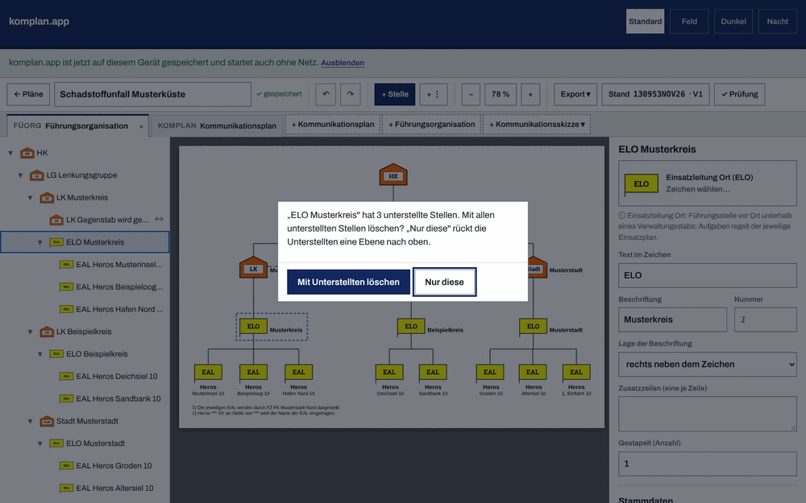
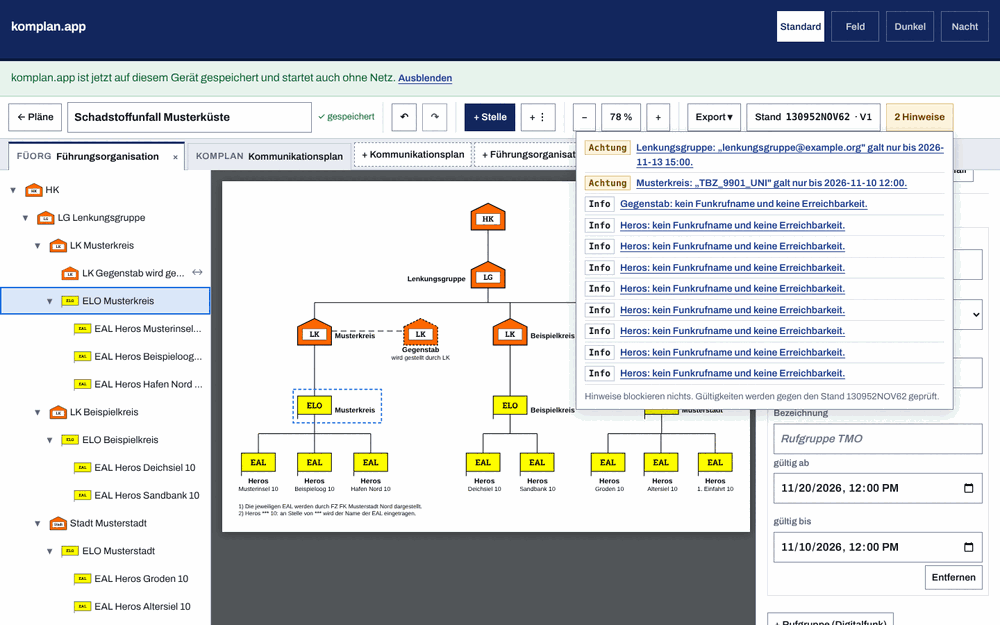
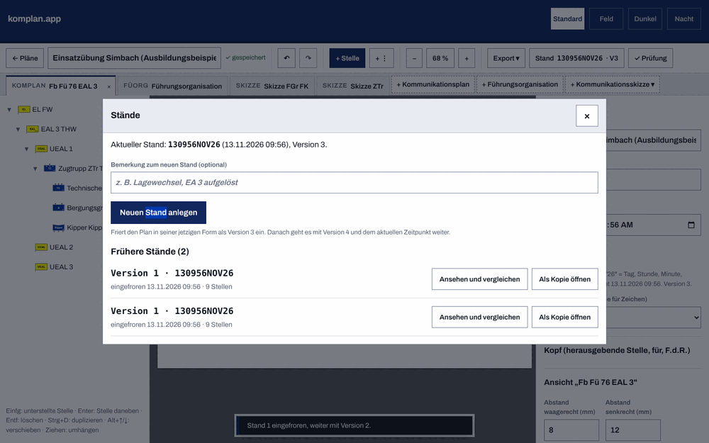
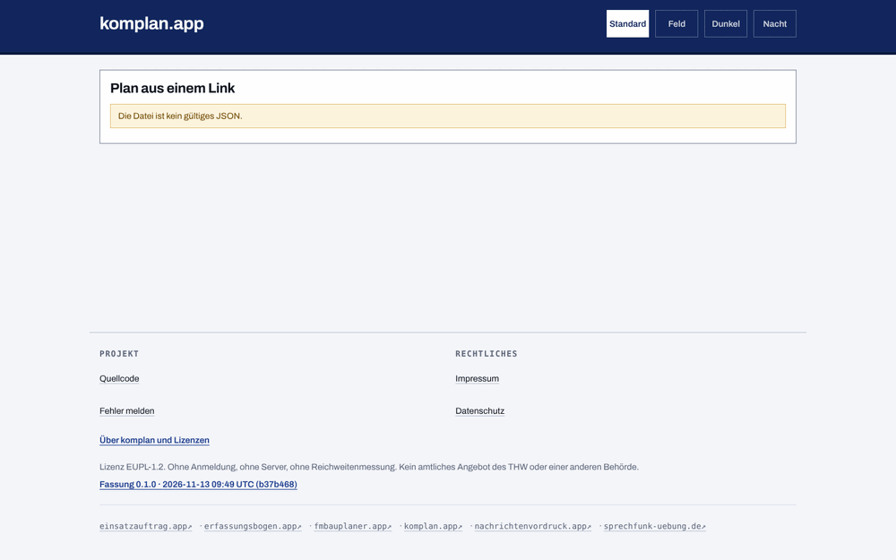
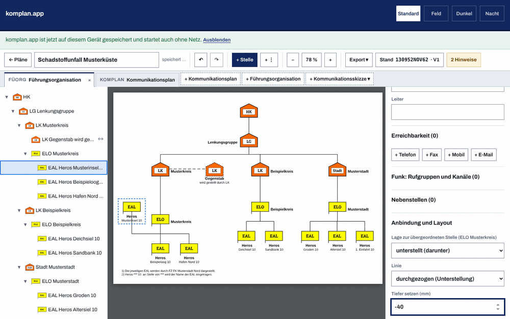

# Review-Runde 1: Fehler und Wiederanlauf

- Reviewer-Skill: `thw-error-recovery-reviewer` (Kürzel FW)
- Prüfgegenstand: komplan.app, main b37b468, lokal per vite preview
- Datum: 2026-11-13
- Viewports/Modi: Desktop 1440×900, Modus Standard (Hauptnutzung im Stab). Tablet und Telefon nicht gesondert, Befunde gelten dort sinngemäß.
- Durchgespielte Abläufe (Playwright, frische Browser-Kontexte, nur Vorlagen „Schadstoffunfall an der Küste“ und „Kommunikationsplan THW Fb Fü 76“):
  Doppelklick auf Vorlage, Stelle mit Unterstellten löschen und abbrechen (Esc), Blattstelle mit Entf/Rücktaste, Rückgängig; DTG mit Zahlendrehern und ungültigen Werten; Rufnummer mit Tippfehlern (l statt 1, O statt 0); „gültig ab“ nach „gültig bis“; unsinnige mm-Werte; Neuladen 0/300/700/1200 ms nach einer Eingabe, Tab schließen, „← Pläne“, Browser-Zurück mit offenem Dialog; gleicher Plan in zwei Tabs; Doppelklick „Neuen Stand anlegen“ und Rückgängig danach; JSON einlesen: Text, abgeschnittenes JSON, fremdes JSON, neuere Schema-Version, gültige Datei zweimal, komplan-Dateien mit beschädigtem Inhalt (leere Ansichten, `knoten: null`, Kontakt ohne Wert, kaputter Stand); Teil-Link abgeschnitten, ein Zeichen verändert, mit eingefügtem Leerzeichen, letzte Zeichen fehlen; Doppelklick „Plan übernehmen und öffnen“, denselben Link zweimal übernehmen.

## Urteil aus Sicht der Rolle

Vieles fängt komplan gut ab: Rückgängig über Strg+Z und die Pfeilknöpfe funktioniert auch nach Löschen, „Gelöscht. Strg+Z macht es rückgängig.“ sagt, wie man zurückkommt, Pläne liegen 30 Tage im Papierkorb, kaputte oder fremde JSON-Dateien werden meist mit verständlicher Meldung abgewiesen, und ein doppelt eingelesener Plan wird als Kopie abgelegt statt überschrieben. Reibung entsteht an drei Stellen: Die Löschrückfrage für Stellen mit Unterstellten hat **kein Abbrechen** (Esc löscht), mehrere Eingaben werden **still verworfen oder still angenommen** (DTG, Rufnummer, mm-Werte), und es gibt Wege zu **Datenverlust ohne jede Meldung** (Neuladen unter einer Sekunde, zwei Tabs) und zu einer **weißen Seite** (beschädigte Datei). Die Kernaufgaben gelingen ohne fremde Hilfe, aber nur, wenn man die Fehler selbst bemerkt.

## P0

### FW-01 Löschrückfrage ohne Abbrechen: Esc und Enter löschen die Stelle
- **Ansicht/Ablauf:** Editor, Gliederung oder Rechtsklick → Stelle mit Unterstellten löschen (Entf, „Löschen…“).
- **Beobachtung:** Der Dialog bietet nur „Mit Unterstellten löschen“ und „Nur diese“. Der Fokus steht auf „Nur diese“. Esc (das übliche „Abbrechen“) schließt den Dialog und **löscht die Stelle trotzdem** („Nur diese“): ELO Musterkreis war weg, die drei EAL hingen eine Ebene höher, 17 → 16 Zeilen. Enter löscht ebenso. Nur die 3,5 s sichtbare Kurzmeldung weist darauf hin. Grund im Code: `bestaetigen()` liefert bei Schließen `false`, das wird als „Nur diese“ gewertet (`src/app/editor.tsx`, `loeschen`).
- **Erwartung der Rolle:** Esc oder ein Klick daneben heißt „doch nicht“. Ein Löschdialog hat einen Abbrechen-Knopf.
- **Auswirkung im Einsatz:** Wer versehentlich Entf gedrückt hat und mit Esc „abbricht“, verliert eine Führungsstelle samt Kontaktdaten und hat eine falsch gegliederte Führungsorganisation, ohne es zu merken. Das falsche Organigramm geht dann so in Druck oder PDF.
- **Vorschlag:** Drei Knöpfe: „Abbrechen“ (Vorgabe, Fokus, Esc), „Nur diese Stelle“, „Mit n Unterstellten“. Esc/Schließen löscht nie.
- **Verifikation:** Stelle mit Kindern wählen, Entf, Esc → Gliederung unverändert, keine Kurzmeldung.

## P1

### FW-02 Beschädigte komplan-Datei führt zu weißer Seite, auch nach Neuladen
- **Ansicht/Ablauf:** Start → „Plan einlesen (JSON)…“ mit einer komplan-Datei, deren Grobform stimmt, deren Inhalt aber beschädigt ist (getestet: `ansichten` leer; `stand` ohne `zeitpunkt`).
- **Beobachtung:** Die Datei wird angenommen („… eingelesen.“), gespeichert, dann bleibt die ganze Seite weiß (Konsole: `Cannot read properties of undefined (reading 'typ')` bzw. `'match'`). Kein Kopf, kein „← Pläne“. Neuladen öffnet wieder dieselbe Adresse `#/plan/…` → wieder weiß. Der kaputte Plan steht danach in der Planliste mit demselben Namen wie der heile („Stand x“). Es gibt keine Fehlerbegrenzung in der Oberfläche (keine Error-Boundary).
- **Erwartung der Rolle:** Entweder „Datei beschädigt“ vor dem Speichern oder wenigstens eine Fehlerseite mit „Zur Planliste“.
- **Auswirkung im Einsatz:** Wer eine per Mail beschädigte oder von Hand „reparierte“ Datei einliest, steht vor einem leeren Bildschirm und kommt nur weiter, wenn er die Adresse von Hand kürzt oder Browser-Zurück kennt. Gleiches gilt für jeden künftigen Darstellungsfehler mitten in der Arbeit.
- **Vorschlag:** Beim Einlesen Inhalt (Ansichten, Stand, Kontakte) vollständig prüfen und reparieren oder ablehnen; zusätzlich eine Fehlerseite „Dieser Plan lässt sich nicht anzeigen – Zur Planliste / als JSON sichern / in den Papierkorb“.
- **Verifikation:** Datei mit `"ansichten":{}, "ansichtReihenfolge":[]` einlesen → verständliche Meldung, kein Plan in der Liste oder Plan öffnet mit Standardansicht.

### FW-03 Neuladen kurz nach einer Eingabe verwirft sie
- **Ansicht/Ablauf:** Editor, Funkrufname einer Stelle geändert, dann F5/Neuladen.
- **Beobachtung:** Neuladen 0, 300 und 700 ms nach der Eingabe: alter Wert („Heros Simbach 10“) wieder da, Eingabe weg. Ab ca. 1 s („✓ gespeichert“) bleibt sie erhalten. Tab schließen und „← Pläne“ sichern dagegen zuverlässig. Rückgängig-Verlauf ist nach dem Neuladen leer.
- **Erwartung der Rolle:** Was im Feld stand, ist nach dem Neuladen noch da.
- **Auswirkung im Einsatz:** Typisch: Nummer eintragen, App hängt scheinbar, F5. Die letzte Änderung (z. B. korrigierte Rufnummer) fehlt dann, ohne Hinweis. Die Anzeige „speichert …“ ist klein und wird übersehen.
- **Vorschlag:** Beim Verlassen synchron sichern (z. B. zusätzlich `beforeunload`-Rückfrage solange „speichert …“, oder Entwurf vorab synchron ablegen) und nach dem Laden nicht gespeicherte Reste anbieten.
- **Verifikation:** Feld ändern, sofort neu laden → Wert erhalten (Playwright mit 0 ms Wartezeit).

### FW-04 Gleicher Plan in zwei Tabs: stilles Überschreiben
- **Ansicht/Ablauf:** Plan in zwei Tabs offen (z. B. Link aus der Planliste mit Mittelklick), in beiden bearbeiten.
- **Beobachtung:** Tab A ändert den Plannamen (gespeichert), Tab B ändert danach einen Funkrufnamen. Tab B zeigt den alten Namen weiter, speichert seinen ganzen Plan, nach Neuladen von Tab A ist dessen Namensänderung weg. Kein Hinweis in einem der Tabs.
- **Erwartung der Rolle:** Warnung „Dieser Plan ist in einem anderen Fenster geöffnet/geändert“.
- **Auswirkung im Einsatz:** Im Stab mit mehreren Fenstern (Plan links, Skizze rechts) gehen Änderungen unbemerkt verloren; der Plan wirkt „gespeichert“.
- **Vorschlag:** Andere Fenster erkennen (z. B. BroadcastChannel/Versionszähler in der Datenbank) und vor dem Überschreiben warnen oder neu laden.
- **Verifikation:** Zwei Tabs, jeweils andere Änderung, beide Änderungen erhalten oder deutliche Warnung.

### FW-05 DTG: Fehleingabe wird still verworfen, Zahlendreher im Jahr still angenommen
- **Ansicht/Ablauf:** Plan-Eigenschaften → „Stand (DTG)“; Kontakt/Funk → „gültig ab/bis“.
- **Beobachtung:** `132560NOV26` (60 Minuten), `311200NOV26` (einen 31. November gibt es nicht) und `1309 52 NVO 26` werden beim Verlassen des Felds **kommentarlos** auf den alten Wert zurückgesetzt, ohne Meldung oder Markierung. `130952NOV62` (Jahreszahlendreher) wird angenommen: Stand jetzt 2062, Kopf zeigt „130952NOV62“, und alle Gültigkeitsprüfungen laufen gegen 2062 („… galt nur bis 2026-11-13 15:00“ als Warnung bei der Lenkungsgruppe). „gültig ab“ 20.11. nach „gültig bis“ 10.11. wird ohne Hinweis gespeichert (keine Regel in `planPruefen`).
- **Erwartung der Rolle:** „DTG ungültig: Minute 60“ am Feld, Eingabe bleibt zum Korrigieren stehen; Rückfrage bei Stand weit in Zukunft/Vergangenheit; Hinweis „gültig ab liegt nach gültig bis“.
- **Auswirkung im Einsatz:** Man glaubt, den Stand gesetzt zu haben, druckt aber den alten. Ein Jahresdreher macht die Hinweisliste falsch (Scheinwarnungen) und steht im Seitenfuß jedes Ausdrucks.
- **Vorschlag:** Ungültige DTG am Feld rot markieren mit konkretem Grund und Eingabe stehen lassen; Plausibilitätsfrage bei mehr als z. B. 30 Tagen Abstand zu heute; neue Prüfregel ab > bis.
- **Verifikation:** `132560NOV26` eingeben → Meldung am Feld, Wert bleibt; `130952NOV62` → Rückfrage; ab > bis → Hinweis in der Prüfung.

### FW-06 Stand doppelt eingefroren, Rückgängig macht Versionszählung inkonsistent
- **Ansicht/Ablauf:** „Stand … · V1“ → „Neuen Stand anlegen“.
- **Beobachtung:** Doppelklick legt zwei Schnappschüsse „Version 1 · 130956NOV26“ an, der Plan springt auf V3. Rückgängig danach setzt den Plan auf V2 zurück, die eingefrorenen Stände bleiben aber (2 Stück). Löschen eines Stands ist im Dialog nicht möglich. Eine eingetippte Bemerkung geht bei Browser-Zurück mit offenem Dialog verloren.
- **Erwartung der Rolle:** Ein Klick = ein Stand; Rückgängig nimmt den Stand ganz zurück oder ist dafür gesperrt.
- **Auswirkung im Einsatz:** Versionsnummern auf ausgedruckten Plänen springen (V1 → V3) und passen nicht zur Standliste; beim Abgleich „welcher Ausdruck ist aktuell“ entsteht Verwirrung.
- **Vorschlag:** Knopf während des Anlegens sperren; Rückgängig nach „Stand anlegen“ entweder mit Schnappschuss zurücknehmen oder als nicht rückgängig kennzeichnen; versehentlichen Stand entfernen können.
- **Verifikation:** Doppelklick → genau ein neuer Stand; Rückgängig → Version und Standliste passen zusammen.

## P2

### FW-07 Doppelklick und Mehrfach-Einlesen erzeugen gleichnamige, nicht unterscheidbare Pläne
- **Ansicht/Ablauf:** „Neuer Plan“ → Vorlage; „Plan einlesen“.
- **Beobachtung:** Doppelklick auf eine Vorlage legt zwei Pläne „Schadstoffunfall Musterküste“ mit gleichem Stand und gleicher Uhrzeit an. Eingelesene Dateien mit anderer Plan-ID (auch beschädigte, siehe FW-02) erscheinen ebenfalls unter identischem Namen; nur bei gleicher ID gibt es „(eingelesen)“.
- **Auswirkung im Einsatz:** In der Planliste ist nicht erkennbar, welcher Plan der bearbeitete ist; man arbeitet im falschen weiter oder löscht den falschen.
- **Vorschlag:** Vorlagenknopf nach dem ersten Klick sperren; bei Namensgleichheit automatisch unterscheiden („(2)“, „eingelesen 13.11. 09:54“).
- **Verifikation:** Doppelklick → ein Plan; zweimal einlesen → zwei unterscheidbare Namen.

### FW-08 Beschädigter Teil-Link: Sackgasse und irreführende Meldung
- **Ansicht/Ablauf:** Teil-Link öffnen (zweiter Browser-Kontext).
- **Beobachtung:** Abgeschnittener Link, fehlende letzte Zeichen, eingefügtes Leerzeichen: „Der Link ist beschädigt oder unvollständig …“ (gut). Ein verändertes Zeichen: „Die Datei ist kein gültiges JSON.“ – der Nutzer hat keine Datei geöffnet. In beiden Fällen gibt es keinen Knopf (kein „Zur Planliste“, kein „JSON einlesen“), nur das Logo im Kopf führt weiter. Leerzeichen/Zeilenumbrüche, wie sie Mailprogramme einfügen, werden nicht toleriert.
- **Auswirkung im Einsatz:** Empfänger weiß nicht, ob er etwas falsch gemacht hat und wie er weiterkommt.
- **Vorschlag:** Einheitlich die Link-Meldung zeigen, Knöpfe „Zur Planliste“ und „JSON-Datei einlesen“ anbieten; Leerraum und `%20` im Fragment vor dem Dekodieren entfernen.
- **Verifikation:** Link mit verändertem Zeichen → Link-Meldung plus Knöpfe; Link mit Umbruch → Plan wird gelesen.

### FW-09 Rufnummern ohne Plausibilitätsprüfung
- **Ansicht/Ablauf:** Stelle → Erreichbarkeit → „+ Telefon“.
- **Beobachtung:** `0999 l23-O` (kleines L, großes O) wird ohne Markierung übernommen und so gedruckt; keine Prüfregel in der Hinweisliste. Gleiches für E-Mail ohne „@“ (laut Code keine Prüfung).
- **Auswirkung im Einsatz:** Tippfehler in der Rufnummer fallen erst auf, wenn jemand die Nummer wählt und niemand erreicht wird.
- **Vorschlag:** Nicht blockierender Hinweis bei Buchstaben in Telefon/Fax/Mobil und bei E-Mail ohne „@“, mit Sprung zur Stelle.
- **Verifikation:** `0999 l23-O` → Hinweis „Rufnummer enthält Buchstaben“.

### FW-10 Unsinnige mm-Werte werden ungeprüft übernommen
- **Ansicht/Ablauf:** Stelle → Anbindung und Layout → „Tiefer setzen (mm)“, „Abstand (mm)“.
- **Beobachtung:** Trotz `min=0 max=120` werden 9999 und −40 übernommen. 9999 schiebt die Stelle weit aus dem Blatt; −40 setzt die EAL **über** ihre ELO, die Linie läuft nach oben, die Unterstellung ist im Bild nicht mehr ablesbar.
- **Auswirkung im Einsatz:** Ein Vertipper erzeugt ein falsch lesbares Organigramm; Ursache ist ohne Kenntnis des Felds schwer zu finden.
- **Vorschlag:** Werte auf den erlaubten Bereich begrenzen und am Feld sagen, was zulässig ist.
- **Verifikation:** −40 und 9999 eingeben → Wert wird auf 0 bzw. 120 begrenzt mit Hinweis.

### FW-11 Falsch umgehängt: Korrektur nur per Ziehen oder Rückgängig
- **Ansicht/Ablauf:** Gliederung, Umhängen per Ziehen.
- **Beobachtung (aus Code und Bedienung):** Umhängen geht nur per Ziehen in der Gliederung; in den Eigenschaften gibt es kein Feld „unterstellt unter“, Alt+↑/↓ verschiebt nur innerhalb derselben Ebene. Wer erst später merkt, dass eine Stelle falsch hängt (Rückgängig-Verlauf nach Neuladen leer), muss erneut präzise ziehen. Auf Touch-Geräten nicht geprüft (siehe unten).
- **Auswirkung im Einsatz:** Korrektur kostet Zeit und Präzision, besonders in tiefen Bäumen.
- **Vorschlag:** Auswahlfeld „Übergeordnete Stelle“ in den Eigenschaften (zugleich Tastatur- und Touch-Alternative).
- **Verifikation:** Stelle über das Feld umhängen, ohne zu ziehen.

## P3

### FW-12 Hinweisliste mit gleichlautenden Einträgen
- **Ansicht/Ablauf:** Knopf „Prüfung/Hinweise“.
- **Beobachtung:** Bei der Vorlage Schadstoffunfall erscheint achtmal „Heros: kein Funkrufname und keine Erreichbarkeit.“ – die Einträge sind nur durch Anklicken unterscheidbar.
- **Vorschlag:** Name mit Zeichen und übergeordneter Stelle nennen („EAL Heros Deichsiel 10 unter ELO Beispielkreis“) und gleichartige Infos zusammenfassen.

### FW-13 Entf/Rücktaste löscht Stellen ohne Rückfrage, Verlauf endet beim Neuladen
- **Ansicht/Ablauf:** Gliederung/Zeichenfläche mit gewählter Stelle.
- **Beobachtung:** Rücktaste oder Entf bei gewählter Blattstelle löscht sofort (nur Kurzmeldung). Rückgängig funktioniert, aber nur bis zum nächsten Neuladen oder Planwechsel.
- **Vorschlag:** Kurzmeldung mit Knopf „Rückgängig“ und länger sichtbar; Rücktaste nicht als Löschtaste belegen.

## Was gut funktioniert
- Rückgängig/Wiederholen per Strg+Z/Strg+Y und Knöpfen, auch nach Löschen; Kurzmeldung nennt Strg+Z.
- JSON-Import weist Text, abgeschnittenes JSON, fremde Dateien und neuere Schema-Versionen mit verständlicher Meldung ab; doppelt eingelesener Plan wird Kopie statt Überschreibung.
- Teil-Link: Doppelklick auf „Plan übernehmen“ legt nur eine Kopie an; zweites Übernehmen wird als „(aus Link)“ gekennzeichnet.
- Tab schließen und „← Pläne“ direkt nach einer Eingabe verlieren nichts.
- Pläne gehen erst in den Papierkorb (30 Tage), endgültiges Löschen mit eigener Rückfrage.

## Nicht geprüft
- Umhängen per Ziehen auf Tablet/Touch, Skizzen-Bedienfehler (Verbinder falsch gezogen, Element gelöscht).
- Speicherfehler der Datenbank (voller Speicher, privater Modus) und das Verhalten der Anzeige „Speichern fehlgeschlagen“.
- Export-Abbruch und Fehler beim PDF/PPTX-Export.

## Abschluss
- **Aufgabe geschafft:** mit Umwegen
- **Fremde Hilfe nötig:** nein, außer bei der weißen Seite nach einer beschädigten Datei (FW-02)
- **Größtes Missverständnis:** Esc im Löschdialog wird als „Abbrechen“ verstanden, löscht aber die Stelle.
- **Größtes Einsatzrisiko:** Unbemerkt falsche Führungsorganisation oder falscher Stand im Ausdruck, weil Löschen, DTG-Fehler und Tab-Konflikte still durchgehen.
- **Top-Priorität für die nächste Iteration:** Löschrückfrage mit echtem „Abbrechen“ als Vorgabe (FW-01).
