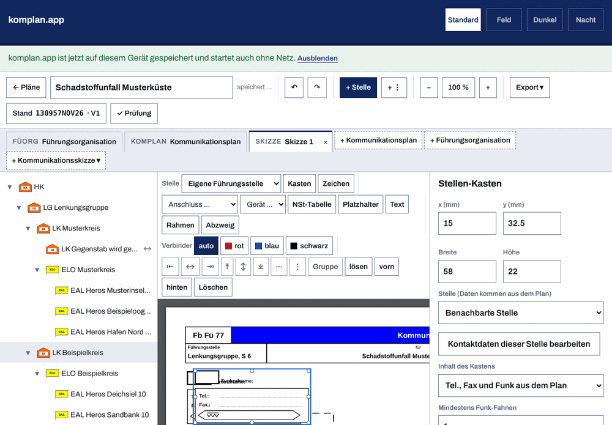
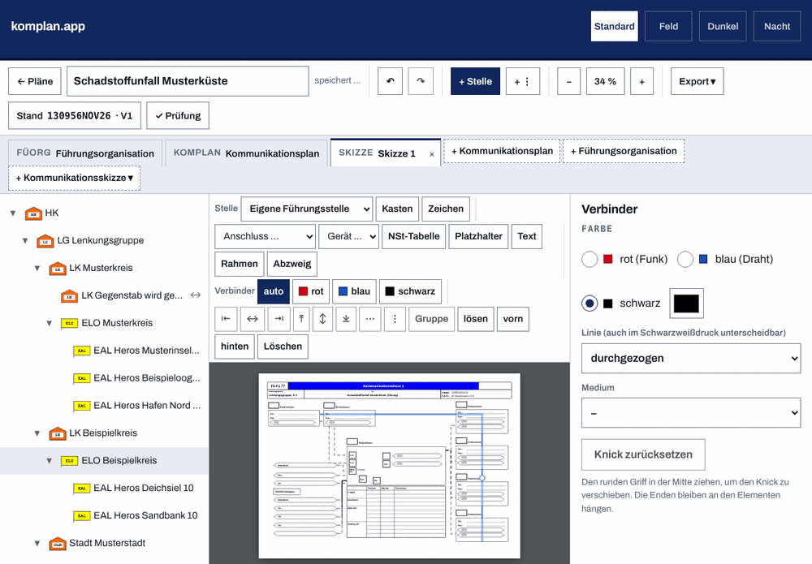
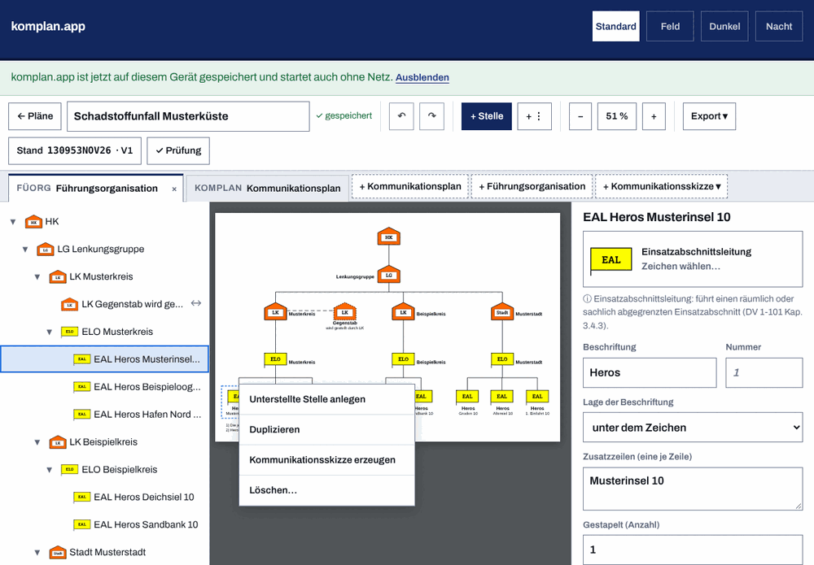
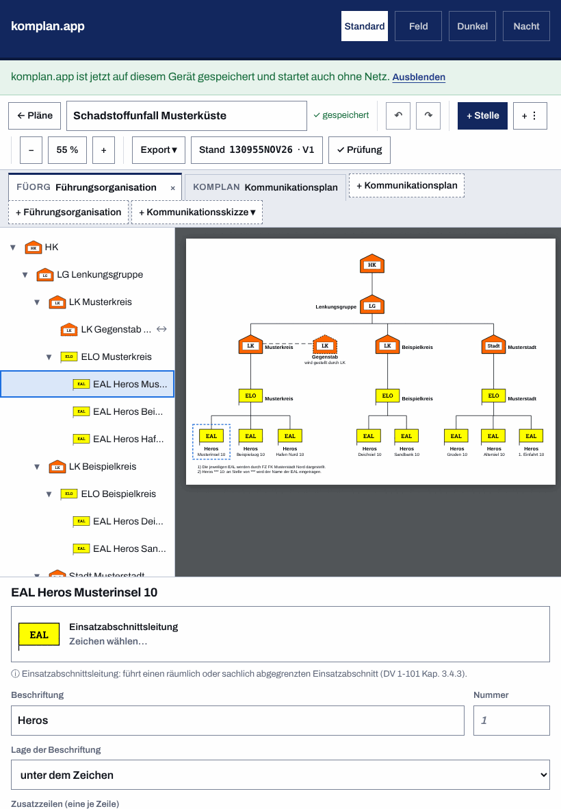

# Review-Runde 1: Feldtauglichkeit (Tablet in Führungsstelle und Führungsfahrzeug)

- Reviewer-Skill: `thw-field-user-reviewer` (Kürzel FT)
- Prüfgegenstand: komplan.app, main b37b468, lokal per vite preview
- Datum: 2026-11-13
- Viewports: iPad quer 1180×820 und iPad hoch 820×1180, jeweils `hasTouch`, deviceScaleFactor 1 (Chromium per Playwright). Touch-Gesten (Wischen, Zwei-Finger-Spreizen, Drei-Finger, langes Drücken, Ziehen) über CDP `Input.dispatchTouchEvent`. Modi Standard und Feld.
- Durchgespielte Abläufe: Ablauf 1 (Vorlage „Schadstoffunfall an der Küste“, FüOrg ansehen, Stelle per Tippen wählen, Eigenschaften ansehen, Umhängen per Ziehen in der Gliederung, Kontextmenü), Ablauf 3 (Skizze „Fb Fü 77 Skizze 1“ über „+ Kommunikationsskizze ▾“, Zoomen, Schwenken, Element wählen und verschieben, Verbinder ziehen, Rückgängig). Ergänzend Quelltext gelesen (`src/app/zeichenflaeche.tsx`, `skizzen-flaeche.tsx`, `gliederung.tsx`, `editor.tsx`, `stil.css`), um Beobachtungen zu erklären.
- Aufgaben erledigt: Ansehen FüOrg/Komplan **ja**; kleine Änderung an Stelle (Text, Kontakt) **ja**; Stelle umhängen, löschen, duplizieren per Touch **nein**; Skizze ansehen und bearbeiten per Touch **mit Schwierigkeiten** (Element verschieben ja, Blatt verschieben nein).
- Mentales Modell des Helfers: „Wie eine Karten-App: mit einem Finger das Blatt schieben, mit zwei Fingern zoomen, lange drücken für mehr Möglichkeiten, Dinge mit dem Finger an eine andere Stelle ziehen.“ Die App ist dagegen auf Maus und Tastatur gebaut (Rechtsklick, Strg+Mausrad, Alt/Mittelklick zum Schwenken, Entf, HTML-Ziehen).

Hinweis zur Belastbarkeit: Die Emulation ist Chromium, nicht Safari auf iPadOS. Wo das Verhalten auf echtem iPad abweichen kann, ist das beim Befund vermerkt („Nicht verifiziert“).

## P0

Keine. Hauptnutzung ist laut Auftrag Desktop; am Tablet bleibt Ansehen und Ändern von Texten und Kontakten möglich.

## P1

### FT-01 Skizzenblatt lässt sich per Touch nicht verschieben

- **Evidenz:** Beobachtet
- **Ansicht/Ablauf:** Reiter „Skizze“, Skizzenfläche (Ablauf 3), iPad quer und hoch
- **Beobachtung:** Nach Vergrößern auf 100 % ist nur ein Ausschnitt des Blatts sichtbar. Ein-Finger-Wischen auf freier Fläche zieht einen Auswahlrahmen auf, Zwei- und Drei-Finger-Wischen bewirken nichts (`scrollLeft/scrollTop` bleiben 0). Wischen auf einem Element verschiebt das Element. Schwenken ist laut Code nur mit Mittelklick oder Alt+Linksklick möglich; die Fläche hat `touch-action: none`, Bildlaufleisten stehen nicht zur Verfügung (Breite 0).
- **Auswirkung im Einsatz:** Wer auf dem Tablet in einer Skizze einen Kasten vergrößert betrachtet oder bearbeiten will, kommt an den Rest des Blatts nicht heran. Einziger Ausweg: wieder verkleinern (siehe FT-02). Versuche zu schwenken verschieben stattdessen versehentlich Elemente.
- **Vorschlag:** Zwei-Finger-Wischen schwenkt immer; zusätzlich Ein-Finger-Wischen auf leerer Fläche schwenkt (Auswahlrahmen dann nur über eigenes Werkzeug oder langes Drücken). Alternativ sichtbare Schwenk-Schaltfläche („Hand“).
- **Nachtest:** iPad, Skizze auf 100 %, rechten unteren Kasten erreichen, ohne dass ein Element seine Lage ändert.

### FT-02 Kein Zoomen mit zwei Fingern; Zeichenblatt im Querformat sehr klein

- **Evidenz:** Beobachtet
- **Ansicht/Ablauf:** FüOrg-Zeichenfläche und Skizzenfläche, iPad quer
- **Beobachtung:** Zwei-Finger-Spreizen ändert den Zoom nicht (bleibt 100 %), auf der FüOrg-Fläche verschiebt es stattdessen das Blatt; Browser-Zoom ist durch `touch-action: none` ebenfalls gesperrt (visualViewport.scale 1). Zoom geht nur über die Knöpfe −/+ (33×40 px). In der Skizze bleibt im iPad quer für das Blatt ein Bereich von 524×243 px; Kopf (88), Anzeige-Schalter, Werkzeugleiste (109, zwei Zeilen), Reiterleiste (85, zwei Zeilen) und Skizzen-Werkzeuge (245, vier Zeilen) belegen den Rest. „Einpassen“ (Tippen auf „51 %“) ergibt 34 %, dabei ist die Skizze nicht mehr lesbar.
- **Auswirkung im Einsatz:** Ansehen einer Skizze auf dem Tablet im Fahrzeug ist mühsam: entweder unleserlich klein oder (wegen FT-01) nur ein fester Ausschnitt. Gerade das Zoomen mit zwei Fingern versucht jeder zuerst.
- **Vorschlag:** Zwei-Finger-Zoom um den Fingermittelpunkt in beiden Flächen. Auf Tablets Skizzen-Werkzeuge einklappbar oder einzeilig mit Überlauf-Menü; Gliederung und Eigenschaften ausblendbar, damit das Blatt den Bildschirm nutzen kann.
- **Nachtest:** iPad quer, Skizze 1 mit zwei Fingern auf lesbare Größe ziehen; sichtbarer Blattbereich mindestens etwa halbe Bildschirmhöhe.

### FT-03 Stelle löschen und duplizieren nur per Rechtsklick oder Taste

- **Evidenz:** Beobachtet (Emulation); auf iPadOS-Safari wahrscheinlich, nicht verifiziert
- **Ansicht/Ablauf:** FüOrg/Komplan, Stelle gewählt (Ablauf 1 und 5)
- **Beobachtung:** „Unterstellte Stelle anlegen / Duplizieren / Kommunikationsskizze erzeugen / Löschen…“ gibt es nur im Kontextmenü der Zeichenfläche (Rechtsklick). Langes Drücken (1,2 s) auf eine Stelle öffnet in der Emulation kein Menü. In der Gliederung gibt es gar kein Kontextmenü. Im Eigenschaften-Bereich gibt es keinen Knopf „Stelle löschen“ oder „Duplizieren“ (alle Knöpfe geprüft, auch in aufgeklappten Gruppen). Die Hilfe unter der Gliederung nennt nur Tasten (Entf, Strg+D). Safari auf iPadOS löst bei langem Drücken nach meinem Kenntnisstand kein `contextmenu`-Ereignis aus.
- **Auswirkung im Einsatz:** Am Tablet ohne Tastatur lässt sich eine falsch angelegte Stelle nicht entfernen. „Kommunikationsskizze erzeugen“ ist über „+ Kommunikationsskizze ▾ → Aus gewählter Stelle erzeugen“ erreichbar, Löschen und Duplizieren nicht.
- **Vorschlag:** Sichtbare Knöpfe „Duplizieren“ und „Löschen…“ im Kopf der Stellen-Eigenschaften (gleiche Rückfrage wie heute); zusätzlich langes Drücken (ca. 500 ms) auf Stelle in Gliederung und Blatt öffnet das Kontextmenü.
- **Nachtest:** iPad ohne Tastatur: Stelle mit Unterstellten löschen, Rückfrage beantworten, mit ↶ zurückholen.

### FT-04 Umhängen per Ziehen in der Gliederung geht per Touch nicht

- **Evidenz:** Beobachtet (Emulation); Verhalten auf iPadOS nicht verifiziert
- **Ansicht/Ablauf:** Gliederung links, Ablauf 1 „umhängen per Ziehen“
- **Beobachtung:** Die Gliederung nutzt HTML-Ziehen (`draggable`). Touch-Ziehen einer Zeile (mit und ohne 0,8 s Halten) auf eine andere Zeile ändert den Baum nicht; Wischen scrollt die Liste. Tastatur-Alternative Alt+↑/↓ verschiebt nur innerhalb der Geschwister, ein Wechsel der übergeordneten Stelle ist ohne Ziehen nicht möglich. Ebenso geht Ziehen einer Stelle aus der Gliederung auf die Skizzenfläche nur mit HTML-Ziehen (Ersatz über Werkzeug „Kasten“ vorhanden).
- **Auswirkung im Einsatz:** Lageänderung (Einheit wechselt Abschnitt) kann am Tablet nicht nachgezogen werden, es sei denn Stelle neu anlegen und alte löschen, was wegen FT-03 auch nicht geht.
- **Vorschlag:** Feld „Untersteht“ (Auswahlliste der möglichen übergeordneten Stellen) und Knöpfe „nach oben/unten“ in den Stellen-Eigenschaften; Touch-Ziehen erst nach langem Drücken mit deutlicher Zielmarkierung.
- **Nachtest:** iPad: „EAL Heros Musterinsel 10“ unter „ELO Beispielkreis“ hängen, ohne Tastatur.

## P2

### FT-05 Ports und Griffe in der Skizze sind 6 bis 7 px groß

- **Evidenz:** Beobachtet (Maße); Trefferquote auf iPad nicht verifiziert
- **Ansicht/Ablauf:** Skizze, Element gewählt, Verbinder ziehen, Größe ändern
- **Beobachtung:** Die vier Anschlusspunkte (Ports) messen 7×7 px, die acht Größengriffe 6×6 px, unabhängig vom Zoom und auch im Feld-Modus. Ports erscheinen nur bei Mausüberfahrt oder nach Auswahl. In Chromium traf ein 9 px daneben aufgesetzter Finger den Port trotzdem (Touch-Korrektur des Browsers); Safari korrigiert so nach meiner Kenntnis nicht. Daneben aufgesetzt verschiebt der Finger das Element statt einen Verbinder zu ziehen. Verbinder-Trefferfläche: 6 px.
- **Auswirkung im Einsatz:** Verbinder setzen und Größe ändern mit dem Finger wird zum Zielspiel, Fehlgriffe verschieben Kästen.
- **Vorschlag:** Bei Touch-Bedienung (pointerType „touch“) Trefferflächen für Ports, Griffe, Knick und Verbinder auf mindestens 32–44 px erweitern (unsichtbarer Rand reicht), sichtbare Punkte etwas größer.
- **Nachtest:** iPad, zehn Verbinder zwischen Kästen ziehen; kein Element darf dabei ungewollt verschoben werden.

### FT-06 Hochformat: Eigenschaften im unteren Drittel, Bildschirmtastatur verdeckt sie

- **Evidenz:** Beobachtet (Lage); Tastatur wahrscheinlich, nicht verifiziert
- **Ansicht/Ablauf:** iPad hoch, Stelle wählen, Kontakt oder Rufgruppe eintragen
- **Beobachtung:** Die Seite selbst scrollt nicht (Dokument = 1180 px). Eigenschaften stehen in einem eigenen Rollbereich von 339 px Höhe ab y=841; nach Tippen auf eine Stelle sieht man nur Zeichen, Beschriftung und Nummer. „Erreichbarkeit“ und „Funk“ liegen weiter unten im kleinen Rollbereich. Wischen über die Zeichenfläche scrollt nichts (`touch-action: none`). Die iPad-Bildschirmtastatur im Hochformat ist etwa so hoch wie dieser Bereich.
- **Auswirkung im Einsatz:** Beim Eintippen einer Telefonnummer ist das Feld voraussichtlich ganz oder teilweise verdeckt; man sieht nicht, was man tippt.
- **Vorschlag:** Im Hochformat Eigenschaften als ausklappbares Blatt über größerer Höhe oder als eigene Ansicht; beim Fokussieren das Feld in den sichtbaren Bereich über der Tastatur bringen (visualViewport berücksichtigen).
- **Nachtest:** Echtes iPad hoch, Telefonnummer bei einer Stelle eintragen; Feld und Eingabe bleiben sichtbar.

### FT-07 Bedienhinweise sprechen nur Tastatur und Maus an

- **Evidenz:** Beobachtet
- **Ansicht/Ablauf:** Gliederung (Tastenhilfe), Meldung nach Löschen, Titel der Knöpfe
- **Beobachtung:** Tastenhilfe: „Einfg … Entf: löschen · Strg+D … Alt+↑/↓ … Ziehen: umhängen“. Nach dem Löschen: „Gelöscht. Strg+Z macht es rückgängig.“ Die Ausrichtungsknöpfe der Skizze (⇤ ↔ ⇥ ⤒ ↕ ⤓ ⋯ ⋮) erklären sich nur über `title`, also Mausüberfahrt; die Reiter lassen sich nur per Doppelklick umbenennen.
- **Auswirkung im Einsatz:** Am Tablet ohne Tastatur wirken die Hinweise wie Bedienung, die es nicht gibt; die Symbolknöpfe sind ohne Maus nicht erklärbar.
- **Vorschlag:** Hinweise geräteabhängig formulieren („↶ oben macht es rückgängig“); Symbolknöpfe mit Kurztext oder eine Gruppe „Ausrichten ▾“ mit beschrifteten Einträgen; Umbenennen auch über Eigenschaften („Name der Ansicht“ gibt es bei Skizzen schon).
- **Nachtest:** Neue Nutzerin am Tablet richtet drei Kästen links aus und benennt eine Ansicht um, ohne Hilfe.

### FT-08 Kleine Bedienelemente in Gliederung und Zoomleiste

- **Evidenz:** Beobachtet
- **Ansicht/Ablauf:** Gliederung, Werkzeugleiste, Reiterleiste
- **Beobachtung:** Auf-/Zuklappen in der Gliederung 26×26 px, Zoom −/+ 33×40 px, Rückgängig/Wiederholen 36×40 px, Ausrichtungsknöpfe 24–37×36 px, „ד zum Löschen einer Ansicht 25×38 px direkt am aktiven Reiter (mit Rückfrage). Im Feld-Modus wachsen Text-Knöpfe auf 40 px Höhe, die genannten bleiben klein.
- **Auswirkung im Einsatz:** Im fahrenden Fahrzeug oder mit kalten Fingern Fehltipper, besonders zwischen Reiter und „ד und bei −/+.
- **Vorschlag:** Mindestens 44×44 px Trefferfläche für alle Bedienelemente bei Touch (Medienabfrage `pointer: coarse`), auch außerhalb des Feld-Modus.
- **Nachtest:** Maße unter `pointer: coarse` messen.

## P3

### FT-09 Kontextmenü schließt nur per Maus-Verlassen oder Tippen daneben, „51 %“ ist ein versteckter Einpassen-Knopf

- **Evidenz:** Beobachtet
- **Ansicht/Ablauf:** FüOrg-Zeichenfläche
- **Beobachtung:** Das Kontextmenü (wo erreichbar, z. B. iPad mit Trackpad) schließt bei `mouseleave`, Tippen daneben schließt es ebenfalls; es wird an Klickposition `fixed` gesetzt und kann am rechten Rand im Hochformat über den Bildschirm hinausragen (Code, nicht nachgestellt). Der Zoom-Anzeigewert „51 %“ ist zugleich der Knopf „Auf Fläche einpassen“, nur per `title` erklärt.
- **Auswirkung im Einsatz:** Geringe Verwirrung; Einpassen wird am Tablet kaum gefunden.
- **Vorschlag:** Menü an Bildschirmrand begrenzen; Einpassen-Knopf beschriften („Ganzes Blatt“).
- **Nachtest:** Rechtsklick auf Stelle ganz rechts im Hochformat; neue Nutzer finden „Ganzes Blatt“.

## Was gut funktioniert

- Ein-Finger-Wischen auf der FüOrg-Zeichenfläche verschiebt das Blatt; Tippen auf eine Stelle wählt sie und markiert sie in Gliederung und Blatt. Nicht beim Umbau entfernen.
- Kasten in der Skizze lässt sich per Finger verschieben, mit ↶ zurücknehmen; Rasterfang hilft bei grober Fingerbedienung.
- „+ Kommunikationsskizze ▾ → Aus gewählter Stelle erzeugen“ ist ein touch-tauglicher Weg zur Skizze.
- Kontaktfelder haben `inputMode` tel/email, das iPad zeigt damit die Zifferntastatur.
- Speicherstand „✓ gespeichert“ ist neben dem Plannamen immer sichtbar; Löschen fragt bei Unterstellten nach.

## Comprehension check (Tablet)

- Orientierung: verstanden
- Nächste Aktion: unsicher (Löschen, Umhängen, Schwenken ohne sichtbaren Weg)
- Systemstatus: verstanden
- Fehlerbehebung: unsicher (Rückgängig-Knopf vorhanden, Hinweis nennt Strg+Z)
- Feldtauglichkeit: eingeschränkt

## Nicht geprüft

- Echte Geräte: Safari auf iPadOS (Kontextmenü bei langem Drücken, HTML-Ziehen, Touch-Korrektur), echte Bildschirmtastatur, Apple Pencil, Hardware-Tastatur am iPad.
- Handschuhbedienung, Sonnenlicht und Vibration im Fahrzeug.
- Teil-Link, Export und Druck am Tablet (Datei-Download in Safari).
