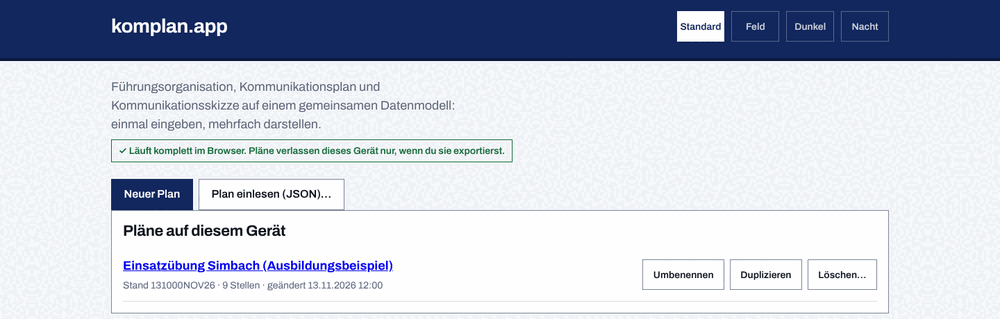
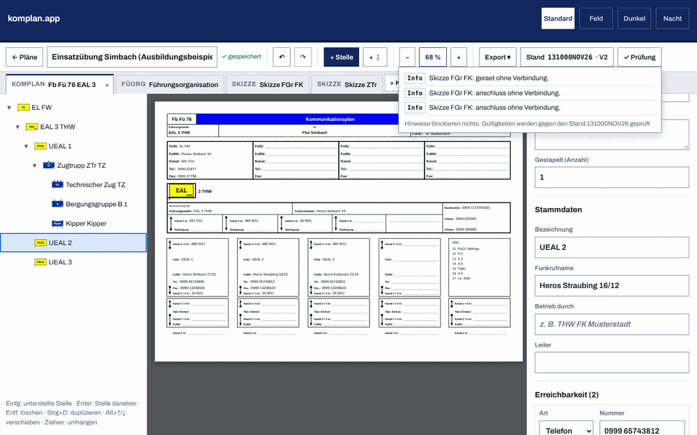
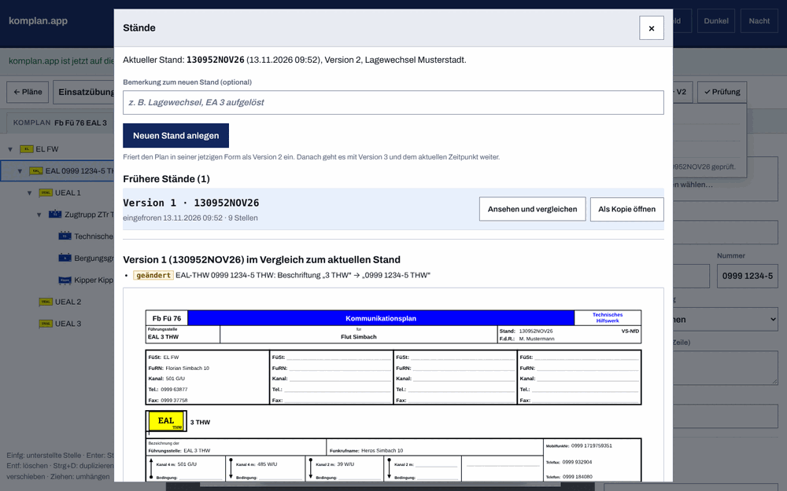
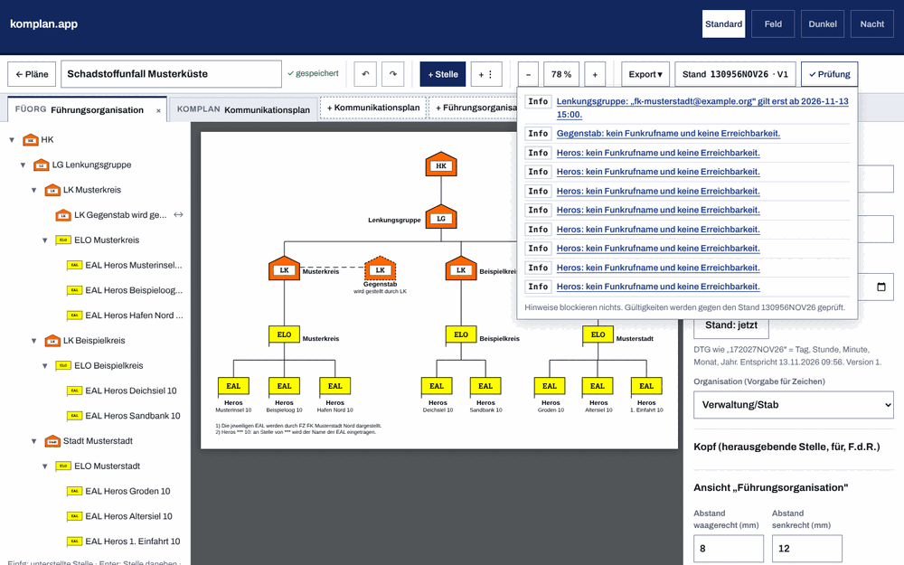
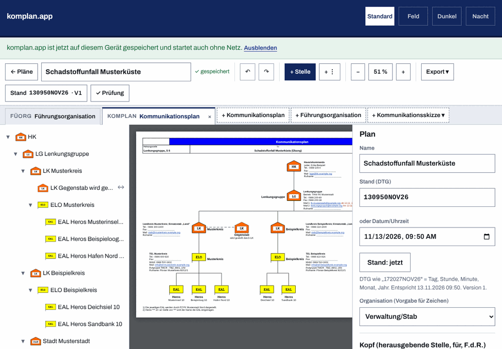
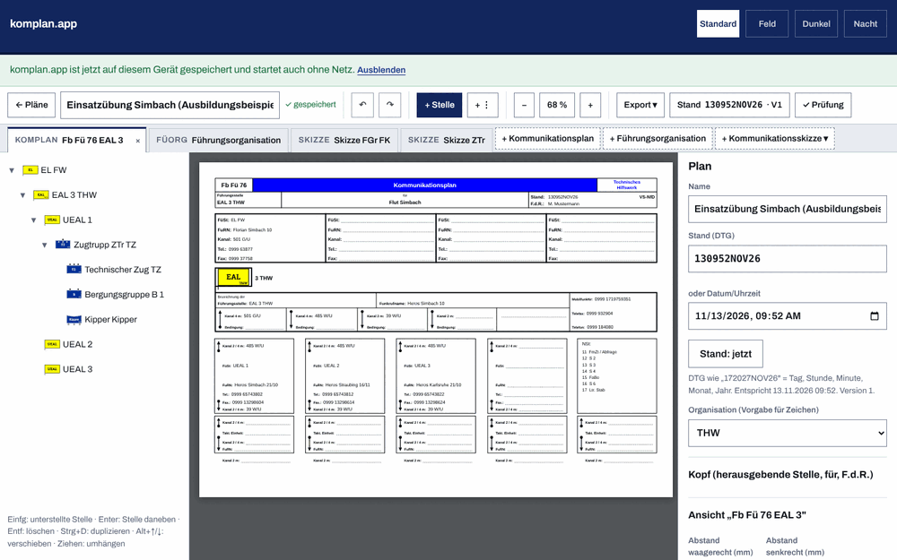

# Review-Runde 1: Führungssicht

- Reviewer-Skill: `thw-command-reviewer` (Führungskraft / Nutzer in der Führungsstelle)
- Prüfgegenstand: komplan.app, main b37b468, lokal per vite preview
- Datum: 2026-11-13
- Viewports/Modi: Desktop 1440×900 (Schwerpunkt), iPad quer 1180×820, Telefon 390×844 (nur Basis-Screenshots); Modus Standard
- Durchgespielte Abläufe: 1 (Vorlage „Schadstoffunfall an der Küste“: FüOrg und Kommunikationsplan ansehen, Prüfung, Sprung aus Hinweis, PDF beider Ansichten erzeugt und gerendert), 2 (Vorlage „Fb Fü 76“ Simbach: Formular ansehen, auf FwDV 800 umschalten, Telefonnummer UEAL 1 und Funkrufname UEAL 2 ändern, Stand anlegen, mit Uhr +2 h weiterarbeiten, Stände vergleichen, Planliste), 3 nur angesehen (Skizzen-Reiter der Fb-Fü-76-Vorlage, Prüfhinweise dazu)

## Urteil aus Sicht der Rolle

Als Grundlage für das Lagebild „Wer führt wen, wie erreiche ich wen“ trägt die App: Die FüOrg ist sauber und schnell lesbar, die Kommunikationsplan-Darstellung zeigt fehlende Angaben sichtbar als punktierte Leerstellen, zeitlich begrenzte Erreichbarkeiten stehen mit „ab/bis“ im Plan, und ein Klick auf einen Prüfhinweis springt zur betroffenen Stelle. Die Aufgaben 1 und 2 sind ohne fremde Hilfe machbar.

Reibung entsteht bei der Nachvollziehbarkeit: Das „Stand“-DTG auf dem Blatt sagt nicht zuverlässig, welcher Inhalt gilt. Nach Änderungen bleibt das alte DTG stehen, die Version steht nur in der PDF-Fußzeile, und der Editor zeigt nicht, dass seit dem Stand geändert wurde. Wer einen Ausdruck an der Wand mit dem Bildschirm abgleicht, kann nicht sicher erkennen, ob beide gleich sind. Der Standvergleich ist eine reine Textliste ohne Markierung im Plan. Die Prüfung meldet „✓“, obwohl zehn Stellen ohne Erreichbarkeit sind, und die Hinweise lassen sich nicht unterscheiden („Heros“ achtmal).

## P0

Keine P0-Befunde.

## P1

### FS-01 Stand-DTG auf dem Blatt belegt den Inhalt nicht

- **Fundstelle / Aufgabe:** Ablauf 2, Kopfleiste Fb Fü 76 / FwDV 800 / Kommunikationsplan, Knopf „Stand … · Vn“, Plan-Eigenschaften „Stand (DTG)“ und „Stand: jetzt“, Planliste
- **Beobachtung:** Stand V1 um 10:00 eingefroren (Bemerkung „Erstausgabe“), danach läuft der Plan als V2 mit DTG 131000NOV26 weiter. Zwei Stunden später werden die Telefonnummer von UEAL 1 und der Funkrufname von UEAL 2 geändert. Das Blatt zeigt weiter „Stand: 131000NOV26“, die Planliste zeigt „Stand 131000NOV26 · geändert 13.11.2026 12:00“. Die Version steht nicht im Blatt, nur in der PDF-Fußzeile („Stand … · Version 1“). PNG und SVG haben gar keine Version. Im ersten Durchlauf hatten V1 und V2 dasselbe DTG (130952NOV26), weil beide in derselben Minute entstanden. Zusätzlich lässt sich das DTG im Plan-Panel frei überschreiben oder per „Stand: jetzt“ neu setzen. Dabei wird nichts eingefroren und die Version nicht erhöht (`src/app/eigenschaften.tsx` Z. 304 ff.). Im Editor gibt es keine Anzeige wie „seit Stand geändert“.
- **Erwartung der Rolle:** Ein Ausdruck mit „Stand X“ zeigt genau den Inhalt von Stand X. Liegen zwei Blätter mit demselben Stand nebeneinander, sind sie gleich. Am Bildschirm sehe ich sofort, ob der angezeigte Plan noch dem zuletzt ausgegebenen Stand entspricht.
- **Auswirkung im Einsatz:** Im Stab hängt ein Ausdruck von 10:00, am Bildschirm ist um 12:00 die Nummer von UEAL 1 geändert, und beide tragen „Stand 131000NOV26“. Ein Sachbearbeiter wählt nach dem Ausdruck die alte Nummer, und niemand merkt die Abweichung beim Abgleich. Bei der Übergabe an die nächste Schicht ist nicht erkennbar, welche Fassung zuletzt verteilt wurde.
- **Empfehlung:** Die Version in jede Kopfleiste und jeden Export schreiben (auch PNG/SVG). Im Editor deutlich anzeigen, dass seit dem Stand geändert wurde (z. B. „V2, Entwurf, geändert 12:00, noch nicht ausgegeben“). Beim Export eines geänderten Entwurfs anbieten, zuerst einen Stand anzulegen. „Stand (DTG)“ und „Stand: jetzt“ im Plan-Panel mit dem Stände-Dialog zu einem einzigen Weg zusammenführen oder klar als „Datum ohne neue Version“ bezeichnen.
- **Verifikation:** Stand anlegen, ändern, PDF/PNG exportieren: Das Blatt muss sich vom eingefrorenen Stand unterscheiden lassen (Version oder Entwurfsvermerk). Der Editor zeigt den Änderungszustand ohne Öffnen eines Dialogs.

## P2

### FS-02 Standvergleich nur als Textliste und nur gegen den aktuellen Stand

- **Fundstelle / Aufgabe:** Ablauf 2, Dialog „Stände“ → „Ansehen und vergleichen“
- **Beobachtung:** Der Vergleich listet die Änderungen sauber auf („geändert UEAL 1: Kontakt telefon 0999 65743802 → telefon 0999 65743899“, „UEAL 2: Funkrufname … → …“). Darunter steht eine Vorschau des alten Stands, nur von der ersten Ansicht und ohne Markierung der geänderten Stellen. Zwei frühere Stände lassen sich nicht miteinander vergleichen, nur ein früherer mit dem aktuellen (Code `staende-dialog.tsx`). Im Editor selbst sind geänderte Stellen nicht markiert.
- **Erwartung der Rolle:** Bei Schichtübergabe oder Lagewechsel auf einen Blick sehen, wo im Organigramm sich etwas geändert hat, und auch „was war zwischen 08:00 und 12:00“ beantworten können.
- **Auswirkung im Einsatz:** Bei vielen Änderungen muss die Textliste Zeile für Zeile mit dem Plan abgeglichen werden. Die Frage, wann eine Nummer gewechselt hat, lässt sich nur über Umwege beantworten (Stand als Kopie öffnen).
- **Empfehlung:** Geänderte, neue und entfernte Stellen in der Vorschau und optional im Editor farbig und mit Text markieren. Einen Vergleich zwischen zwei frei wählbaren Ständen ermöglichen. Die Vorschau der aktiven Ansicht zeigen statt immer der ersten.
- **Verifikation:** Zwei Änderungen an verschiedenen Stellen, danach Vergleich: Beide Stellen sind in der Vorschau markiert. Vergleich V1↔V2 bei vorhandener V3 möglich.

### FS-03 „✓ Prüfung“ trotz offener Lücken; Hinweise nicht unterscheidbar

- **Fundstelle / Aufgabe:** Ablauf 1, Knopf „Prüfung“ in der Vorlage Schadstoffunfall
- **Beobachtung:** Der Knopf zeigt „✓ Prüfung“. Geöffnet stehen zehn Hinweise der Stufe „Info“, darunter achtmal wortgleich „Heros: kein Funkrufname und keine Erreichbarkeit.“ Welche EAL gemeint ist, sieht man erst nach dem Klick (der Sprung zur Stelle funktioniert). Info-Hinweise werden am Knopf nicht gezählt.
- **Erwartung der Rolle:** Ein Häkchen heißt „vollständig, keine Lücken“. Eine Stelle ohne jede Erreichbarkeit ist im Kommunikationsplan eine relevante Lücke. Jeder Hinweis nennt die Stelle eindeutig (z. B. „EAL Heros Deichsiel 10“).
- **Auswirkung im Einsatz:** Die Führungskraft sieht ✓ und hält den Plan für vollständig. Fehlende Erreichbarkeiten fallen erst auf, wenn jemand anrufen will.
- **Empfehlung:** Die Zahl offener Hinweise am Knopf zeigen, auch bei Stufe Info, z. B. „10 offen“ in neutraler Farbe. Das ✓ nur zeigen, wenn wirklich nichts offen ist. In Hinweisen den vollständigen Namen wie in der Gliederung verwenden (Zeichen + Beschriftung + Zusatzzeile). Gleichartige Hinweise gruppieren („8 Stellen ohne Erreichbarkeit: …“).
- **Verifikation:** In der Vorlage Schadstoffunfall zeigt der Knopf die Zahl offener Punkte, und jede Zeile ist ohne Klick einer Stelle zuzuordnen.

### FS-04 Gültigkeiten werden gegen das Stand-DTG geprüft, nicht gegen die aktuelle Zeit

- **Fundstelle / Aufgabe:** Prüfung, Kontakte mit „ab/bis“ (Vorlage Schadstoffunfall: Lenkungsgruppe Mail 1 „ab 13.11. 15:00“, Mail 2 „bis 13.11. 15:00“)
- **Beobachtung:** Der Hinweistext sagt „Gültigkeiten werden gegen den Stand 131000NOV26 geprüft.“ (siehe auch `validierung.ts`, `const stand = plan.stand.zeitpunkt`). Bleibt das Stand-DTG stehen (siehe FS-01), wird ein abgelaufener Kontakt nach 15:00 nicht als abgelaufen gemeldet. Im Plan stehen beide Mailadressen gleich rot markiert. Am Bildschirm ist nicht zu erkennen, welche jetzt gilt.
- **Erwartung der Rolle:** Am Bildschirm in der Führungsstelle will ich wissen, welche Erreichbarkeit jetzt gilt. Der Ausdruck soll den Stand wiedergeben.
- **Auswirkung im Einsatz:** Nach dem Wechsel um 15:00 wird weiter die alte Adresse genutzt, ohne Warnung.
- **Empfehlung:** In der Prüfung zusätzlich gegen die aktuelle Uhrzeit prüfen und das kennzeichnen („jetzt abgelaufen“ getrennt von „zum Stand abgelaufen“). Im Editor die aktuell nicht gültigen Einträge erkennbar abschwächen.
- **Verifikation:** Uhr auf 16:00 stellen, Stand bei 10:00 lassen: Die Prüfung meldet Mail 2 als jetzt abgelaufen.
- *Hinweis:* Das Prüfen gegen den Stand kann für den Ausdruck gewollt sein. Der Befund betrifft die fehlende Sicht auf „jetzt“.

### FS-05 Kein Ansichtsmodus: Blattfläche klein, Kommunikationsplan auf iPad und Desktop angeschnitten

- **Fundstelle / Aufgabe:** Ablauf 1, Reiter Kommunikationsplan; Desktop und iPad quer
- **Beobachtung:** Gliederung (links) und Eigenschaften (rechts) bleiben immer offen. Auf dem Desktop bleiben etwa 780 px von 1440 px für das Blatt, auf dem iPad quer etwa 520 px von 1180 px. Der Kommunikationsplan öffnet mit 78 % (Desktop) bzw. 51 % (iPad) und ist rechts angeschnitten (Kontaktblöcke „Stadt Musterstadt“ fehlen). Ganz zu sehen ist er erst nach Klick auf die Prozentanzeige („einpassen“), was am Knopf nicht erkennbar ist. Die Seitenleisten lassen sich nicht ausblenden (im Code nicht gefunden).
- **Erwartung der Rolle:** Den Plan auf Monitor oder Tablet ganz zeigen, ohne Bearbeitungsleisten, z. B. für die Lagebesprechung oder zum Mitlesen am Führungstisch.
- **Auswirkung im Einsatz:** Wer den Plan nur ansehen will, sieht einen Ausschnitt und kann übersehen, dass rechts Stellen fehlen. Für die Lagebesprechung muss erst ein PDF erzeugt werden.
- **Empfehlung:** Eine Funktion „Nur ansehen / Vollbild“, die beide Leisten ausblendet und das Blatt einpasst. Beim Öffnen einer Ansicht das Blatt standardmäßig einpassen. Die Prozentanzeige als „Einpassen“ beschriften.
- **Verifikation:** Vorlage Schadstoffunfall, Reiter Kommunikationsplan auf iPad quer: Mit einem Tipp ist das ganze Blatt ohne Leisten sichtbar.

## P3

### FS-06 Formularinhalt am Bildschirm nur mit Zoom lesbar

- **Fundstelle / Aufgabe:** Ablauf 2, Fb Fü 76 und FwDV 800 bei Einpassen (68 % Desktop)
- **Beobachtung:** Die Feldinhalte (Kanal, Tel., FuRN) sind etwa 5 px hoch und erst nach Zoom und Verschieben lesbar. Die Auswahl in der Gliederung markiert die Stelle auf dem Blatt (gut). Ein schneller Blick auf „Wie erreiche ich UEAL 2?“ geht trotzdem über das Eigenschaften-Panel schneller als über das Formular.
- **Erwartung der Rolle:** Kernangaben einer Stelle schnell nachschlagen, ohne zu zoomen.
- **Auswirkung im Einsatz:** Etwas Zeit pro Nachschlagen. Kein Risiko, solange das Panel genutzt wird.
- **Empfehlung:** Beim Darüberfahren oder Antippen einer Stelle auf dem Blatt eine kompakte Erreichbarkeitskarte zeigen (Telefon, Funk, Rufname).
- **Verifikation:** Erreichbarkeit einer UEAL ohne Zoom und ohne Scrollen im Panel ablesbar.

### FS-07 Prüf-Liste schließt nicht mit Esc oder per Klick daneben

- **Fundstelle / Aufgabe:** Knopf „Prüfung“
- **Beobachtung:** Die geöffnete Liste blieb nach Esc und nach einem Klick auf das Blatt offen. Sie verdeckt den oberen Teil der Eigenschaften (Zeichen, Name) und lag auch über dem Stände-Dialog. Schließen ging nur über den Knopf selbst (beobachtet in Playwright, Desktop).
- **Erwartung der Rolle:** Esc oder ein Klick daneben schließt die Liste wie die übrigen Menüs.
- **Auswirkung im Einsatz:** Verdeckte Felder und Verwirrung, welche Stelle gerade bearbeitet wird.
- **Empfehlung:** Die Liste wie ein Menü schließen lassen (Esc, Klick außerhalb).
- **Verifikation:** Liste öffnen, Esc drücken: Die Liste ist zu.

### FS-08 Interne Bezeichner in Hinweisen und im Vergleich

- **Fundstelle / Aufgabe:** Prüfung (Vorlage Fb Fü 76), Standvergleich
- **Beobachtung:** „Skizze FGr FK: geraet ohne Verbindung.“, „anschluss ohne Verbindung.“ (ohne Sprung zum Element), „Kontakt telefon 0999 …“. Laut Code erscheint bei Kopfänderungen „Kopf fuehrungsstelle: …“.
- **Erwartung der Rolle:** Deutsche Fachbegriffe („Gerät“, „Anschluss“, „Telefon“, „Führungsstelle“) und ein Sprung zum betroffenen Skizzenelement.
- **Auswirkung im Einsatz:** Kleine Irritation. Skizzen-Hinweise lassen sich nicht zuordnen.
- **Empfehlung:** Anzeigetexte statt Schlüsselwörter. Skizzen-Hinweise anklickbar machen (Reiter wechseln, Element auswählen).
- **Verifikation:** Alle Hinweise und Vergleichszeilen sind in normalem Deutsch, Skizzen-Hinweise springen zum Element.

### FS-09 FüOrg-Blatt ohne Titel und Stand im Blatt

- **Fundstelle / Aufgabe:** Ablauf 1, FüOrg der Vorlage Schadstoffunfall, PDF
- **Beobachtung:** Das FüOrg-Blatt trägt in der Vorlage weder Planname noch Stand (Kopfleiste aus). Im PDF stehen beide nur klein in der Fußzeile, PNG/SVG haben keine. Mit „Kopfleiste“ lassen sich Titel und Stand einschalten.
- **Erwartung der Rolle:** Jede ausgehängte Organisationsübersicht zeigt, wofür sie gilt und von wann sie ist.
- **Auswirkung im Einsatz:** Ausgehängte oder per Bild verteilte FüOrg ist zeitlich nicht einzuordnen.
- **Empfehlung:** Titel und Stand im Blatt standardmäßig einschalten, mindestens bei den Vorlagen.
- **Verifikation:** PNG der FüOrg aus der Vorlage zeigt Plan, Stand und Version.

### FS-10 Gliederung schneidet Namen ab

- **Fundstelle / Aufgabe:** Gliederung links, Vorlage Schadstoffunfall
- **Beobachtung:** „LK Gegenstab wird ge…“, „EAL Heros Musterinsel…“, „EAL Heros Hafen Nord …“. Die unterscheidende Angabe steht gerade am Ende.
- **Erwartung der Rolle:** Den vollen Namen sehen, wenigstens beim Darüberfahren.
- **Auswirkung im Einsatz:** Bei gleich beginnenden Namen muss erst angeklickt werden.
- **Empfehlung:** Den vollen Namen als Tooltip zeigen und/oder die Gliederung verbreiterbar machen.
- **Verifikation:** Alle EAL-Zeilen der Vorlage sind ohne Klick unterscheidbar.

## Was gut funktioniert

- FüOrg und Kommunikationsplan entstehen aus denselben Daten. Eine geänderte Nummer erscheint sofort in Formular, FwDV-800-Muster und Skizze.
- Fehlende Angaben sind im Kommunikationsplan als punktierte Leerfelder sichtbar, zeitlich begrenzte Kontakte tragen „ab/bis“.
- Ein Klick auf einen Prüfhinweis springt zur Stelle und markiert sie in Gliederung und Blatt.
- Der Standvergleich nennt die Änderungen konkret mit alt → neu. Die PDF-Fußzeile enthält Stand und Version, der Dateiname das DTG.
- Der Wechsel Fb Fü 76 ↔ FwDV 800 geht mit einer Auswahl und ohne Datenverlust.

## Nicht geprüft

- Ablauf 3 (Skizze bearbeiten, taktisch/technisch) und Ablauf 4/5 nur gestreift. Feld-/Nacht-Modus, Telefon-Bedienung und PPTX aus Führungssicht nicht vertieft.

## Abschluss

- **Aufgabe geschafft:** mit Umwegen (Einpassen und Standvergleich)
- **Fremde Hilfe nötig:** nein
- **Größtes Missverständnis:** „Stand 131000NOV26“ auf dem Blatt wird als Inhaltsstand gelesen, obwohl danach weiter geändert wurde.
- **Größtes Einsatzrisiko:** Ausdruck und Bildschirm tragen denselben Stand bei unterschiedlichem Inhalt, und nach dem Ausdruck wird eine veraltete Nummer genutzt.
- **Top-Priorität für die nächste Iteration:** Version und Entwurfszustand auf jedem Blatt und im Editor sichtbar machen (FS-01).
