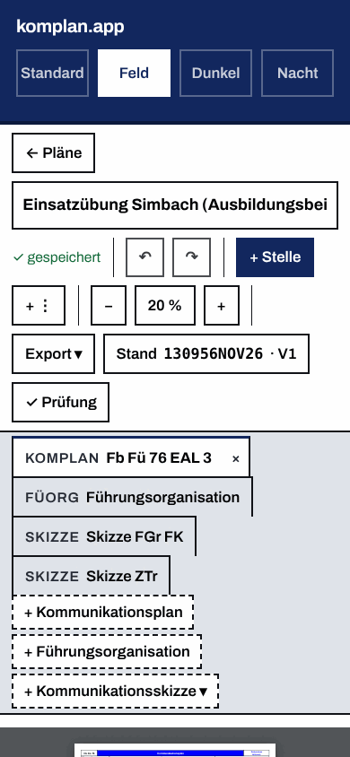
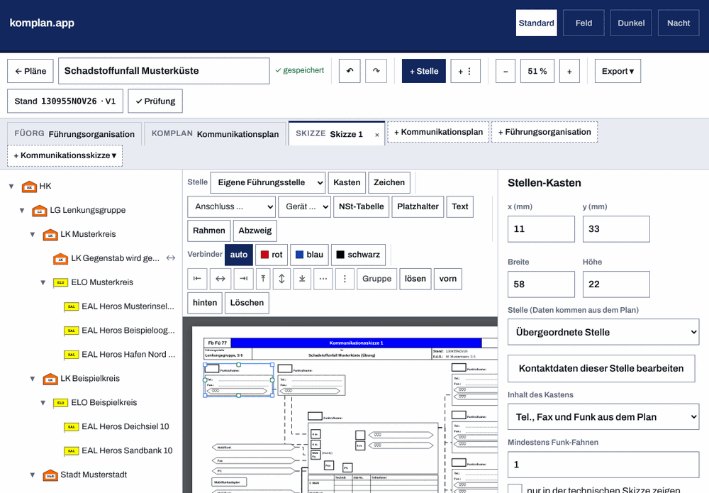
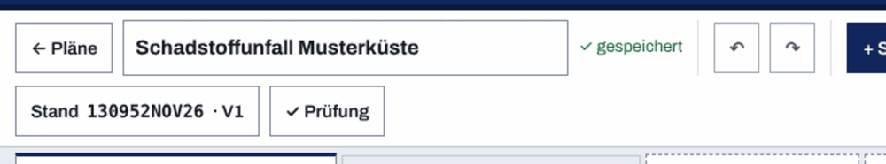
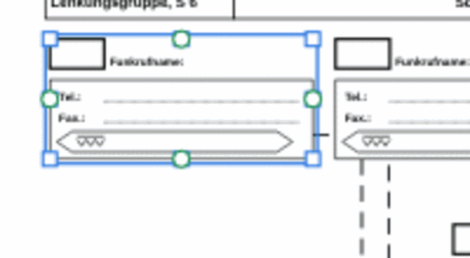

# Review-Runde 1: Handschuh- und Touch-Bedienung

- **Reviewer-Skill:** thw-glove-touch-reviewer (Kürzel HB)
- **Prüfgegenstand:** komplan.app, main b37b468, lokal per vite preview
- **Datum:** 2026-11-13
- **Viewports:** iPad quer 1180×820 und hoch 820×1180 (hasTouch), Telefon 390×844 hoch und 844×390 quer (hasTouch, isMobile); Desktop nur zum Vergleich. Modi Standard und Feld.
- **Abläufe:** Startseite, Vorlagenwahl, Planliste mit zwei Plänen; Vorlage „Schadstoffunfall“ (FüOrg, Komplan, Exportmenü, „+ ⋮“); Vorlage „Fb Fü 76“ (vier Ansichten) im Feld-Modus; Kommunikationsskizze „Fb Fü 77 Skizze 1“ auf dem iPad (Auswahl, Griffe, Schwenken). Gesten mit CDP-Touch-Events (Ein-Finger-Ziehen, Zwei-Finger-Spreizen, langes Drücken).
- **Messung:** `getBoundingClientRect()` aller Knöpfe, Reiter, Reiter-×, Gliederungszeilen, Aufklapp-Dreiecke, Menüeinträge, Zoom-Knöpfe, Eingaben, dazu der kleinste Abstand zum nächsten Bedienelement. Maßstab: 44 px als Mindestziel für bloßen Finger, mit Arbeitshandschuh eher 48 px und mehr, plus Abstand.
- **Einschränkung:** Gesten in Chromium-Emulation, nicht auf echtem iPad oder Telefon. Wo Emulation und echtes Gerät sich unterscheiden können (langes Drücken, HTML5-Ziehen), ist das beim Befund vermerkt.

## Urteil aus Sicht der Rolle

Auf dem iPad komme ich mit Handschuh durch Startseite, Vorlagenwahl, Planliste und Exportmenü: Die Knöpfe dort sind meist 40 bis 54 px hoch, Löschen fragt nach, und gelöschte Pläne landen im Papierkorb. Auch das FüOrg-Blatt lässt sich mit einem Finger verschieben. Mühsam wird es in der Werkzeugleiste, deren Knöpfe nur 33 bis 36 px breit und 40 px hoch sind, an den Reitern mit dem direkt angesetzten × und überall dort, wo die App Maus oder Tastatur erwartet. Eine Stelle löschen oder duplizieren geht nur mit Rechtsklick oder Taste. In der Skizze lässt sich das Blatt mit dem Finger nicht verschieben. Die Griffe und Anschlusspunkte sind 6 bis 7 px groß.

Auf dem Telefon kann ich den Plan nicht sinnvoll ansehen. Kopf, Werkzeugleiste, Reiter und Gliederung belegen den Bildschirm, für das Blatt bleiben 108 px, im Feld-Modus mit vier Ansichten noch 36 px. Ohne fremde Hilfe kann ich am Telefon also nur exportieren und die Datei woanders ansehen.

## P0

Keine.

## P1

### HB-01: Telefon: Für das Blatt bleiben 36 bis 108 px, ansehen ist praktisch nicht möglich

- **Ansicht/Ablauf:** Editor auf dem Telefon, alle Ansichten. Hochformat und Querformat, Standard und Feld.
- **Beobachtung:** Der Editor ist auf Bildschirmhöhe festgelegt, die Seite selbst scrollt nicht (`scrollTo(0,400)` bleibt bei 0). Von oben nach unten folgen Kopf mit Modusschaltern, drei bis vier Zeilen Werkzeugleiste, umbrechende Reiter mit den drei „+ …“-Knöpfen, dann Gliederung, Blatt und Eigenschaften mit festen Anteilen (30 / Rest / 35 %). Gemessene Höhe der Zeichenfläche:
  - Standard, „Schadstoffunfall“ (2 Ansichten): 108 px, Zoom 20 %.
  - Feld, „Fb Fü 76“ (4 Ansichten): 36 px.
  - Telefon quer, Feld: 36 px.
  - Die Gliederung zeigt im Hochformat 2 bis 3 Zeilen.
- **Erwartung der Rolle:** Plan öffnen und das Blatt bildschirmfüllend sehen, mit einem Finger verschieben und mit zwei Fingern zoomen.
- **Auswirkung im Einsatz:** Am Telefon ist Ansehen laut Auftrag der Hauptzweck. Der Helfer sieht keinen lesbaren Plan und muss den Umweg über den PDF-Export und einen Betrachter gehen. Im Feld-Modus, den man draußen wählt, wird es noch schlechter.
- **Vorschlag:** Auf schmalen Bildschirmen eine eigene Ansehen-Darstellung anbieten: nur das Blatt und eine schmale Leiste mit Reiterauswahl als Liste, Export und Zurück. Die Bearbeitungsleisten, die Gliederung und die Eigenschaften einklappen oder ausblenden. Alternativ ein Vollbild-Knopf für das Blatt.
- **Verifikation:** Telefon 390×844 und 844×390, Feld-Modus, Plan mit vier Ansichten: Das Blatt nimmt mindestens 70 % der Höhe ein, und mit einem Finger lässt sich das ganze Blatt durchsehen.

### HB-02: Stelle löschen oder duplizieren geht ohne Tastatur nur über das Kontextmenü (Rechtsklick)

- **Ansicht/Ablauf:** FüOrg- und Komplan-Ansicht auf dem Tablet, Ablauf 5 (versehentlich angelegte Stelle wieder entfernen).
- **Beobachtung:** Laut Code gibt es zum Löschen einer Stelle nur die Tasten Entf/Rücktaste und den Eintrag „Löschen…“ im Kontextmenü der Zeichenfläche. Duplizieren geht ebenso nur mit Strg+D oder über das Kontextmenü (`editor.tsx` Zeilen 246–257 und 492–508). Die Eigenschaften-Spalte hat keinen Löschknopf. Das Kontextmenü hängt am `contextmenu`-Ereignis. In der Touch-Emulation öffnete ein langes Drücken (900 ms) auf eine Stelle kein Menü. Die Bildschirmtastatur erscheint bei einer Gliederungszeile nicht, also gibt es dort auch keine Entf-Taste.
- **Erwartung der Rolle:** Stelle antippen und einen sichtbaren Knopf „Stelle löschen…“ finden.
- **Auswirkung im Einsatz:** Auf dem Tablet ohne Tastatur lässt sich eine falsch angelegte Stelle unter Umständen gar nicht entfernen. Es bleibt nur Rückgängig, und das hilft nur, solange die Stelle die letzte Änderung war. Dann steht eine falsche Stelle im Plan.
- **Vorschlag:** In den Eigenschaften der gewählten Stelle sichtbare Knöpfe „Duplizieren“, „Unterstellte Stelle anlegen“ und „Löschen…“ anbieten, mit der vorhandenen Abfrage. Den Löschknopf räumlich von den anderen absetzen.
- **Verifikation:** Auf einem echten iPad (Safari) und einem Android-Tablet (Chrome) ohne Tastatur eine Stelle löschen und duplizieren. Zusätzlich prüfen, ob langes Drücken dort das Kontextmenü öffnet. Aus der Emulation ist das nicht sicher zu sagen.

### HB-03: Skizze: Mit einem Finger lässt sich das Blatt nicht verschieben, die Geste zieht ein Auswahlrechteck auf

- **Ansicht/Ablauf:** Kommunikationsskizze auf dem iPad quer, Ablauf 3.
- **Beobachtung:** Bei „Fb Fü 77 Skizze 1“ mit hohem Zoom (Inhalt 1431×1021 px, sichtbar 524×293 px) bewegt Ein-Finger-Ziehen auf freier Fläche das Blatt nicht (`scrollLeft`/`scrollTop` bleiben 0). Laut Code startet die Geste ein Gummiband. Schwenken ist nur mit mittlerer Maustaste oder Alt+Ziehen vorgesehen. Weil die Fläche `touch-action: none` hat, scrollt auch der Browser nicht selbst. In der FüOrg-Ansicht funktioniert dieselbe Geste: Das Blatt wanderte um 200/200 px.
- **Erwartung der Rolle:** Das Blatt mit einem Finger auf freier Fläche verschieben, wie in der FüOrg-Ansicht und in jeder Karten-App.
- **Auswirkung im Einsatz:** Wer zum Platzieren hineinzoomt, kommt mit dem Finger nicht mehr an andere Teile der Skizze. Er muss wieder herauszoomen und erneut hineinzoomen. Am Tablet kostet das bei jeder Änderung Zeit, mit Handschuh führt es zu Fehlauswahlen.
- **Vorschlag:** Bei Touch-Eingabe schwenkt Ein-Finger-Ziehen auf freier Fläche und Zwei-Finger-Ziehen immer. Das Gummiband nur mit Maus oder nach ausdrücklicher Wahl, etwa über einen Knopf „Mehrere auswählen“.
- **Verifikation:** iPad, Skizze 1 bei 200 % oder mehr: Mit einem Finger alle vier Ecken des Blatts erreichen, ohne zu zoomen.

## P2

### HB-04: Das × zum Löschen der Ansicht sitzt ohne Abstand direkt am aktiven Reiter

- **Ansicht/Ablauf:** Reiterleiste, alle Viewports.
- **Beobachtung:** Das × ist 25×38 px groß (Feld: 29×43 px) und schließt ohne Abstand (0 px) an den Reiter an. Es erscheint nur am aktiven Reiter, also genau dort, wo man nach dem Wechsel noch einmal hintippt. Auf dem Telefon brechen die Reiter untereinander um, wieder ohne Abstand nach oben und unten (zum Beispiel Reiter bei y = 381 und y = 419, je 38 px hoch). Ein Fehltipp öffnet die Abfrage „Ansicht … löschen?“. Daten gehen dabei nicht unbemerkt verloren.
- **Erwartung der Rolle:** Eine zerstörende Aktion liegt nicht unmittelbar neben dem Ziel, das man am häufigsten antippt.
- **Auswirkung im Einsatz:** Mit Handschuh gibt es wiederholt Löschabfragen, die man wegtippen muss. Wer unter Druck die Abfrage bestätigt, löscht die Ansicht. Rückgängig hilft dann, sofern es der Helfer kennt.
- **Vorschlag:** Ansicht löschen in ein Reitermenü oder in die Eigenschaften der Ansicht verlegen. Falls das × bleibt: mindestens 44×44 px groß und mit 8 px oder mehr Abstand zum Reiter. Reiter auf dem Telefon als Liste oder Auswahlfeld darstellen.
- **Verifikation:** Messung: × mindestens 44×44 px, Abstand zum Reiter mindestens 8 px. Test mit Handschuh: Zehnmal den aktiven Reiter antippen, keine einzige Löschabfrage.

### HB-05: Werkzeugleiste: Rückgängig, Wiederholen und Zoom sind kleiner als 44 px, „+ ⋮“ legt beim Tippen sofort an

- **Ansicht/Ablauf:** Werkzeugleiste des Editors, Tablet und Telefon.
- **Beobachtung:** Gemessene Größen im Standard-Modus:
  - ↶ und ↷: je 36×40 px.
  - „Verkleinern −“ und „Vergrößern +“: je 33×40 px.
  - Prozentanzeige: 57×40 px.
  - Abstände zwischen den Knöpfen: 8 px.
  - Im Feld-Modus wachsen sie auf 43×45 px bzw. 40×45 px.

  In `stil-basis.css` ist `--ziel-basis: 2.75rem` (44 px) definiert, die Editorleiste setzt aber `min-height: 2.5rem`. „+ ⋮“ (50×40 px) steht 8 px neben „+ Stelle“ und legt beim Antippen ohne Rückfrage sofort eine Auslassung an. Im Test entstand so ungewollt eine Auslassung.
- **Erwartung der Rolle:** Häufige Knöpfe wie Rückgängig und Zoom lassen sich mit dem Daumen im Handschuh sicher treffen. Ein Knopf mit „⋮“ öffnet ein Menü und legt nichts an.
- **Auswirkung im Einsatz:** Wer Rückgängig verfehlt, trifft Wiederholen und macht seine Korrektur selbst wieder rückgängig. Wer Zoom verfehlt, verliert Zeit. Wer „+ ⋮“ trifft, hat unbemerkt einen zusätzlichen Eintrag im Plan.
- **Vorschlag:** Alle Knöpfe der Editorleiste auf mindestens 44×44 px bringen, im Feld-Modus auf 48 px. Zwischen ↶ und ↷ und zwischen − und + mindestens 8 bis 12 px Abstand. „+ ⋮“ verständlich beschriften („+ Auslassung“) oder weiter von „+ Stelle“ absetzen.
- **Verifikation:** Die Messung aller Knöpfe in `.werkzeugleiste` ergibt keinen Wert unter 44 px. Mit Handschuh je zehnmal Rückgängig antippen, kein Treffer auf Wiederholen.

### HB-06: Kein Zwei-Finger-Zoom auf dem Blatt, außerhalb wird die ganze Oberfläche gezoomt

- **Ansicht/Ablauf:** FüOrg und Komplan auf Tablet und Telefon, Ablauf 1 (Plan ansehen).
- **Beobachtung:** Zwei-Finger-Spreizen auf der Zeichenfläche ändert die Zoomstufe nicht (iPad: 195 % bleibt, Telefon: 76 % bleibt). Das Blatt wird stattdessen verschoben (`scrollLeft` 200 → 320). Spreizen außerhalb, etwa am Kopf, vergrößert die gesamte Seite (`visualViewport.scale` 3,85). Danach liegen Werkzeugleiste und Reiter teilweise außerhalb des Bildschirms. Zoomen geht nur über die 33 px breiten Knöpfe − und + in festen Schritten.
- **Erwartung der Rolle:** Mit zwei Fingern auf dem Plan zoomen.
- **Auswirkung im Einsatz:** Wer auf dem Tablet ein Detail lesen will, etwa eine Rufgruppe oder eine Nummer, greift zu Pinch und bekommt eine verschobene, vergrößerte Oberfläche statt eines größeren Plans. Zurück geht es nur durch erneutes Zusammenziehen.
- **Vorschlag:** Pinch auf der Zeichenfläche als Zoom der Zeichenfläche umsetzen (wie Strg+Mausrad), mit dem Mittelpunkt zwischen den Fingern als Bezug. Optional „Einpassen“ als großer Knopf.
- **Verifikation:** iPad und Telefon: Pinch auf dem Blatt ändert die Prozentanzeige, die Oberfläche bleibt unverändert (`visualViewport.scale` = 1).

### HB-07: Skizze: Griffe, Anschlusspunkte und Verbinder sind für den Finger zu klein, und die Werkzeugleiste lässt der Fläche wenig Höhe

- **Ansicht/Ablauf:** Kommunikationsskizze auf dem iPad, Ablauf 3 (verschieben, Größe ändern, Verbinder ziehen).
- **Beobachtung:** Nach dem Antippen eines Kastens bei 51 % Zoom misst jeder Größengriff 6×6 px und jeder Anschlusspunkt 7×7 px. Die Trefferbreite der Verbinder beträgt 6 Bildschirm-px, und diese Werte sind unabhängig vom Zoom (`* sw`). Die Skizzen-Werkzeuge sind 36 px hoch. Darunter sind Ausrichtungsknöpfe wie ⤒ mit 24×36 px und ↕/⤓ mit 30×36 px, und „Löschen“ steht in derselben Reihe wie „hinten“. Auf dem iPad quer bricht die Leiste in vier Zeilen um, für das Blatt bleiben 293 von 820 px Höhe. Positiv: Die Eigenschaften bieten x, y, Breite und Höhe als Zahlenfelder. Damit gibt es einen Weg ohne Feinmotorik.
- **Erwartung der Rolle:** Griffe und Anschlusspunkte groß genug für den Finger, Werkzeuge kompakt.
- **Auswirkung im Einsatz:** Mit Handschuh trifft man statt eines Anschlusspunkts den Kasten und verschiebt ihn, statt einen Verbinder zu ziehen. Größe ändern geht praktisch nur über die Zahlenfelder. Der Editor wird am Tablet geringer gewichtet, deshalb P2.
- **Vorschlag:** Bei Touch-Eingabe die Trefferflächen der Griffe und Anschlusspunkte auf mindestens 44 px vergrößern; die sichtbaren Punkte dürfen klein bleiben. Verbinder mit breiter Trefferfläche. Die Skizzen-Werkzeugleiste auf dem Tablet einklappbar machen oder seitlich anordnen.
- **Verifikation:** Die Messung von `[data-griff]` und `[data-port]` ergibt mindestens 44 px Trefferfläche bei Touch. Mit Handschuh zehnmal einen Verbinder von Kasten zu Kasten ziehen, ohne dass ein Kasten verrutscht.

### HB-08: Umhängen in der Gliederung geht nur durch Ziehen und Ablegen

- **Ansicht/Ablauf:** Gliederung, Ablauf 1 („umhängen per Ziehen“) auf dem Tablet.
- **Beobachtung:** Die Gliederung nutzt HTML5-Ziehen (`draggable`, `onDragStart/onDrop`). In der Touch-Emulation hat langes Drücken mit anschließendem Ziehen über vier Zeilen nichts umgehängt. Der Hilfetext nennt nur Tastenkürzel und „Ziehen: umhängen“. Laut Code gibt es weder eine Auswahl „Übergeordnete Stelle“ in den Eigenschaften noch einen Knopf zum Ein- oder Ausrücken. Die einzige Ablageentscheidung „davor / hinein / danach“ hängt am obersten bzw. untersten Viertel einer 40 px hohen Zeile, also an je 10 px.
- **Erwartung der Rolle:** Stelle antippen und „Unterstellen unter …“ aus einer Liste wählen.
- **Auswirkung im Einsatz:** Wenn Ziehen auf dem Gerät nicht geht, lässt sich die Führungsorganisation am Tablet nicht umbauen. Wenn es geht, landet die Stelle mit Handschuh leicht „hinein“ statt „danach“. Rückgängig hilft dann.
- **Vorschlag:** In den Eigenschaften eine Auswahl „Übergeordnete Stelle“ und Knöpfe „nach oben“, „nach unten“, „eine Ebene höher“ anbieten.
- **Verifikation:** Auf einem echten iPad und Android-Tablet ohne Tastatur eine EAL von einem ELO unter einen anderen hängen. Das Ziehen auf dem echten Gerät prüfen, die Emulation ist dafür nicht belastbar.

## P3

### HB-09: Aufklapp-Dreiecke der Gliederung sind 26×26 px groß

- **Ansicht/Ablauf:** Gliederung, alle Viewports.
- **Beobachtung:** Das Dreieck misst 26×26 px (Feld: 29×29 px) und liegt in einer 40 px hohen Zeile, die selbst auswählt. Ein Fehltipp wählt die Stelle aus, statt den Zweig zu öffnen. Beim Auswählen entsteht keine Datenänderung.
- **Vorschlag:** Trefferfläche des Dreiecks auf die volle Zeilenhöhe und mindestens 44 px Breite erweitern, die Zeile im Feld-Modus auf 48 px.
- **Verifikation:** Messung `.gl-klapp` mindestens 44×44 px.

### HB-10: Exportmenü ragt auf dem Telefon über den rechten Rand

- **Ansicht/Ablauf:** „Export ▾“ auf dem Telefon, Ablauf 1 und 4.
- **Beobachtung:** Die Menüliste beginnt bei x = 177 und ist 254 px breit, endet also bei 431 px auf einem 390 px breiten Bildschirm. Der rechte Rand wird abgeschnitten, die Texte sind noch sichtbar. Die Einträge sind 40 px hoch, ohne Abstand untereinander. Ein Fehlgriff führt hier nur zu einem anderen Exportformat, das Risiko ist gering.
- **Vorschlag:** Menü am Bildschirmrand ausrichten, auf dem Telefon in voller Breite und mit Einträgen von mindestens 48 px Höhe.
- **Verifikation:** Telefon 390 px: Menüliste vollständig sichtbar, alle Einträge mindestens 48 px hoch.

### HB-11: Kleine Kontrollkästchen und Textknöpfe außerhalb der Werkzeugleiste

- **Ansicht/Ablauf:** Eigenschaften, Startseite, Planliste.
- **Beobachtung:** Weitere Ziele unter 44 px:
  - Kontrollkästchen in den Eigenschaften: 24×24 px (Feld: 1,7 rem).
  - Planname in der Planliste als Knopf: 324×27 px.
  - „Ausblenden“ im Hinweisband: 78×34 px.
  - Fußzeilen-Links: 34 px hoch.
  - Reiter-Neu-Knöpfe „+ Kommunikationsplan“ usw.: 35 px hoch, 0 bis 4 px Abstand.

  Positiv: Umbenennen, Duplizieren und Löschen in der Planliste sind 44 px hoch (Feld: 54 px), Löschen steht in einer eigenen Zeile und fragt nach.
- **Vorschlag:** Kontrollkästchen samt Beschriftung als 44-px-Zeile antippbar machen, Plannamen-Knopf auf 44 px Höhe bringen, „+ …“-Knöpfe auf 44 px mit 8 px Abstand.
- **Verifikation:** Die Messung aller interaktiven Elemente auf Start und Planliste ergibt keinen Wert unter 44 px.

## Was gut funktioniert

- Der Feld-Modus vergrößert Ziele spürbar: Modusschalter 81×54 px, Planlisten-Knöpfe 54 px hoch, Kontrollkästchen 1,7 rem.
- Zerstörende Aktionen auf Plan- und Ansichtsebene fragen nach. Pläne gehen in einen Papierkorb, nicht ins Nichts.
- In der FüOrg- und Komplan-Ansicht verschiebt Ein-Finger-Ziehen das Blatt. Antippen wählt eine Stelle, ohne dass sie verrutscht.
- Für die Skizze gibt es Zahlenfelder für Lage und Größe, ein Weg ohne Feinmotorik.
- Einträge im Exportmenü sind 40 px hoch und ganzzeilig antippbar.

## Nicht geprüft

- Verhalten auf echten Geräten: iOS Safari und Android Chrome bei langem Drücken (Kontextmenü), HTML5-Ziehen und Pinch-Zoom. Die Werte stammen aus Chromium-Emulation.
- Bildschirmtastatur: Ob Eingabefeld und zugehörige Aktion bei geöffneter Tastatur sichtbar bleiben, ließ sich in der Emulation nicht prüfen.
- Ziehen eines Skizzen-Elements per Touch: Ein Versuch verschob das Element nicht. Die Ursache (Trefferpunkt oder Verhalten) ist nicht geklärt, deshalb gibt es dazu keinen Befund.

## Abschluss

- **Aufgabe geschafft:** mit Umwegen (Tablet), nein für Ansehen auf dem Telefon in der App (nur über Export)
- **Fremde Hilfe nötig:** nein auf dem Tablet für Ansehen und Export; für Stelle löschen ohne Tastatur möglicherweise ja (HB-02)
- **Größtes Missverständnis:** Wer auf dem Plan mit zwei Fingern zoomt, vergrößert die ganze Oberfläche statt des Plans.
- **Größtes Einsatzrisiko:** Am Telefon ist der Plan in der App praktisch nicht lesbar, und am Tablet lässt sich eine falsch angelegte Stelle ohne Tastatur womöglich nicht entfernen.
- **Top-Priorität für die nächste Iteration:** Eine Ansehen-Darstellung für schmale Bildschirme, in der das Blatt fast den ganzen Bildschirm einnimmt (HB-01).
