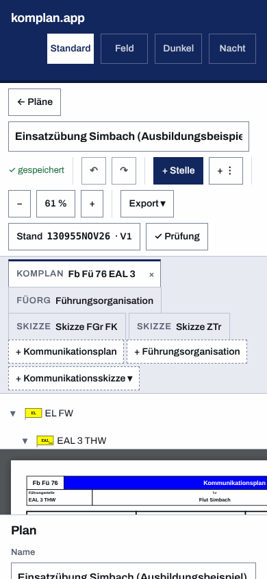
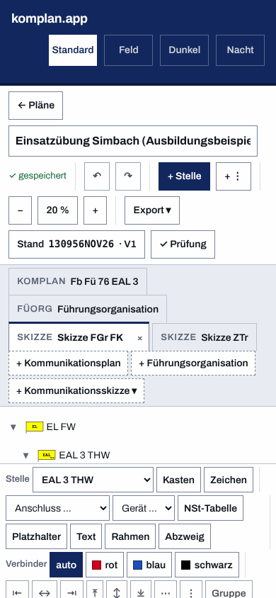
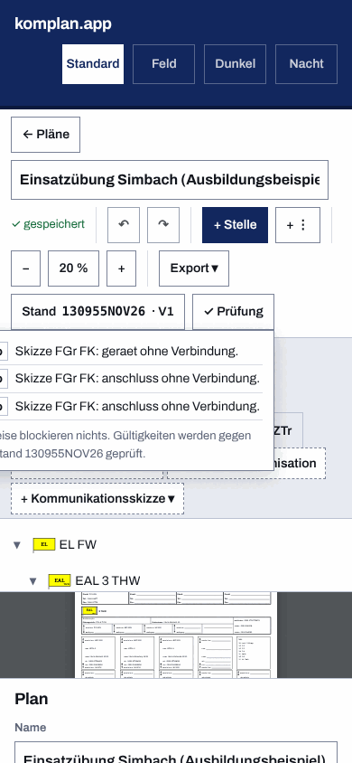
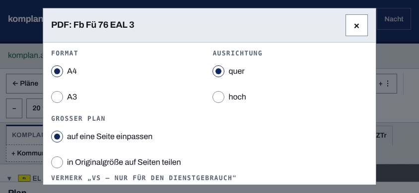
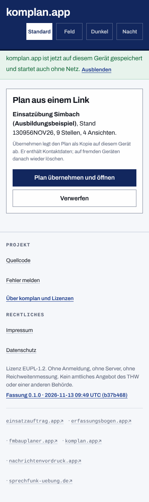
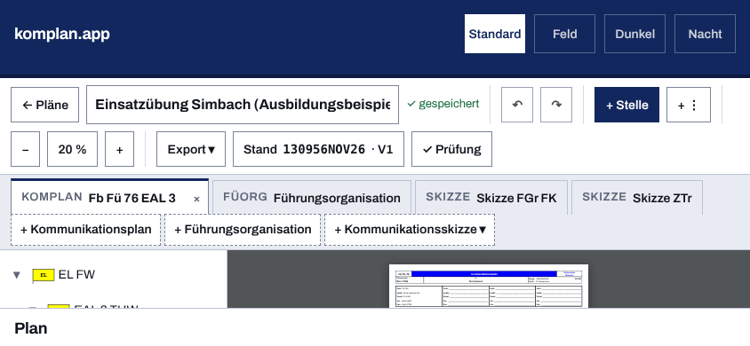

# Review-Runde 1: Mobile UI (Telefon und Tablet, Ansehen und Export)

- **Reviewer-Skill:** mobile-ui-reviewer (Kürzel MU)
- **Prüfgegenstand:** komplan.app, main b37b468, lokal per vite preview
- **Datum:** 2026-11-13
- **Modus:** Prüfung der laufenden Website mit Playwright/Chromium, Touch-Gesten per CDP (`Input.dispatchTouchEvent`), dazu Belege aus dem CSS und den Komponenten
- **Viewports:** Telefon 390×844 (Schwerpunkt), 320×640, Telefon quer 844×390, iPad hoch 820×1180; Basis-Screenshots für iPad quer und Desktop zum Vergleich. Modi: Standard, Nacht (Stichprobe)
- **Durchgespielte Abläufe:** Startseite und Planliste; Plan aus den Vorlagen „Schadstoffunfall“ und „Fb Fü 76“ öffnen; Organigramm, Formular (Fb Fü 76) und Skizze (Fb Fü 77) ansehen, zoomen (Knöpfe, Einpassen, Pinch) und verschieben (Ein-Finger-Ziehen); Exportmenü, PDF-Dialog, Stände-Dialog, Prüfung; Teil-Link erzeugen und in einem neuen Telefon-Kontext öffnen
- **Grenzen:** Kein echtes iOS/Safari. Bildschirmtastatur, Download-Verhalten mobiler Browser und Safe-Area-Ränder (Notch, Home-Indikator) lassen sich in Chromium nicht nachstellen. Diese Punkte sind aus dem Code begründet und unten so gekennzeichnet.

Gewichtung nach BRIEF: Auf dem Telefon wird nur angesehen und exportiert, das Tablet muss bedienbar sein.

## P0

Keine Befunde.

## P1

### MU-01 Am Telefon bleiben für das Blatt nur etwa 90–110 px Höhe
- **Ansicht/Ablauf:** Editor, alle Ansichten, Telefon 390×844 (hoch und quer)
- **Beobachtung:** Die Seite selbst scrollt nicht (`scrollHeight` = 844). Kopf mit Anzeige-Schalter (121 px), Hinweis „auf diesem Gerät gespeichert“ (75 px, bis man ihn ausblendet), Werkzeugleiste (253 px) und Reiterleiste (ca. 160 px, bei 4 Ansichten über 200 px) nehmen zusammen gut 600 px ein. Den Rest teilt das Raster `30% / 1fr / 35%` (stil.css, `@media (max-width: 44rem)`) auf drei Bereiche auf, die jeder für sich scrollen: Gliederung 70–92 px, **Blatt 82–108 px**, Eigenschaften 82–108 px (Eigenschaften: Inhalt 1849 px hoch, sichtbar 94 px). Im Querformat 844×390 bleiben für das Blatt etwa 65 px. Bei 61 % Zoom sieht man vom Fb-Fü-76-Formular nur den Kopfstreifen.
- **Auswirkung im Einsatz:** Gerade das Ansehen, die einzige Aufgabe am Telefon, klappt praktisch nicht. Wer unterwegs eine Rufgruppe oder Nummer im Plan nachschlagen will, schiebt das Blatt in einem Schlitz von gut 2 cm hin und her. Drei kleine Scrollbereiche übereinander machen außerdem leicht den falschen Wisch: Man scrollt ungewollt in Gliederung oder Eigenschaften statt im Blatt.
- **Vorschlag:** Am Telefon einen eigenen Ansichtsmodus vorsehen: Das Blatt nimmt fast die ganze Höhe ein, Gliederung und Eigenschaften öffnen sich bei Bedarf als Schublade oder Unterseite, die Werkzeugleiste schrumpft auf „← Pläne“, Zoom und Export, die Bearbeitungsknöpfe verschwinden oder wandern ins Menü. Der Kopf mit den Modus-Knöpfen wird einzeilig.
- **Prüfung der Behebung:** Bei 390×844 und 844×390 ist die Blattfläche mindestens etwa 60 % der Höhe hoch.

### MU-02 Kommunikationsskizze ist am Telefon gar nicht zu sehen
- **Ansicht/Ablauf:** Reiter „Skizze …“ (Vorlage Fb Fü 76), Telefon 390×844, 320×640 und quer
- **Beobachtung:** Über dem Blatt liegen noch die Skizzen-Werkzeuge (Stelle, Kasten, Zeichen, Anschluss, Gerät, Verbinderfarben, Ausrichten …, etwa 5 Zeilen). Die `.skizzen-flaeche` ist danach nur 32 px hoch und beginnt bei y = 900 (bei 320×640 bei y = 1105), liegt also ganz außerhalb des Bildschirms. Weil die Seite nicht scrollt, kommt man auch nicht hin.
- **Auswirkung im Einsatz:** Die Skizze lässt sich am Telefon weder ansehen noch prüfen. Es bleibt nur der Weg über PDF exportieren und dann außerhalb der App öffnen.
- **Vorschlag:** Die Skizzen-Werkzeuge am Telefon (und auf schmalen Breiten allgemein) standardmäßig einklappen oder ganz ausblenden; auf jeden Fall die Fläche vor die Werkzeuge stellen. Siehe MU-01.
- **Prüfung der Behebung:** Bei 390×844 ist `.skizzen-flaeche` sichtbar und mindestens etwa 400 px hoch.

## P2

### MU-03 Prüfungs-Popup ragt am Telefon links aus dem Bild
- **Ansicht/Ablauf:** Knopf „✓ Prüfung“ bzw. „Hinweis“, Telefon 390×844
- **Beobachtung:** Die `.hinweis-liste` beginnt bei x = −47 px. Der linke Rand der Hinweise ist abgeschnitten („eise blockieren nichts“, das Symbol vor jeder Zeile fehlt). Auf dem Tablet sitzt sie richtig.
- **Auswirkung im Einsatz:** Gerade die Warnungen (fehlende Verbindung, abgelaufene Kontakte) liest man nur bruchstückhaft.
- **Vorschlag:** Popup am Rand des Viewports festhalten, am Telefon als volle Breite oder als Dialog von unten zeigen.

### MU-04 Im Querformat liegen der PDF-Download und das Exportmenü unter dem Bildschirmrand
- **Ansicht/Ablauf:** Export ▾ und PDF-Dialog, Telefon quer 844×390
- **Beobachtung:** Das Exportmenü reicht bis y = 561 bei 390 px Bildhöhe, „Drucken“ und „Als Link teilen…“ sind zunächst nicht zu sehen. Der PDF-Dialog ist 358 px hoch, der Fuß mit „PDF herunterladen“ liegt bei y = 513–583, also erst nach Scrollen im Dialog. Die vorhandenen `max-height: 30rem`-Regeln betreffen nur andere Seitenteile (Sprungleiste, Vorschau), nicht Editor-Menüs und Dialoge.
- **Auswirkung im Einsatz:** Der Export ist am Telefon die zweite Hauptaufgabe, aber die Hauptaktion bleibt unsichtbar. Ob sich der Dialog scrollen lässt, sieht man nicht.
- **Vorschlag:** Den Dialogfuß bei geringer Höhe festhalten (Inhalt scrollt, Fuß bleibt stehen). Das Menü auf die verfügbare Höhe begrenzen und darin scrollen lassen, oder es nach oben öffnen.

### MU-05 Teil-Link lässt sich am Telefon nur durch Übernehmen ansehen
- **Ansicht/Ablauf:** Teil-Link (`#p=…`, 5,1 kB) in frischem Telefon-Kontext öffnen
- **Beobachtung:** Die Seite nennt nur Name, Stand, Zahl der Stellen und Ansichten. Ansehen geht erst über „Plan übernehmen und öffnen“, also nur als Kopie in IndexedDB. Der Hinweis sagt selbst, man solle sie „auf fremden Geräten danach wieder löschen“. Dazu schiebt der Hinweis „auf diesem Gerät gespeichert“ die Karte nach unten.
- **Auswirkung im Einsatz:** Wer einen Link nur zum Nachschlagen aufs Telefon bekommt, muss den Plan samt Kontaktdaten dauerhaft speichern. Anschließend landet er im Editor mit den Platzproblemen aus MU-01. Auf geliehenen oder privaten Geräten bleiben so leicht VS-NfD-Daten liegen. (Annahme: Teil-Links werden auch an Leute geschickt, die nur lesen.)
- **Vorschlag:** „Nur ansehen“ als eigene, gleichwertige Aktion anbieten: das Blatt im Vollbild aus dem Link rendern, ohne zu speichern, mit Export/PDF. „Übernehmen“ bleibt als zweite Aktion.

### MU-06 Telefon quer: der Kopf frisst die Höhe
- **Ansicht/Ablauf:** Editor, 844×390
- **Beobachtung:** Kopf (ca. 88 px), Speicherhinweis, zwei Zeilen Werkzeugleiste und zwei Zeilen Reiter belegen ungefähr 280 px von 390. Das Blatt ist ein Streifen von etwa 65 px, darunter beginnt schon „Plan“ (Eigenschaften).
- **Auswirkung im Einsatz:** Das Querformat, in dem man ein breites Organigramm oder Formular natürlicherweise ansieht, bringt keinen Gewinn.
- **Vorschlag:** Bei `max-height` von etwa 30rem den Kopf ausblenden oder auf eine Zeile verkleinern, die Reiter in eine einzeilige, waagrecht scrollende Leiste legen und Gliederung/Eigenschaften ausblenden (wie MU-01).

### MU-07 Safe Areas: `viewport-fit=cover` ohne `env(safe-area-inset-*)`
- **Ansicht/Ablauf:** alle Seiten; als PWA im Vollbild bzw. im Querformat auf Telefonen mit Notch
- **Beobachtung (Code):** `index.html` setzt `viewport-fit=cover`, aber in `src/` steht nirgends `env(safe-area-inset-…)`. Die Kurzmeldung ist `position: fixed; bottom: var(--r-4)`, Kopf und Werkzeugleiste beginnen direkt am Rand. In Chromium nicht nachstellbar: **muss auf einem echten Gerät geprüft werden.**
- **Auswirkung im Einsatz:** Auf iPhones im Querformat können „← Pläne“ und die linke Gliederung unter der Notch liegen; die Kurzmeldung (z. B. „Gespeichert“, Fehler) kann vom Home-Indikator verdeckt sein.
- **Vorschlag:** Entweder `viewport-fit=cover` weglassen oder Kopf, Seitenränder und fixe Elemente mit `env(safe-area-inset-*)` polstern.

### MU-08 Tablet hoch: Blatt nur mittelgroß, die Skizze hat wenig Fläche
- **Ansicht/Ablauf:** iPad 820×1180, FüOrg und Skizze
- **Beobachtung:** Ab ≤ 72rem stehen die Eigenschaften fest mit 40 % unter dem Blatt (359 px), die Gliederung links mit 256 px. Für das Organigramm bleiben 564×539 px; das geht gerade so. In der Skizze nehmen die Werkzeuge rund 245 px über der Fläche ein, die Fläche selbst ist nur 294 px hoch. Gliederung und Eigenschaften lassen sich nicht einklappen.
- **Auswirkung im Einsatz:** Auf dem Tablet bedient man noch, muss aber laufend zoomen und verschieben; die Skizze sieht man immer nur in Ausschnitten.
- **Vorschlag:** Gliederung und Eigenschaften zum Einklappen machen, oder einen Knopf „Blatt groß“ anbieten. Die Skizzen-Werkzeuge in eine Zeile mit Überlaufmenü legen.

## P3

### MU-09 Kleine Touchziele neben häufig getippten Elementen
- **Ansicht/Ablauf:** Reiterleiste, Gliederung, Werkzeugleiste (Telefon)
- **Beobachtung:** Das „ד zum Löschen einer Ansicht ist 25×38 px und sitzt direkt am Reiter; die Aufklapp-Dreiecke der Gliederung (`.gl-klapp`) sind 26×26 px; Rückgängig/Wiederholen sind 36×40 px. Das Löschen der Ansicht fragt immerhin nach.
- **Auswirkung im Einsatz:** Beim Reiterwechsel auf dem Telefon öffnet man leicht die Löschfrage, und Äste klappt man mühsam auf.
- **Vorschlag:** Das „ד nur am aktiven Reiter zeigen oder ins Ansichtsmenü verlegen; die Aufklapp-Fläche auf die ganze Zeilenhöhe von 40 px vergrößern.

### MU-10 Reiterleiste bricht am Telefon in viele Zeilen um
- **Ansicht/Ablauf:** Editor, Telefon, Plan mit 4 Ansichten
- **Beobachtung:** Jeder Reiter steht in einer eigenen Zeile, dazu kommen drei gestrichelte „+ …“-Knöpfe in zwei weiteren Zeilen. Fünf Zeilen, rund 200 px, nur für die Navigation.
- **Vorschlag:** Am Telefon eine einzeilige, waagrecht scrollende Reiterleiste oder eine Auswahlliste nehmen; die „+ …“-Knöpfe in ein Menü legen (am Telefon wird ohnehin nicht angelegt).

### MU-11 Eigenschaften am Telefon sind sofort bearbeitbar
- **Ansicht/Ablauf:** Eigenschaften-Bereich beim Ansehen
- **Beobachtung:** Unter dem Blatt stehen aktive Eingabefelder (Name, Stand, DTG, Organisation …), auf dem Telefon in einem 94 px hohen Scrollbereich. Ein Tipp beim Wischen setzt den Fokus und öffnet die Tastatur. Tastatur selbst nicht emuliert.
- **Vorschlag:** Am Telefon die Eigenschaften nur lesend zeigen, oder als Teil des Ansichtsmodus aus MU-01 ausblenden.

## Was gut funktioniert
- An keiner Stelle scrollt die Seite waagrecht, auch nicht bei 320 px (`scrollWidth` = Viewportbreite).
- Das Blatt lässt sich mit einem Finger verschieben, und „Einpassen“ (Klick auf die Prozentanzeige) holt es zuverlässig zurück. Pinch zoomt in Chromium das Blatt und nicht die Seite.
- Hochformat-Dialoge (PDF, Stände, Link teilen) passen auf 390×844, haben große Optionsfelder, einen 44-px-Schließknopf und Eingaben in 16 px (also kein Auto-Zoom).
- Startseite und Planliste stapeln sauber, die Hauptaktion „Neuer Plan“ steht über dem Falz, und die Anzeige-Knöpfe sind 44 px hoch mit Abstand zueinander.

## Nicht geprüft
- Echtes iOS Safari und Android Chrome: Pinch auf `touch-action: none`, Download von PDF/PPTX, Safe Areas, Bildschirmtastatur
- Bearbeiten am Telefon (laut Nutzungssituation nicht vorgesehen) und Ziehen/Umhängen auf dem Tablet
- Dunkel- und Feldmodus nur über die Basis-Screenshots
