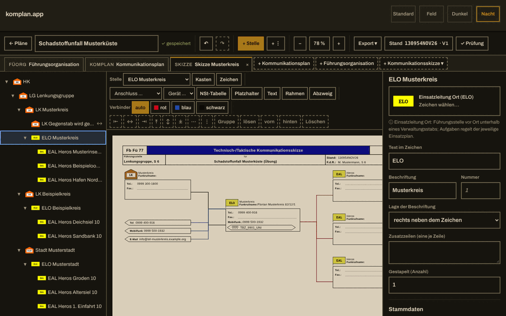
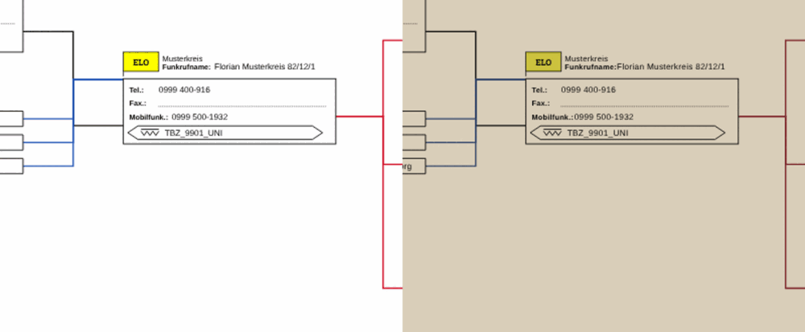
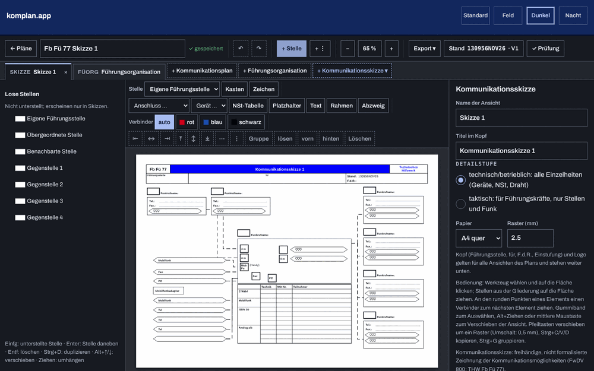
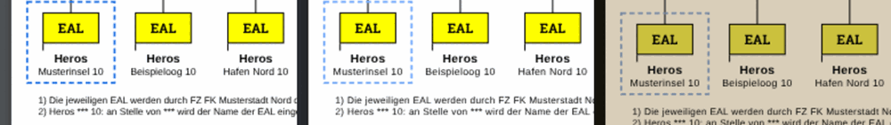
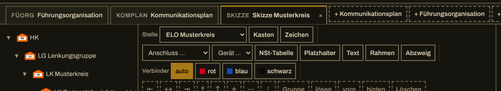
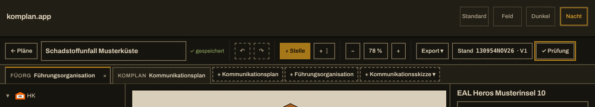

# Review-Runde 1: Nacht und Sicht

- Reviewer-Skill: `thw-night-visibility-reviewer` (Kürzel NS)
- Prüfgegenstand: komplan.app, main b37b468, lokal per vite preview
- Datum: 2026-11-13
- Viewports: Desktop 1440×900 (alle vier Modi, vollständig), iPad quer 1180×820 und hoch 820×1180 (Nacht, Dunkel), Telefon 390×844 (Nacht, Dunkel, nur Ansehen)
- Modi: Standard, Feld, Dunkel, Nacht über `.anzeige-schalter`
- Abläufe: Startseite und Vorlagenauswahl; Vorlage „Schadstoffunfall“ mit FüOrg, Auswahl in Gliederung und Blatt, Tastaturfokus, Hinweisliste, Exportmenü, Komplan-Reiter, Stände-Dialog, „Kommunikationsskizze ▾ → Aus gewählter Stelle erzeugen“, Auswahl in der Skizze, Löschrückfrage; Vorlage „Fb Fü 76“ (Simbach) mit Umschalten auf FwDV 800 und PDF-Dialog; Vorlage „Fb Fü 77 Skizze 1“ mit Zoom; Moduswechsel während einer Eingabe.
- Messung: Kontrast aller sichtbaren DOM-Texte per `getComputedStyle` gegen den tatsächlich darunterliegenden Hintergrund (WCAG-Formel), Pixelstichproben und mittlere Helligkeit aus Screenshots (ImageMagick). Reale Umgebungshelligkeit, Displayhelligkeit und Blendung im Fahrzeug ließen sich nicht simulieren; Aussagen dazu sind aus Messwerten abgeleitet.

## Urteil aus Sicht der Rolle

Die Bedienoberfläche selbst ist in allen vier Modi sauber gemacht: Von allen gemessenen DOM-Texten unterschreitet nur ein einzelner Trennpunkt „·“ im Standardmodus 4,5:1 (4,3:1); Feld, Dunkel und Nacht haben keinen Text unter 4,5:1. Hinweise tragen ein Wort („Info“, „Achtung“, „Fehler“), deaktivierte Knöpfe sind im Dunkeln gestrichelt, der Moduswechsel verliert keine Eingabe. Die Reibung liegt dort, wo man nachts am meisten hinschaut: auf dem Zeichenblatt. Im Nacht-Modus bleibt das Blatt eine große helle Fläche (gleich hell wie die hellste Schrift, rund ein Drittel bis die Hälfte des Bildes), im Dunkel-Modus sogar reinweiß. Auf dem Blatt sind Auswahlmarkierung und Leitungsarten (Funk rot, Draht blau, sonst schwarz) gerade in den dunklen Modi schwach. Die Arbeit ist ohne fremde Hilfe machbar, nachts aber mit Blendung und Unsicherheit beim Lesen der Skizze.

## P0

Keine.

## P1

### NS-01 Nacht-Modus: Zeichenblatt bleibt große helle Fläche

- **Fundstelle / Aufgabe:** Editor, alle Reiter (FüOrg, Kommunikationsplan Fb Fü 76/FwDV 800, Skizze), Nacht-Modus; Desktop und Tablet.
- **Beobachtung:** Das Blatt wird nur per Filter gedimmt (`.nacht-modus .blatt { filter: brightness(0.75) sepia(0.4) }`, `src/app/stil.css`). Gemessene Blattfarbe #DACFBA, Mittelwert 200/255; der Seitengrund ist #0d0c08. Das Blatt ist damit genauso hell wie die hellste Schrift (#d9cdb6) und füllt auf Desktop rund 30 % (FüOrg), in der Skizze nach Einpassen über 40 % der Fläche. Mittlere Bildhelligkeit: Startseite Nacht 20/255, Editor Nacht 81/255, also das Vierfache. Die PDF-/Bildvorschau wird im Nacht-Modus dagegen invertiert (`invert(0.92) sepia(0.7) brightness(0.75)` in `stil-basis.css`), das Blatt nicht.
- **Erwartung der Rolle:** Im „Nacht“-Modus ist nichts im Bild heller als nötig, schon gar nicht die größte Fläche.
- **Auswirkung im Einsatz:** Wer nachts im Fahrzeug oder im abgedunkelten Führungsraum die Skizze liest, schaut in eine helle Fläche; Dunkeladaption geht verloren, das Gerät leuchtet nach außen. Der Moduswechsel verspricht etwas („schont die Dunkeladaption“), das an der Hauptfläche nicht eingelöst wird.
- **Empfehlung:** Das Blatt im Nacht-Modus wie die Vorschau negativ darstellen (dunkles Blatt, helle warme Linien und Schrift), Taktische-Zeichen-Farben dabei erkennbar halten; alternativ die Helligkeit deutlich stärker absenken. Export und Druck bleiben unberührt (heute schon `filter: none` im Druck).
- **Verifikation:** Mittlere Helligkeit des Editor-Screenshots im Nacht-Modus höchstens etwa auf Niveau der Startseite; keine Fläche über ~40 % Helligkeit größer als ein Eingabefeld.

### NS-02 Leitungsarten in der Skizze nur über Farbe unterscheidbar

- **Fundstelle / Aufgabe:** Skizze aus Stelle erzeugen (ELO Musterkreis), Vorlagen Fb Fü 77; alle Modi, besonders Nacht.
- **Beobachtung:** Erzeugte Verbinder sind alle durchgezogen: Funk rot (#d0021b), Draht/Daten blau (#1a4fb4), Stellen ohne Funkangabe schwarz (`src/modell/skizze.ts`, „Farbkonvention der THW-Ausbildungsbeispiele“). Das Verbinder-Medium wird nicht beschriftet (nur Anschluss-Fahnen tragen „Tel“, „Mobilfunk“ usw.). Im Nacht-Modus werden die Farben durch den Filter zu #7C2025 (rot) und einem dunklen Graublau; Blau und Schwarz sind auf dem beigen Blatt praktisch gleich. Die Verbinderknöpfe heißen „rot / blau / schwarz“, nicht Funk/Draht.
- **Erwartung der Rolle:** Ob eine Verbindung Funk oder Draht ist, erkenne ich auch bei schwachem Licht, auf einem Graustufen-Ausdruck oder mit Farbsehschwäche.
- **Auswirkung im Einsatz:** Funk- und Drahtwege werden verwechselt, besonders auf Schwarzweiß-Kopien und nachts; die Skizze ist aber gerade das Mittel, um Erreichbarkeit schnell zu klären.
- **Empfehlung:** Zusätzlich zur Farbe ein zweites Merkmal (Strichart oder kurzes Kürzel/Blitz-Symbol an der Leitung) und im Kopf oder Fuß eine kleine Legende; Verbinderknöpfe nach Bedeutung benennen („Funk (rot)“, „Draht (blau)“). Annahme: Die Farbkonvention selbst ist fachlich gesetzt und soll bleiben.
- **Verifikation:** Skizze in Graustufen rendern und vom Nutzer Funk/Draht zuordnen lassen; gleiches im Nacht-Modus.

## P2

### NS-03 Dunkel-Modus: reinweißes Blatt

- **Fundstelle / Aufgabe:** Editor im Dunkel-Modus, alle Reiter; Desktop und Tablet.
- **Beobachtung:** Das Blatt bleibt bewusst weiß („Druckbild“, `stil.css`), Mittelwert 245/255 bei Seitengrund #0f1116. In der Skizze (Fb Fü 77, 65 %) ist rund die Hälfte des Bildes weiß.
- **Erwartung der Rolle:** Wer „Dunkel“ wählt, will keine weiße Fläche; Nacht-Modus ist nicht immer die bewusste Wahl (bei Systemeinstellung „dunkel“ startet die App im Dunkel-Modus, nicht im Nacht-Modus).
- **Auswirkung im Einsatz:** Starker Hell-Dunkel-Sprung zwischen Leisten und Blatt, Blendung in dunkler Umgebung; Augen springen zwischen zwei Helligkeiten.
- **Empfehlung:** Blatt im Dunkel-Modus ebenfalls abgedunkelt oder invertiert anbieten, mindestens als Schalter „Blatt hell/dunkel“; Druckbild per Export unverändert.
- **Verifikation:** Helligkeitsmessung wie NS-01.

### NS-04 Auswahlmarkierung auf dem Blatt in Dunkel und Nacht schwach

- **Fundstelle / Aufgabe:** Stelle in Gliederung oder Blatt auswählen (FüOrg, Komplan, Skizze).
- **Beobachtung:** Die Auswahl auf dem Blatt ist ein dünner gestrichelter Rahmen (0,6 mm, Strich 1,5/1) in `--auswahl`. Im Dunkel- und Nacht-Modus wird `--auswahl` auf #6fa8ff gestellt, gedacht für dunklen Grund, liegt aber auf dem hellen Blatt: 2,4:1 gegen Weiß (Standard #1d6fe0: 4,8:1); im Nacht-Modus nach Filter #7487A1 auf #DACFBA, ebenfalls 2,4:1. Die gleiche gestrichelte Form nutzt das Blatt auch für „wird gestellt durch“-Stellen (Gegenstab).
- **Erwartung der Rolle:** Ich sehe sofort, welche Stelle ich gerade bearbeite.
- **Auswirkung im Einsatz:** Rufnummer oder Rufgruppe wird an der falschen Stelle geändert, weil die Markierung im Halbdunkel übersehen wird (die Gliederung links zeigt die Auswahl zwar deutlicher, aber der Blick liegt auf dem Blatt).
- **Empfehlung:** Auswahlfarbe am Blatthintergrund ausrichten, nicht am Modus; Rahmen kräftiger und durchgezogen bzw. mit Eckgriffen, damit er sich von der fachlichen Strichelung abhebt.
- **Verifikation:** Kontrast der Markierung gegen Blatt ≥ 3:1 in allen Modi; Nutzer findet die gewählte Stelle in Screenshot ohne Gliederung.

### NS-05 Gestrichelter Rahmen bedeutet zweierlei

- **Fundstelle / Aufgabe:** Kopfleiste und Skizzen-Werkzeugleiste, Nacht und Dunkel.
- **Beobachtung:** Im Dunkel/Nacht-Modus werden deaktivierte Knöpfe gestrichelt dargestellt (Rückgängig/Wiederholen, Ausrichten, Gruppe, lösen, vorn, hinten, Löschen) – gut, weil nicht nur Helligkeit. Gleichzeitig sind die aktiven Knöpfe „+ Kommunikationsplan“, „+ Führungsorganisation“, „+ Kommunikationsskizze ▾“ in allen Modi gestrichelt (`.ansicht-neu`). Die Textfarbe unterscheidet sich nur wenig (text-2 gegen text).
- **Erwartung der Rolle:** Gleiche Form, gleiche Bedeutung.
- **Auswirkung im Einsatz:** Nachts wirken die Ansicht-Anlegen-Knöpfe gesperrt, oder gesperrte Knöpfe wirken bedienbar; kostet Fehlversuche.
- **Empfehlung:** Für „neue Ansicht“ eine andere Form wählen (z. B. durchgezogener Rahmen mit „+“), Strichelung ausschließlich für „nicht verfügbar“.
- **Verifikation:** Nutzer im Nacht-Modus benennen, welche Knöpfe der Leiste bedienbar sind.

### NS-06 Ungedimmte Signalfarben in Gliederung und Eigenschaften (Nacht)

- **Fundstelle / Aufgabe:** Gliederung links, Zeichenvorschau rechts, „Lose Stellen“ der Skizze; Nacht-Modus.
- **Beobachtung:** Das Blatt wird gefiltert, die Zeichen in Gliederung und Eigenschaften nicht: EAL/ELO in reinem Gelb (#FFFF00, 17:1 gegen Fläche), Leitungszeichen orange, „Lose Stellen“ als reinweiße Kästchen. Das Zeichen im Eigenschaftenkopf ist rund 56 px breit.
- **Erwartung der Rolle:** Im Nacht-Modus ist nichts greller als die Schrift.
- **Auswirkung im Einsatz:** Viele kleine grelle Punkte am Bildrand; geringere Blendung als NS-01, aber gleiche Ursache.
- **Empfehlung:** Zeichen außerhalb des Blatts im Nacht-Modus mit derselben Dämpfung zeigen wie auf dem Blatt; weiße Platzhalter-Kästchen im Nacht-Modus abdunkeln.
- **Verifikation:** Pixelmaximum im Nacht-Screenshot nicht über Schrifthelligkeit (~210/255).

## P3

### NS-07 Fokusring und „gewählter Modus“ sehen im Nacht-Modus gleich aus

- **Fundstelle / Aufgabe:** Tastaturbedienung im Editor, Nacht.
- **Beobachtung:** Der gewählte Modus „Nacht“ ist ein Bernsteinrahmen, der Tastaturfokus (z. B. auf „Prüfung“) ebenfalls ein Bernsteinrahmen (#a8791a, 5,0:1 gegen Grund). In der Gliederung ist die Auswahl blau, der Fokus bernstein; beides kommt gleichzeitig vor.
- **Erwartung der Rolle:** Fokus (wo bin ich) und Zustand (was ist an) sind verschieden markiert.
- **Auswirkung im Einsatz:** Gering; bei Tastaturbedienung im Stab kurze Orientierungssuche.
- **Empfehlung:** Fokus zusätzlich mit Versatz/Doppelring oder anderer Form, Zustand weiterhin als Rahmen.
- **Verifikation:** Screenshot mit fokussiertem Knopf neben gewähltem Modus vergleichen.

### NS-08 Blaue Auswahlfarbe im warmen Nacht-Schema

- **Fundstelle / Aufgabe:** Gliederung, Planliste, Skizzengriffe im Nacht-Modus.
- **Beobachtung:** `--auswahl` ist im Nacht-Modus #6fa8ff (kaltes Hellblau), alle übrigen Farben sind warm gedämpft. Kontrast gegen Fläche 7,6:1.
- **Erwartung der Rolle:** Ein Nacht-Schema, das konsequent warm bleibt.
- **Auswirkung im Einsatz:** Gering; helles Blau ist nachts auffällig und stört die Dunkeladaption etwas stärker als warme Töne (allgemeine Annahme, nicht gemessen).
- **Empfehlung:** Auswahl im Nacht-Modus warm (z. B. aus der Bernsteinfamilie, aber vom Fokus unterscheidbar, siehe NS-07) oder durch Form statt Farbe.
- **Verifikation:** Sichtprüfung im abgedunkelten Raum.

### NS-09 Hinweisknopf: „Fehler“ und „Warnung“ nur farblich unterschieden

- **Fundstelle / Aufgabe:** Knopf „N Hinweise“ in der Kopfleiste (aus Code, `src/app/editor.tsx`; in den Vorlagen gab es nur „Info“, Zustand nicht live beobachtet).
- **Beobachtung:** Der Knopf zeigt in beiden Fällen nur „N Hinweise“; Fehler rot (Nacht #e08a7e), Warnungen gelb (#d9b96a). In der geöffneten Liste steht dagegen „Fehler“/„Achtung“ als Wort – gut.
- **Erwartung der Rolle:** Schon am Knopf erkennen, ob etwas kaputt ist.
- **Auswirkung im Einsatz:** Gering; Fehler (z. B. Verbinder auf gelöschtes Element) wird nachts als gewöhnlicher Hinweis gelesen.
- **Empfehlung:** Am Knopf das Wort oder ein Symbol ergänzen („2 Fehler“, „3 Hinweise“).
- **Verifikation:** Plan mit Fehlerhinweis in Graustufen ansehen.

### NS-10 Trennpunkt im Standardmodus knapp unter 4,5:1

- **Fundstelle / Aufgabe:** Startseite, Planliste (Nebentext-Trennzeichen „·“).
- **Beobachtung:** #6b7488 auf #f3f5f9, 4,3:1 bei 14 px. Einziger gemessener Text unter 4,5:1 in allen Modi.
- **Auswirkung im Einsatz:** Vernachlässigbar (Trennzeichen), nur der Vollständigkeit halber.
- **Empfehlung:** Nebentextfarbe minimal dunkler.
- **Verifikation:** Kontrastmessung wiederholen.

## Abschluss

- **Aufgabe geschafft:** mit Umwegen (nachts mit Blendung durch das Blatt und unsicherer Unterscheidung von Funk/Draht)
- **Fremde Hilfe nötig:** nein
- **Größtes Missverständnis:** „Nacht“ dämpft die Leisten, aber nicht die Fläche, auf die man tatsächlich schaut.
- **Größtes Einsatzrisiko:** Funk- und Drahtwege der Skizze werden bei wenig Licht oder auf Schwarzweiß-Kopien verwechselt, weil nur Farbe sie trennt.
- **Top-Priorität für die nächste Iteration:** Zeichenblatt im Nacht- (und optional Dunkel-)Modus dunkel darstellen, mit erkennbaren Leitungsarten und kräftiger Auswahlmarkierung.

## Was gut funktioniert

- DOM-Kontraste: in Feld, Dunkel und Nacht kein Text unter 4,5:1; Nacht-Text 11,6:1 auf Fläche, Feld-Modus mit Schwarz auf Weiß und 2-px-Linien für Sonnenlicht.
- Deaktivierte Knöpfe im Dunkeln über Strichelung, nicht nur über Helligkeit; gewählter Modus als Rahmen statt heller Fläche.
- Hinweisliste nennt die Stufe als Wort („Info“, „Achtung“, „Fehler“).
- Moduswechsel mitten in einer Eingabe verliert nichts (Text, Auswahl, Zoom blieben erhalten); PDF-Dialog und Vorschau folgen dem Modus.

## Nicht geprüft

- Reale Beleuchtung (Sonnenlicht, Fahrzeuginnenraum), Displayhelligkeit, Farbsehschwäche-Simulation (nur Code- und Pixelanalyse).
- Ob Exporte (PDF, PPTX, PNG) im Nacht-Modus unverändert bleiben (laut CSS ja, nicht exportiert und verglichen).
- Hinweisknopf im Fehler-/Warnzustand live (Vorlagen erzeugen nur „Info“).
- Rechtsklick-Kontextmenü an der Stelle in der Gliederung erschien nicht; Skizze wurde über „+ Kommunikationsskizze ▾“ erzeugt.
