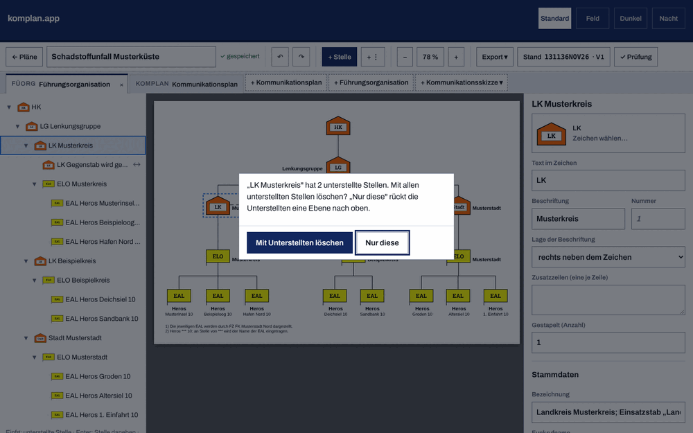
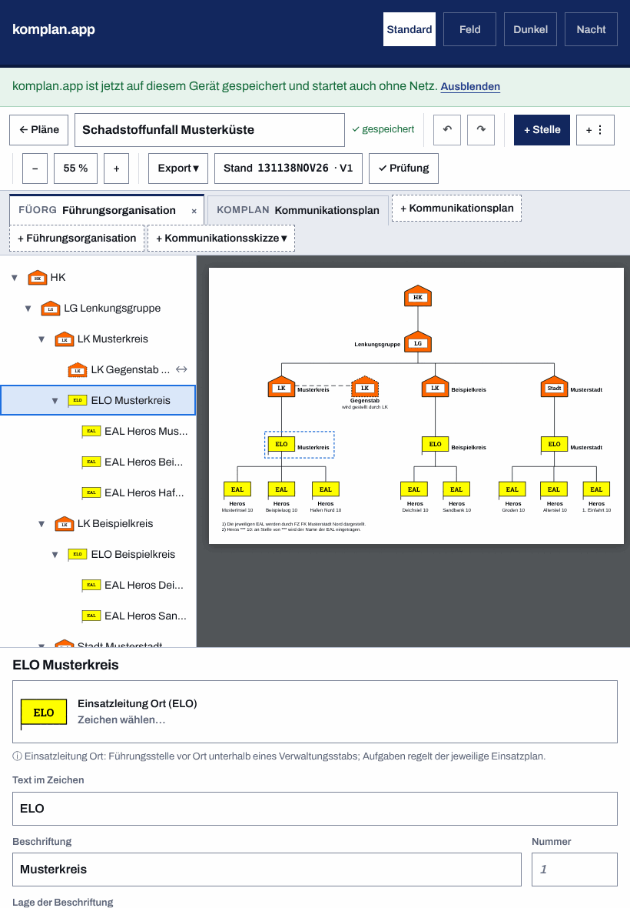
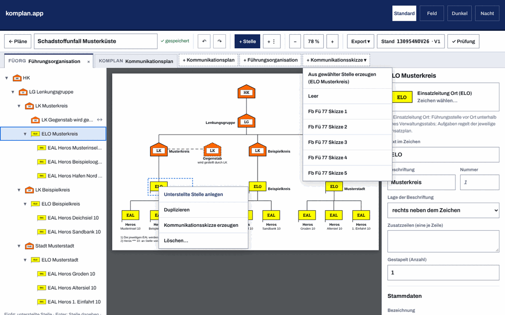
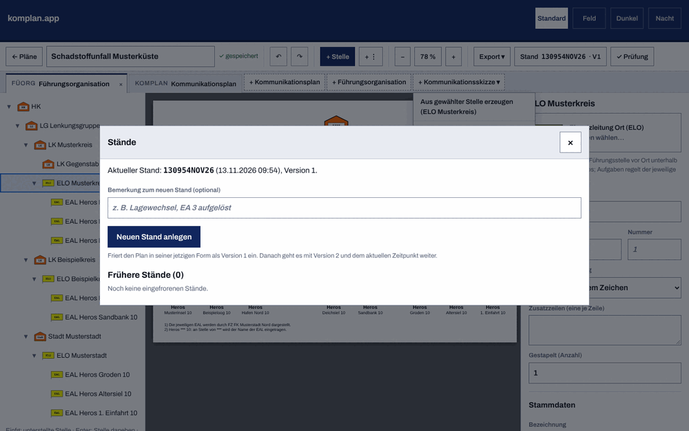
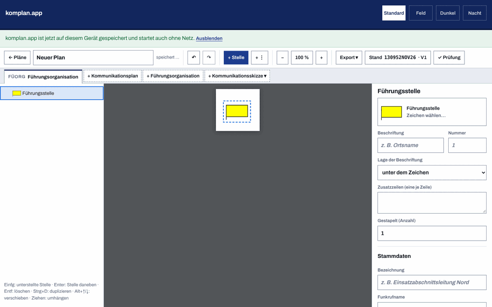
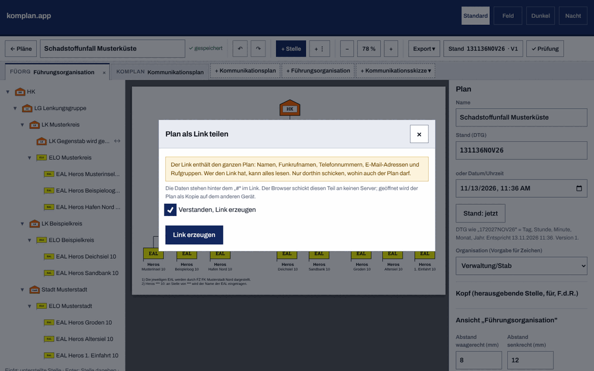

# Review-Runde 1: Neuer Nutzer ohne Einweisung

- Reviewer-Skill: `thw-new-user-reviewer` (THW-Helfer, erste Nutzung, ohne Handbuch)
- Prüfgegenstand: komplan.app, main b37b468, lokal per vite preview
- Datum: 2026-11-13
- Viewports/Modi: Desktop 1440×900 (Standard), iPad hoch 820×1180 (Touch), Basis-Screenshots aller Viewports gesichtet
- Durchgespielt: Startseite, „Neuer Plan“ mit Vorlage „Leer“ und „Schadstoffunfall an der Küste“, erste Stelle anlegen, Zeichensuche (EAL, UEAL, Zugtrupp, ZTr, Zugtrupp THW, Bergung, TEL, Gruppe), Umhängen per Ziehen (Gliederung und Zeichenfläche), Rechtsklick auf Gliederung und Zeichenfläche, „+ Kommunikationsskizze ▾“, Stelle mit Unterstellten löschen (Entf, Esc, Rückgängig), Reiter-× (Ansicht löschen), Stände anlegen, Prüfung, Teil-Link erzeugen, Reiter Kommunikationsplan, „Über komplan“.
- Vorab gelesen: nur BRIEF und Kurzbeschreibung; Code nur zur Bestätigung beobachteten Verhaltens.

## Urteil aus Sicht der Rolle

Den Zweck verstehe ich auf der Startseite sofort, und mit einer Vorlage habe ich in unter einer Minute einen vollständigen Plan vor mir. Die Zeichensuche ist das Beste an der App: „ZTr“, „UEAL“ oder „Zugtrupp THW“ führen ohne Umweg zum richtigen Zeichen. Reibung entsteht bei allem, was über Anschauen und Ausfüllen hinausgeht. Löschen, Duplizieren und „Kommunikationsskizze erzeugen“ gibt es nur über Tastenkürzel oder einen Rechtsklick, den man erst finden muss. Ein Löschdialog löscht auch dann, wenn ich ihn mit Esc abbrechen will. Die Begriffe rund um „Stand“ musste ich mir durch Ausprobieren erschließen. Die Grundaufgabe (Plan aus Vorlage, Stelle anlegen, Zeichen wählen, umhängen) schaffe ich am Desktop ohne Hilfe. Am Tablet finde ich keinen Weg, eine Stelle zu löschen.

## P0

Keine.

## P1

### NN-01 Löschdialog hat kein „Abbrechen“: Esc, Enter und Schließen löschen trotzdem
- **Fundstelle / Aufgabe:** FüOrg, Stelle mit Unterstellten wählen (z. B. „LK Musterkreis“), Entf oder Kontextmenü „Löschen…“
- **Beobachtung:** Der Dialog bietet nur „Mit Unterstellten löschen“ und „Nur diese“. Der Fokus steht auf „Nur diese“. Ich wollte mit Esc abbrechen: „LK Musterkreis“ war danach weg, die Unterstellten waren eine Ebene hochgerückt, unten stand „Gelöscht. Strg+Z macht es rückgängig.“ (Laut Code wertet der Dialog jedes Schließen ohne Ja als „Nur diese“.) Der Text nennt „2 unterstellte Stellen“; „Mit Unterstellten löschen“ entfernt aber auch die drei EAL unter der ELO, also fünf Stellen.
- **Erwartung der Rolle:** Esc oder Klick daneben bricht ab. Ein dritter Knopf „Abbrechen“. Die Zahl nennt alles, was verschwindet.
- **Auswirkung im Einsatz:** Wer nach einem versehentlichen Entf instinktiv Esc drückt, löscht die Stelle tatsächlich und verändert die Unterstellung. Die Kurzmeldung verschwindet nach wenigen Sekunden. Wer sie übersieht, merkt den Fehler erst auf dem Ausdruck.
- **Empfehlung:** Drei Wahlmöglichkeiten: „Mit allen N Unterstellten löschen“, „Nur diese Stelle (Unterstellte rücken hoch)“, „Abbrechen“. Esc, × und Klick daneben bedeuten Abbrechen, der Fokus liegt auf Abbrechen. Die Zahl nennt alle betroffenen Stellen.
- **Verifikation:** Entf, dann Esc: Gliederung unverändert. Entf, dann Enter: nichts gelöscht.

### NN-02 Löschen, Duplizieren und „Skizze aus Stelle“ sind ohne Tastatur und Rechtsklick nicht auffindbar, am Tablet gibt es keinen Weg zum Löschen
- **Fundstelle / Aufgabe:** Stelle bearbeiten in Gliederung, Zeichenfläche und rechter Spalte. iPad hoch.
- **Beobachtung:** Die rechte Spalte einer Stelle hat viele Felder, aber keinen Knopf „Stelle löschen“ oder „Duplizieren“. Ein Rechtsklick auf eine Zeile der Gliederung macht nichts (kein Menü). Nur ein Rechtsklick auf das Zeichen in der Zeichenfläche öffnet ein Menü („Unterstellte Stelle anlegen / Duplizieren / Kommunikationsskizze erzeugen / Löschen…“). Dieses Menü verschwindet, sobald die Maus es verlässt. Die Kürzel stehen nur in einer grauen Kleinschriftzeile unten links. Am iPad hoch ist diese Zeile nicht im Blick, und es gibt keine Entf-Taste. Laut Code löscht nur Entf/Rücktaste oder das Kontextmenü. Annahme, nicht am Gerät geprüft: Auf iPadOS öffnet langes Drücken kein Kontextmenü.
- **Erwartung der Rolle:** In der rechten Spalte, wo ich die Stelle bearbeite, finde ich unten auch „Duplizieren“ und „Löschen“. Die Gliederung reagiert auf Rechtsklick genauso wie die Zeichnung.
- **Auswirkung im Einsatz:** Am Tablet bleibt eine falsch angelegte Stelle im Plan, oder man arbeitet um den Fehler herum. Am Desktop geht Zeit verloren, bis jemand den Rechtsklick zufällig entdeckt.
- **Empfehlung:** Eine sichtbare Aktionszeile für die gewählte Stelle (rechte Spalte oben oder unten): Unterstellte anlegen, Daneben anlegen, Duplizieren, Skizze erzeugen, Löschen. Dasselbe Menü per Rechtsklick und per „⋯“-Knopf in der Gliederungszeile. Das Kontextmenü schließt erst bei Klick daneben oder Esc, nicht schon beim Verlassen mit der Maus.
- **Verifikation:** Am iPad ohne Tastatur eine Stelle löschen und duplizieren. Am Desktop findet ein Erstnutzer „Löschen“ ohne Hinweis in unter 30 s.

## P2

### NN-03 Menü „+ Kommunikationsskizze ▾“ bleibt offen und überdeckt andere Menüs
- **Fundstelle / Aufgabe:** Ansichten-Leiste, „+ Kommunikationsskizze ▾“ öffnen, dann Esc drücken oder in die Zeichenfläche klicken
- **Beobachtung:** Das Aufklappmenü bleibt nach Esc und nach einem Klick daneben offen. Danach liegt es über der Prüfungsliste und über dem Export-Menü: „Als Link teilen…“ war nicht mehr anklickbar, weil „Fb Fü 77 Skizze 3“ darüber lag. Schließen ließ es sich nur durch erneuten Klick auf denselben Knopf.
- **Erwartung der Rolle:** Ein Aufklappmenü geht zu, sobald ich woanders hinklicke oder Esc drücke, wie das Export-Menü.
- **Auswirkung im Einsatz:** Ein offenes Menü verdeckt Prüfhinweise und Exportbefehle. Wer dann daneben klickt, legt womöglich versehentlich eine leere Skizze an.
- **Empfehlung:** Gleiches Schließverhalten wie bei den übrigen Menüs (Esc, Klick daneben, nach Auswahl).
- **Verifikation:** Menü öffnen, Esc: zu. Menü öffnen, Klick in die Zeichenfläche: zu.

### NN-04 Ziehen in der Zeichnung hängt nicht um, nur Ziehen in der Gliederung
- **Fundstelle / Aufgabe:** Ablauf 1, EAL „Heros Groden 10“ unter „ELO Beispielkreis“ umhängen
- **Beobachtung:** In der Gliederung hat das Ziehen einer Zeile auf eine andere sofort funktioniert. Das Ziehen desselben Zeichens in der Zeichnung auf die ELO hat nichts umgehängt, die Fläche hat sich nur verschoben. Der einzige Hinweis ist „Ziehen: umhängen“ in der Kleinschriftzeile unten links.
- **Erwartung der Rolle:** Das Organigramm ist das, was ich sehe. Ich ziehe das Kästchen in der Zeichnung dorthin, wo es hingehört.
- **Auswirkung im Einsatz:** Mehrere Fehlversuche, bis klar ist, dass die linke Liste das eigentliche Bedienelement ist.
- **Empfehlung:** Entweder Umhängen auch per Ziehen in der Zeichnung mit sichtbarem Ziel, oder beim Ziehen in der Zeichnung ein kurzer Hinweis „Zum Umhängen in der Gliederung links ziehen“. Den Kürzelhinweis gut sichtbar über der Gliederung zeigen.
- **Verifikation:** Erstnutzer hängt eine Stelle beim ersten Versuch um.

### NN-05 „Stand“ steht an zwei Stellen mit unterschiedlicher Bedeutung, die Versionszählung ist schwer zu durchschauen
- **Fundstelle / Aufgabe:** Kopfzeile „Stand 131136NOV26 · V1“, rechte Spalte „Stand (DTG)“, „oder Datum/Uhrzeit“, „Stand: jetzt“, Dialog „Stände“
- **Beobachtung:** Rechts gibt es ein Feld „Stand (DTG)“ und einen Knopf „Stand: jetzt“, oben einen Knopf „Stand …“, der den Dialog „Stände“ öffnet. „Neuen Stand anlegen“ friert die aktuelle Version 1 ein und arbeitet danach als Version 2 weiter. „Stand: jetzt“ klingt wie „jetzt einen Stand anlegen“, setzt aber nur das Datum. Die Erklärung „DTG wie ‚172027NOV26‘ = …“ ist hilfreich.
- **Erwartung der Rolle:** „Stand“ ist das Datum auf dem Papier. Eine gesicherte Fassung heißt anders, etwa „Version sichern“, und steht an einer Stelle.
- **Auswirkung im Einsatz:** Wer „Stand: jetzt“ drückt, glaubt eine Sicherung angelegt zu haben, und kann später nicht vergleichen. Wer ein DTG eintippt, erwartet womöglich eine neue Version.
- **Empfehlung:** Begriffe trennen, zum Beispiel „Stand (DTG) auf dem Ausdruck“ und „Fassung einfrieren / Fassungen vergleichen“. Den Knopf „Stand: jetzt“ in „Uhrzeit: jetzt“ umbenennen. Im Kopfknopf sichtbar machen, dass er gespeicherte Fassungen öffnet.
- **Verifikation:** Ein Erstnutzer erklärt ohne Hilfe den Unterschied zwischen beiden Stellen.

### NN-06 Viele namensartige Felder ohne Hinweis, wo welcher Text erscheint
- **Fundstelle / Aufgabe:** Erste Stelle anlegen, rechte Spalte
- **Beobachtung:** Für eine Stelle gibt es „Text im Zeichen“, „Beschriftung“, „Nummer“, „Zusatzzeilen“, unter „Stammdaten“ zusätzlich „Bezeichnung“ und „Funkrufname“. Die Platzhalter („z. B. Ortsname“, „z. B. Einsatzabschnittsleitung Nord“) helfen etwas. Wo welcher Text im Organigramm, im Kommunikationsplan oder im Formular landet, sieht man erst durch Ausprobieren über mehrere Reiter. „Gestapelt (Anzahl)“ bleibt ohne Erklärung.
- **Erwartung der Rolle:** Ein Feld „Name“. Wenn es mehrere gibt, steht dabei, wo jedes erscheint.
- **Auswirkung im Einsatz:** Doppelte oder vergessene Einträge. Der Name steht in der FüOrg, fehlt aber im Fb Fü 76, oder umgekehrt.
- **Empfehlung:** Kurze Hilfszeilen je Feld („erscheint im Zeichen“, „steht neben dem Zeichen“, „steht im Kontaktblock/Formular“). Alternativ eine Vorschau beim Fokus auf ein Feld.
- **Verifikation:** Erstnutzer trägt eine Stelle so ein, dass sie in FüOrg und Fb Fü 76 richtig beschriftet ist, ohne zwischen den Reitern zu wechseln.

### NN-07 Kein Einstieg und keine Hilfe außer Abkürzungserklärungen
- **Fundstelle / Aufgabe:** Startseite, Vorlagenwahl, Editor
- **Beobachtung:** Die Startseite erklärt den Zweck in einem Satz. Eine Anleitung oder ein „So fängst du an“ gibt es nicht, „Über komplan und Lizenzen“ behandelt Lizenzen und Vorschriften. Die Vorlagenwahl ist eine lange Liste von 19 Kacheln ohne Bild. Die Titel „Fb Fü 77 Skizze 1“ bis „Skizze 5“ unterscheiden sich nur im Beschreibungstext, und die Liste empfiehlt keinen Einstieg. Im Editor gibt es ⓘ-Erklärungen zu Abkürzungen (gut) und eine graue Kürzelzeile. Begriffe wie „Ansicht“ (Reiter, „Ansicht löschen“), „Auslassung (⋮)“ und „Prüfung“ erklärt die App nur per Tooltip, am Tablet also gar nicht.
- **Erwartung der Rolle:** Eine Hilfeseite oder ein „?“ im Editor mit den Grundgriffen (anlegen, umhängen, löschen, Zeichen, Reiter = Ansichten auf dieselben Daten, Stände, Export). Bei Vorlagen ein kleines Vorschaubild.
- **Auswirkung im Einsatz:** Wer die App unter Zeitdruck zum ersten Mal nutzt, findet Funktionen nur durch Ausprobieren. Das trifft besonders die Funktionen hinter Rechtsklick und Tastenkürzeln.
- **Empfehlung:** Ein „?“-Knopf im Editorkopf mit einer Seite Kurzanleitung (offline verfügbar), dazu Vorschaubilder in der Vorlagenwahl und eine Markierung wie „Zum Kennenlernen“ bei einem Beispiel.
- **Verifikation:** Erstnutzer findet die Kurzanleitung in unter 10 s und erledigt Ablauf 1 ohne Rückfrage.

## P3

### NN-08 „+ Stelle“ legt einen gelben Platzhalter an, die Zeichenwahl muss man selbst finden
- **Fundstelle / Aufgabe:** Leerer Plan, „+ Stelle“
- **Beobachtung:** Es entsteht „Führungsstelle“ mit einem gelben Fähnchen. Die Zeichenwahl steckt in der rechten Spalte hinter „Zeichen wählen…“. Die Suche dort ist sehr gut (Beispiele im Feldtitel, Kategorien, Favoriten, Kürzel wie „ZTr“).
- **Erwartung der Rolle:** Nach „+ Stelle“ werde ich gefragt, was für eine Stelle es ist.
- **Auswirkung im Einsatz:** Gering, aber Erstnutzer lassen Platzhalter stehen.
- **Empfehlung:** Bei neuer Stelle direkt die Zeichensuche anbieten (mit „Später“), oder die Zeichenwahl in der rechten Spalte hervorheben.
- **Verifikation:** Erstnutzer setzt bei der ersten Stelle ein passendes Zeichen, ohne zu suchen.

### NN-09 Teil-Link: Häkchen und Knopf heißen fast gleich
- **Fundstelle / Aufgabe:** Export ▾ → „Als Link teilen…“
- **Beobachtung:** Die Warnung ist klar und gut. Das Häkchen heißt aber „Verstanden, Link erzeugen“ und erzeugt noch nichts, darunter steht der Knopf „Link erzeugen“. Ich habe zuerst auf den noch gesperrten Knopf geklickt. Das Ergebnis nennt „Link (2.949 Zeichen)“, ohne zu sagen, dass der Empfänger eine Kopie bekommt und spätere Änderungen nicht sieht. Der Hinweis „als Kopie“ steht nur oben im Kleingedruckten.
- **Erwartung der Rolle:** Häkchen „Ich habe verstanden, dass der Link alle Kontaktdaten enthält“, danach der Knopf.
- **Auswirkung im Einsatz:** Kurze Verwirrung. Die Annahme, dass der Link sich aktualisiert, führt zu veralteten Plänen beim Empfänger.
- **Empfehlung:** Häkchen umbenennen. Beim fertigen Link „Stand von <DTG>, spätere Änderungen erfordern einen neuen Link“ anzeigen.
- **Verifikation:** Erstnutzer erzeugt den Link beim ersten Versuch und kann sagen, ob er sich aktualisiert.

### NN-10 Zeichen und Kürzel ohne Text: „✓ Prüfung“, „+ ⋮“, „↔“, Reiter-Kürzel
- **Fundstelle / Aufgabe:** Werkzeugleiste, Gliederung, Ansichten-Leiste
- **Beobachtung:** „✓ Prüfung“ zeigt einen Haken, obwohl die Liste zehn Info-Hinweise enthält. „+ ⋮“ (Auslassung) und das „↔“ in der Gliederung (seitlich angehängt) erklären sich nur per Tooltip. Die Reiter tragen die Kürzel „FüOrg“ und „Komplan“. Das „ד am aktiven Reiter löscht die Ansicht, der Rückfragetext ist dabei klar („Stellen und Kontaktdaten bleiben erhalten“).
- **Erwartung der Rolle:** Der Haken heißt „alles in Ordnung“. Symbole tragen ein Wort.
- **Auswirkung im Einsatz:** Gering. Info-Hinweise werden übersehen, „+ ⋮“ bleibt ungenutzt.
- **Empfehlung:** Prüfknopf mit Anzahl („Prüfung: 10 Hinweise“), „+ ⋮“ als „+ Auslassung“, „↔“ mit Wort oder Legende.
- **Verifikation:** Erstnutzer erklärt die Symbole ohne Tooltip.

## Was gut funktioniert
- Die Zeichensuche ist treffsicher (EAL, UEAL, Zugtrupp, ZTr, Zugtrupp THW), zeigt die Organisation unter der Kachel und hat ⓘ-Erklärungen zu Abkürzungen in der Stelle.
- Mit einer Vorlage steht in Sekunden ein realistischer Plan. Der leere Plan sagt klar „+ Stelle legt die oberste Führungsstelle an“.
- Umhängen per Ziehen in der Gliederung funktioniert sofort. Rückgängig (↶ bzw. Strg+Z) stellt gelöschte Stellen samt Unterstellten wieder her.
- Die Rückfrage „Ansicht löschen?“ erklärt, dass die Daten erhalten bleiben. Die Warnung beim Teil-Link ist deutlich.
- Die Hinweise zu Offline und lokaler Speicherung auf der Startseite sind klar.
- „Kommunikationsskizze aus gewählter Stelle erzeugen“ steht auch im Menü „+ Kommunikationsskizze ▾“, nicht nur im Rechtsklick.

## Abschluss
- **Aufgabe geschafft:** mit Umwegen (Desktop), Löschen am Tablet nein
- **Fremde Hilfe nötig:** nein am Desktop; am Tablet für Löschen/Duplizieren voraussichtlich ja
- **Größtes Missverständnis:** Esc im Löschdialog bricht nicht ab, sondern löscht die Stelle („Nur diese“).
- **Größtes Einsatzrisiko:** Unbemerkt veränderte Unterstellung nach einem vermeintlich abgebrochenen Löschen.
- **Top-Priorität für die nächste Iteration:** Löschdialog mit „Abbrechen“ als Standard für Esc/×/Enter und vollständiger Zahl der betroffenen Stellen.

## Nicht geprüft
- Langes Drücken (Kontextmenü) und Ziehen in der Gliederung auf echtem iPad/iPadOS-Safari, nur Chromium-Emulation.
- Abläufe 3–5 (Skizze bearbeiten, Export-Dateien öffnen, offline) nur gestreift, da andere Reviewer zuständig.
