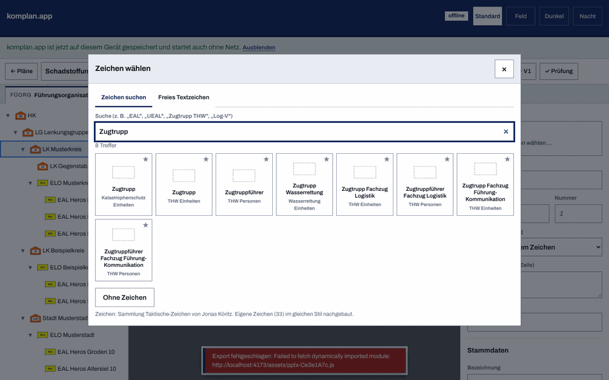
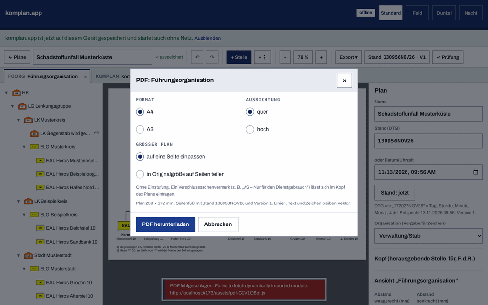
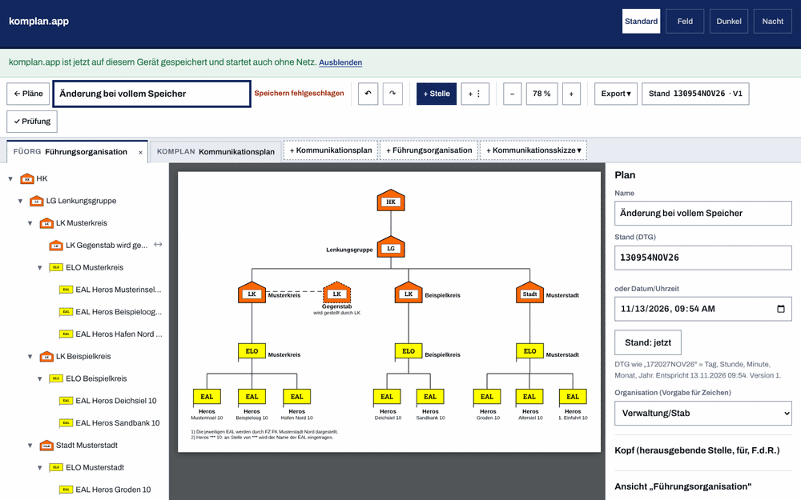
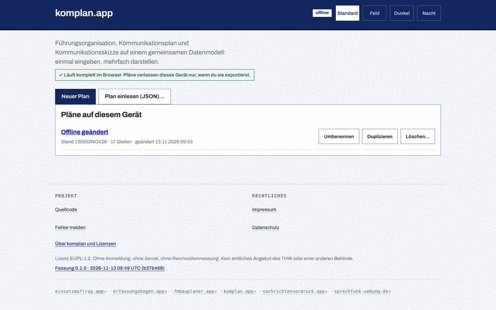

# Review-Runde 1: Offline und Speicher

- Reviewer-Skill: `thw-offline-resilience-reviewer` (Helfer, der sich nicht auf Netz verlässt und wissen will, wo seine Eingaben liegen)
- Prüfgegenstand: komplan.app, main b37b468, lokal per vite preview
- Datum: 2026-11-13
- Viewports/Modi: Desktop 1440×900, Modus Standard (Offline- und Speicherverhalten ist viewportunabhängig; Tablet/Telefon nur über die Basis-Screenshots)
- Durchgespielte Abläufe (Playwright, Chromium, jeweils frischer Browser-Kontext mit Service Worker):
  - Erstaufruf, Installation des Service Workers, Hinweis „startet auch ohne Netz“, `navigator.storage.persisted()` und `estimate()` abgefragt
  - Ablauf 1 offline: Plan aus „Schadstoffunfall an der Küste“, Netz aus, neu laden, Name ändern, Zeichensuche „Zugtrupp“, Export SVG/PNG/PPTX/PDF, Teil-Link-Dialog, Planliste, Impressum
  - Dieselben Schritte offline **in der ersten Sitzung** (ohne Neuladen nach der Installation)
  - Zwei und mehr Tabs mit demselben Plan, abwechselnd bearbeitet
  - Volle Ablage simuliert (IndexedDB `put` wirft `QuotaExceededError`), danach weiterarbeiten, Planliste, neuer Plan
  - Websitedaten (IndexedDB) bei offenem Editor gelöscht (CDP `Storage.clearDataForOrigin`)
  - Neu laden (F5) und Tab schließen 50/300/700/1200 ms nach einer Änderung
  - Ablauf 4 teilweise: JSON-Export auf „Gerät 1“, Einlesen auf „Gerät 2“ (zweiter Kontext), dort ändern, zurück auf Gerät 1 einlesen
- Ergänzend aus dem Code gelesen: `src/app/aktualisierung.tsx`, `src/speicher/db.ts`, `src/app/editor.tsx` (Autosave), `src/app/start.tsx`, `vite.config.ts`, `dist/sw.js`

## Urteil aus Sicht der Rolle

Der Grundsatz stimmt: komplan braucht keinen Server, alles liegt im Browser, und nach einmaligem Neuladen startet die App ohne Netz vollständig. Offline gingen Bearbeiten, Zeichensuche und alle Exporte (SVG, PNG, PPTX, PDF mit eingebetteter Roboto Slab), die Planliste und sogar das Impressum. Die Marke „offline“ im Kopf erscheint zuverlässig. Es gibt kein „angekommen / nicht angekommen“-Problem wie bei Sync-Apps.

Die Risiken liegen woanders: im Speicher dieses einen Browsers. Mehrere Tabs mit demselben Plan überschreiben sich still, beide zeigen „✓ gespeichert“. Ein F5 kurz nach einer Änderung verwirft diese Änderung. Schlägt das Speichern fehl, steht nur ein roter Zweiwortvermerk da, und man kann den Editor ohne Rückfrage verlassen. Die Erfolgsmeldung „startet auch ohne Netz“ erscheint schon, bevor die laufende Seite offline wirklich alles kann: Fällt in der ersten Sitzung das Netz weg, scheitern PDF, PPTX und die Zeichenbilder. Und nirgends steht, dass die Pläne mit dem Löschen der Browserdaten verschwinden und wann zuletzt gesichert wurde.

Die Aufgabe „offline weiterarbeiten und exportieren“ ist ohne fremde Hilfe machbar, wenn man zufällig einmal neu geladen hat. Den letzten sicheren Datenstand erkennt man nur, solange nur ein Tab offen ist und man nach jeder Änderung eine Sekunde wartet.

## P0

### OS-01 Zwei Tabs mit demselben Plan überschreiben sich still

- **Fundstelle / Aufgabe:** Editor, derselbe Plan in zwei Tabs/Fenstern (z. B. FüOrg auf Monitor 1, Kommunikationsplan auf Monitor 2)
- **Beobachtung:** Tab A ändert den Namen („Name aus Tab A“), Tab B fügt eine Stelle hinzu (17 → 18 Stellen). Beide zeigen „✓ gespeichert“. Tab A sieht die neue Stelle nicht. Ein neu geöffneter Tab zeigt 18 Stellen und den **alten** Namen, die Namensänderung aus A ist weg. Ändert A danach noch einmal etwas, zeigt ein neuer Tab den Namen aus A und wieder **17** Stellen: Die Stelle aus B ist ohne jeden Hinweis verloren. Laut Code speichert jeder Tab seinen ganzen Plan per `put` (`src/app/editor.tsx`, Autosave; `src/speicher/db.ts` `planSpeichern`). Es gibt keinen Abgleich zwischen Tabs und keine Sperre.
- **Erwartung der Rolle:** Entweder sehen beide Fenster dieselben Daten, oder das zweite Fenster sagt deutlich „Dieser Plan ist schon in einem anderen Fenster offen“ und lässt nur ansehen.
- **Auswirkung im Einsatz:** Im Stab arbeitet man oft mit zwei Bildschirmen oder öffnet „schnell nochmal“ den Plan aus der Liste. Eine nachgetragene Rufgruppe oder Telefonnummer verschwindet still, obwohl „✓ gespeichert“ dastand. Der nächste Ausdruck enthält wieder die alte Nummer.
- **Empfehlung:** Tabs desselben Plans abgleichen: Änderungen eines Tabs im anderen übernehmen, oder einen zweiten Tab nur lesend öffnen und darauf hinweisen. Mindestens vor dem Speichern erkennen, dass der gespeicherte Plan inzwischen von woanders geändert wurde, und dann fragen statt überschreiben.
- **Verifikation:** Plan in zwei Tabs öffnen, in jedem eine andere Stelle ändern, dritten Tab öffnen: beide Änderungen müssen da sein, oder der zweite Tab hat das Bearbeiten vorher erkennbar verhindert.

## P1

### OS-02 F5 kurz nach einer Änderung verwirft diese Änderung

- **Fundstelle / Aufgabe:** Ablauf 5, Editor, neu laden mitten in der Bearbeitung
- **Beobachtung:** Name ändern oder Stelle anlegen und beschriften, innerhalb von 50, 300 oder 700 ms neu laden: Nach dem Laden ist die Änderung weg, auch nach einem zweiten Neuladen (Stelle anlegen: 18 → 17 Stellen). Vorher stand „speichert …“. Nach 1200 ms (Anzeige „✓ gespeichert“) bleibt die Änderung erhalten. Beim **Schließen** des Tabs nach 50 ms blieb die Änderung erhalten, nur das Neuladen verliert sie. Der Autosave wartet 800 ms (`SPEICHER_VERZUG`). Die Sicherung bei `pagehide` wird nicht abgewartet. Derselbe Weg betrifft den Knopf „Jetzt neu laden“ im Update-Hinweis (OS-07).
- **Erwartung der Rolle:** Was ich getippt habe und auf dem Bildschirm sehe, ist nach F5 noch da.
- **Auswirkung im Einsatz:** F5 ist der Reflex, wenn etwas hakt. Die letzte Eingabe, oft genau die gerade korrigierte Nummer, ist dann still weg. Bemerkt wird es erst auf dem Ausdruck.
- **Empfehlung:** Beim Verlassen oder Neuladen den ausstehenden Stand sicher schreiben, bevor die Seite geht, oder bei ungespeicherter Änderung kurz zurückfragen. Die Wartezeit des Autosave so kurz halten, dass „speichert …“ selten sichtbar ist.
- **Verifikation:** Änderung tippen, sofort F5, in mehreren Durchläufen mit 0 bis 800 ms Wartezeit: Die Änderung ist jedes Mal erhalten.

### OS-03 „Startet auch ohne Netz“ erscheint, bevor die laufende Seite offline alles kann

- **Fundstelle / Aufgabe:** Erstaufruf, danach ohne Neuladen arbeiten. Ablauf 1 und 3 (Zeichen wählen, PDF/PPTX exportieren)
- **Beobachtung:** Beim ersten Besuch erscheint nach wenigen Sekunden das grüne Band „komplan.app ist jetzt auf diesem Gerät gespeichert und startet auch ohne Netz.“ Die Seite wird in dieser Sitzung aber noch nicht vom Service Worker bedient (`navigator.serviceWorker.controller` ist leer, `dist/sw.js` ohne `clientsClaim`). Geht dann das Netz weg:
  - Die Zeichensuche „Zugtrupp“ zeigt 8 Treffer, aber nur leere gestrichelte Rahmen statt Zeichen (Kataloge laden nicht).
  - „PDF herunterladen“: rote Kurzmeldung „PDF fehlgeschlagen: Failed to fetch dynamically imported module: http://localhost:4173/assets/pdf-….js“.
  - „PowerPoint (bearbeitbar)“: „Export fehlgeschlagen: Failed to fetch dynamically imported module …“.
  - Nach einmaligem Neuladen (offline) funktionieren dieselben Schritte einwandfrei.
- **Erwartung der Rolle:** Wenn die App sagt „startet auch ohne Netz“, dann kann ich jetzt das Kabel ziehen und weiterarbeiten und exportieren.
- **Auswirkung im Einsatz:** Typischer Fall: Die App wird im Stab einmal mit WLAN geöffnet und bleibt dann stundenlang offen. Fällt das Netz weg, scheitert genau der Ausdruck, der gebraucht wird. Die Fehlermeldung ist englisch und technisch und sagt nicht, dass Neuladen hilft. Leere Zeichenrahmen sehen aus wie „Zeichen fehlt“.
- **Empfehlung:** Die laufende Seite sofort offline-fähig machen (Exportbausteine und Zeichenkataloge nach der Installation bereits in der Seite verfügbar), oder das Band erst zeigen, wenn es wirklich stimmt, mit dem Satz „einmal neu laden, dann geht alles ohne Netz“. Fehlermeldungen beim Nachladen in Klartext: „Ohne Netz noch nicht verfügbar. Seite neu laden, dann geht es offline.“
- **Verifikation:** Frischer Browser, App öffnen, Band abwarten, Netz trennen, ohne Neuladen Zeichen suchen, PDF und PPTX exportieren: alles funktioniert oder die Meldung nennt den Ausweg.

### OS-04 Speichern fehlgeschlagen: kein Ausweg, Verlassen ohne Rückfrage

- **Fundstelle / Aufgabe:** Editor bei voller oder gesperrter Browserablage (simuliert mit `QuotaExceededError`), danach Planliste und „Neuer Plan“
- **Beobachtung:** Neben dem Namen steht klein in Rot „Speichern fehlgeschlagen“, ohne Erklärung, ohne Tooltip und ohne Knopf. Man kann weiterarbeiten (die Anzeige bleibt rot). „← Pläne“ führt ohne Rückfrage zur Liste, dort steht der alte Name, alle Änderungen seit dem Fehler sind weg. „Neuer Plan“ mit Vorlage „Leer“ tut bei voller Ablage nichts: Der Dialog bleibt offen, keine Meldung (nur ein Skriptfehler in der Konsole).
- **Erwartung der Rolle:** Ein deutlicher Hinweis „Dieser Plan ist NICHT gespeichert“, was die Ursache sein kann (Speicher voll, privates Fenster, Browserdaten gelöscht) und was ich jetzt tun soll, nämlich sofort als Datei sichern (JSON/PDF). Vor dem Verlassen eine Warnung.
- **Auswirkung im Einsatz:** Der Helfer arbeitet eine halbe Stunde weiter, weil der Plan ja offen ist, wechselt zur Liste und verliert alles. Bei „Neuer Plan“ glaubt er, die Vorlage sei kaputt.
- **Empfehlung:** Speicherfehler als auffälliges Band mit Klartext und den Knöpfen „Erneut versuchen“ und „Als Datei sichern (JSON)“. Verlassen des Plans und Neuladen bei ungespeicherten Änderungen abfragen. Fehler beim Anlegen eines Plans melden.
- **Verifikation:** Ablage künstlich voll machen, ändern: Band mit Sicherungsknopf erscheint. „← Pläne“ fragt nach. JSON-Sicherung enthält die ungespeicherten Änderungen.

### OS-05 Kein Hinweis, dass die Pläne nur in diesem Browser liegen und mit seinen Daten verschwinden

- **Fundstelle / Aufgabe:** Startseite, Planliste. Persistenter Speicher. Privates Fenster
- **Beobachtung:** Die Startseite sagt „✓ Läuft komplett im Browser. Pläne verlassen dieses Gerät nur, wenn du sie exportierst.“ und „Pläne auf diesem Gerät“. Dass „Browserdaten löschen“, Aufräumprogramme, ein privates Fenster (Daten weg beim Schließen) oder der Browser selbst bei Platzmangel die Pläne löschen können, steht nirgends. `navigator.storage.persist()` wird nur beim Anlegen aus einer Vorlage angefragt (`start.tsx`), nicht beim Einlesen einer JSON-Datei oder beim Übernehmen eines Teil-Links. Das Ergebnis wird nirgends angezeigt. Im Test blieb `persisted()` `false`, ohne dass die App das sagt. Es gibt keine Anzeige „zuletzt gesichert/exportiert“ und keine Erinnerung an eine Sicherung. Ein privates Fenster wird nur erkannt, wenn IndexedDB gar nicht geht. Das ließ sich im Test nicht nachstellen (nicht geprüft), ist laut Code aber der einzige Fall mit Warnung.
- **Erwartung der Rolle:** Ein ehrlicher Satz, wo die Daten liegen und wie sicher das ist („nur in diesem Browser; dauerhaft gespeichert: ja/nein; zuletzt als Datei gesichert: nie“), und ein Knopf „Alle Pläne sichern“.
- **Auswirkung im Einsatz:** Auf Leihlaptops oder Stabsrechnern mit Profilbereinigung ist der vorbereitete Kommunikationsplan am nächsten Morgen weg. Wer im privaten Fenster gearbeitet hat, merkt es erst beim nächsten Öffnen. Eine Sicherung gibt es dann nicht.
- **Empfehlung:** Auf der Startseite den Speicherstatus zeigen (dauerhaft ja/nein, ggf. belegter Platz) und je Plan „zuletzt als Datei gesichert“. Eine Sammelsicherung aller Pläne mit Ständen anbieten. Bei nicht dauerhaftem Speicher deutlich zur Sicherung raten. Dauerhaften Speicher bei jedem Weg anfragen, auf dem ein Plan entsteht.
- **Verifikation:** Startseite in normalem und privatem Fenster öffnen: Der Status unterscheidet sich sichtbar. Nach JSON-Export steht „gesichert“ mit Uhrzeit am Plan.

## P2

### OS-06 Übertragung auf ein anderes Gerät und zurück erzeugt Kopien statt eines Stands

- **Fundstelle / Aufgabe:** Ablauf 4, „Plan einlesen (JSON)…“
- **Beobachtung:** Plan auf Gerät 1 als JSON exportiert, auf Gerät 2 eingelesen und geändert, wieder exportiert und auf Gerät 1 eingelesen. Ergebnis auf Gerät 1: zwei Pläne, „Einsatzübung Simbach (Ausbildungsbeispiel)“ und „Auf Gerät 2 weiterbearbeitet (eingelesen)“. Es gibt keine Wahl „vorhandenen Plan aktualisieren“, keinen Vergleich der beiden Fassungen und keinen Hinweis, welche neuer ist. Positiv: Der JSON-Export enthält die Stände, nichts wird still überschrieben.
- **Erwartung der Rolle:** Beim Einlesen eines Plans, den es schon gibt: „Diesen Plan gibt es schon (geändert 09:57). Die Datei ist von 10:30. Ersetzen, als Kopie einlesen oder vergleichen?“
- **Auswirkung im Einsatz:** Beim Schichtwechsel oder beim Wechsel zwischen Laptop und Stabsrechner entstehen „(eingelesen)“-Kopien. Nach zwei, drei Runden ist unklar, welcher Plan der gültige ist, und es wird der falsche ausgedruckt.
- **Empfehlung:** Beim Einlesen eines vorhandenen Plans die Wahl Ersetzen/Kopie anbieten und beide Änderungszeiten zeigen. Beim Ersetzen den alten Stand als Stand behalten.
- **Verifikation:** Hin- und Rückübertragung: Am Ende gibt es auf Wunsch genau einen Plan mit der neueren Fassung und dem alten Stand in den Ständen.

### OS-07 Update-Hinweis: kein Hinweis auf offene Änderungen, andere Tabs bleiben auf der alten Fassung

- **Fundstelle / Aufgabe:** Band „Eine neue Fassung von komplan.app ist geladen. [Jetzt neu laden]“ (nur aus dem Code, `src/app/aktualisierung.tsx`. Ein echter Fassungswechsel ließ sich ohne neuen Build nicht herbeiführen, nicht beobachtet)
- **Beobachtung (Code):** Der Knopf lädt die Seite neu. Das ist derselbe Weg wie F5, bei dem in OS-02 die letzte Änderung verloren ging. Das Band lässt sich nicht ausblenden. Es sagt nicht, ob die eigene Arbeit gesichert ist. Andere offene Tabs laden nicht mit. Nach der Aktivierung räumt der Service Worker die alten Dateien weg (`cleanupOutdatedCaches`), ein alter Tab kann dann Bausteine wie PDF/PPTX nicht mehr nachladen (Risiko, nicht beobachtet). Eine regelmäßige Prüfung auf neue Fassungen bei lange offenen Tabs gibt es nicht (`registerSW` ohne Intervall).
- **Erwartung der Rolle:** „Neue Fassung verfügbar. Deine Pläne sind gespeichert. Jetzt neu laden oder später.“ Alle Fenster wechseln gemeinsam.
- **Auswirkung im Einsatz:** Wer mitten in der Arbeit auf „Jetzt neu laden“ klickt, kann die letzte Eingabe verlieren. Ein zweites Fenster scheitert später beim Export.
- **Empfehlung:** Vor dem Neuladen sicher speichern und das bestätigen. „Später“ anbieten. Andere Tabs informieren bzw. mitladen.
- **Verifikation:** Mit zwei Builds: Tab A und B offen, in A ändern und sofort „Jetzt neu laden“. Die Änderung ist erhalten, B zeigt ebenfalls den Hinweis und exportiert weiterhin.

### OS-08 Nach dem Löschen der Browserdaten zeigt der offene Editor weiter „✓ gespeichert“

- **Fundstelle / Aufgabe:** Editor offen, Websitedaten (IndexedDB) über den Browser gelöscht, danach weiter bearbeitet
- **Beobachtung:** Nach dem Löschen ändert man den Namen, die Anzeige springt auf „✓ gespeichert“. Nach dem Neuladen: „Diesen Plan gibt es auf diesem Gerät nicht (mehr).“ Kein Hinweis, warum, und kein Hinweis, dass der Plan vor dem Neuladen noch im Fenster war und als Datei hätte gesichert werden können.
- **Erwartung der Rolle:** „✓ gespeichert“ heißt: Es liegt wirklich in der Ablage.
- **Auswirkung im Einsatz:** Selten (jemand räumt den Browser auf, während komplan offen ist), dann aber Totalverlust bei grüner Anzeige.
- **Empfehlung:** Nach dem Speichern prüfen, ob der Plan wirklich da ist. Bei verschwundener Ablage wie OS-04 warnen und zur Dateisicherung führen. Die Meldung „gibt es nicht (mehr)“ um mögliche Ursachen und den Weg „aus JSON-Sicherung einlesen“ ergänzen.
- **Verifikation:** IndexedDB bei offenem Editor löschen, ändern: Die Anzeige meldet den Verlust und bietet die Sicherung an.

## P3

### OS-09 „offline“ und „✓ gespeichert“ erklären die Folge nur im Tooltip bzw. gar nicht

- **Fundstelle / Aufgabe:** Kopf (Marke „offline“), Werkzeugleiste („✓ gespeichert“)
- **Beobachtung:** Die gute Erklärung „Kein Netz. komplan arbeitet weiter, Pläne werden auf diesem Gerät gespeichert.“ steht nur im `title` der Marke, auf Tablets also nicht erreichbar. „✓ gespeichert“ sagt nicht, wo gespeichert wurde. Das Band „startet auch ohne Netz“ bleibt bis zum Klick auf „Ausblenden“ auch im Editor stehen und nimmt eine Zeile weg.
- **Erwartung der Rolle:** Kurz und sichtbar: „offline – alles geht weiter“. „✓ auf diesem Gerät gespeichert“.
- **Auswirkung im Einsatz:** Gering. Wer die App von Sync-Apps kennt, könnte „gespeichert“ als „bei den anderen angekommen“ missverstehen.
- **Empfehlung:** Erklärung sichtbar beim Antippen, Wortlaut „auf diesem Gerät gespeichert“. Das Erfolgsband nach einiger Zeit selbst ausblenden.
- **Verifikation:** Auf dem Tablet „offline“ antippen: Erklärung erscheint.

## Was gut funktioniert

- Nach einmaligem Neuladen startet die App offline vollständig: Planliste, Editor, Zeichensuche, Impressum. Alle Exporte (SVG, PNG, PPTX, PDF) gingen offline. Im PDF ist die Roboto Slab eingebettet.
- Keine fremden Hosts: Das Precache umfasst 61 Dateien (ca. 2,7 MB), die CSP erlaubt nur `self`.
- Die Marke „offline“ erscheint und verschwindet zuverlässig. Bearbeiten geht ohne Netz ohne jede Einschränkung.
- Beim Schließen des Tabs kurz nach einer Änderung blieb die Änderung erhalten.
- Der JSON-Export enthält die Stände. Beim Einlesen wird nichts überschrieben (Kopie statt Ersatz).
- Neue Fassungen werden nicht ungefragt geladen (`registerType: "prompt"`).
- Teil-Link-Dialog funktioniert offline und erklärt, dass der Link nicht an einen Server geht.

## Nicht geprüft

- Echter Fassungswechsel des Service Workers (braucht einen zweiten Build). OS-07 beruht auf dem Code.
- Privates Fenster in Firefox/Safari, Safari-Löschung nach Inaktivität, echter Speichermangel. Volle Ablage nur simuliert.
- Installation als PWA auf iPad/Android und Start vom Homescreen.
- Langsame/wackelige Verbindung während der Erstinstallation (nur ganz an / ganz aus geprüft).

## Abschluss

- **Aufgabe geschafft:** mit Umwegen (offline arbeiten und exportieren geht erst nach einmaligem Neuladen; Sicherung und Übertragung nur als Kopie)
- **Fremde Hilfe nötig:** nein, aber den Neulade-Trick nach OS-03 kennt ein Erstnutzer nicht
- **Größtes Missverständnis:** „✓ gespeichert“ wird als sicherer Stand gelesen, obwohl ein zweiter Tab, ein schnelles F5 oder ein geleerter Browser den Plan still überschreibt oder löscht.
- **Größtes Einsatzrisiko:** Zwei offene Fenster desselben Plans überschreiben sich gegenseitig, und eine nachgetragene Telefonnummer oder Rufgruppe fehlt im nächsten Ausdruck, ohne dass es jemand merkt.
- **Top-Priorität für die nächste Iteration:** Gleichzeitiges Bearbeiten desselben Plans in mehreren Tabs erkennen und verhindern bzw. abgleichen (OS-01). Zusammen damit das sichere Schreiben beim Neuladen (OS-02).
