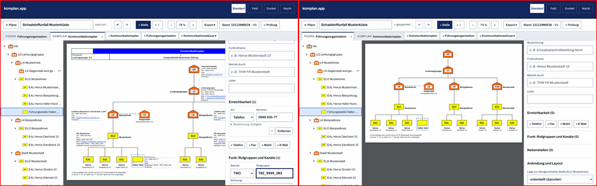
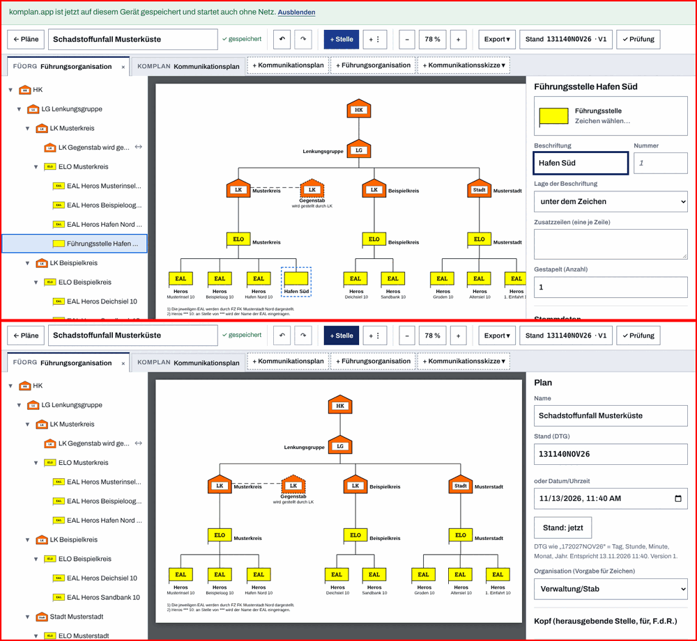
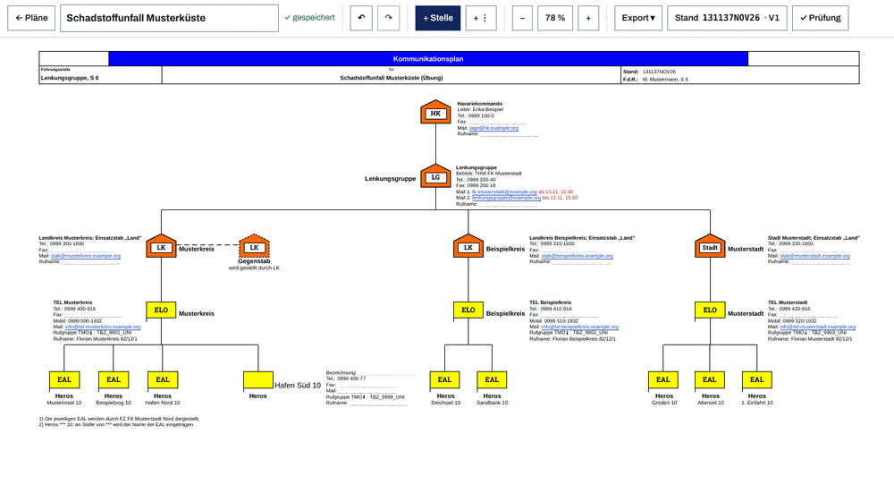

# Review-Runde 1: Stress und Unterbrechung

- Reviewer-Skill: `thw-stress-test-user` (Kürzel SU)
- Prüfgegenstand: komplan.app, main b37b468, lokal per vite preview
- Datum: 2026-11-13
- Viewports/Modi: Desktop 1440×900, Modus Standard (Basis-Screenshots der übrigen Viewports/Modi gesichtet)
- Durchgespielte Abläufe (alle mit Vorlage „Schadstoffunfall an der Küste“, Musterdaten):
  1. Unter Zeitdruck neue Stelle unter „ELO Musterkreis“ anlegen, Beschriftung, Telefon (0999 400-77) und Rufgruppe (TBZ_9999_UNI) eintragen, Kommunikationsplan drucken (Druckbild per `page.pdf` mit Druckmedien).
  2. Unterbrechungen mitten in der Eingabe: Seite neu laden, Reiter schließen und neu öffnen, im selben Reiter weg- und zurücknavigieren, „← Pläne“ und zurück.
  3. Derselbe Plan in zwei Browser-Reitern (z. B. vergessener zweiter Reiter), in beiden ändern.
  4. Nach Unterbrechung die eben angelegte Stelle wiederfinden; Stand/DTG vor und nach der Änderung vergleichen (mit über einer Minute Abstand).

## Urteil aus Sicht der Rolle

Wenn man in Ruhe arbeitet, kommt man ohne Hilfe zum Ziel: Stelle anlegen, Telefon und Rufgruppe eintragen, Kommunikationsplan drucken geht in unter einer Minute, der Ausdruck ist eine saubere A4-Seite mit den neuen Daten. Unter Stress kippt es an drei Stellen: (1) Wer nach dem Tippen sofort neu lädt oder die Seite verlässt, verliert genau die zuletzt eingetragene Nummer und Rufgruppe, ohne Warnung. (2) Ein zweiter offener Reiter mit demselben Plan überschreibt still die neue Stelle, und der erste Reiter meldet weiter „✓ gespeichert“. (3) Der Stand/DTG im Kopf und auf dem Ausdruck bleibt beim Ändern stehen, so dass alter und neuer Ausdruck denselben Stand und dieselbe Version tragen. Gerade das Verteilen des „aktualisierten“ Plans ist damit nicht verlässlich.

## P0

### SU-01 Reload oder Wegnavigieren verliert die zuletzt eingegebene Telefonnummer und Rufgruppe, ohne Warnung

- **Ansicht/Ablauf:** Editor, rechte Spalte „Erreichbarkeit“ und „Funk“; Ablauf 1 und 2.
- **Beobachtung:** Stelle angelegt, Beschriftung eingetragen, 2 s Pause (Anzeige „✓ gespeichert“), dann „+ Telefon“, Nummer zügig getippt, „+ Rufgruppe (Digitalfunk)“, Rufgruppe zügig getippt (zusammen etwa 4 s, Tastenabstand 150 ms). Anzeige „speichert …“. Sofort danach Seite neu geladen: Stelle und Beschriftung sind da, **Telefon und Rufgruppe fehlen ganz** („Erreichbarkeit (0)“, „Funk (0)“). In 3 von 3 Reload-Versuchen und beim Wegnavigieren im selben Reiter (andere Adresse, dann zurück) reproduziert. Werden alle Schritte ohne Pause von über 0,8 s gemacht, fehlt nach dem Reload sogar die ganze neue Stelle. Es erscheint keine Rückfrage „Ungespeicherte Änderungen“. Schließen des Reiters und neu Öffnen hat dagegen alles erhalten.
- **Ursache laut Code:** Der Autosave wartet 800 ms nach der **letzten** Änderung (`SPEICHER_VERZUG` in `src/app/editor.tsx`); jede Eingabe startet die Wartezeit neu. Das Sofort-Speichern bei `pagehide`/`visibilitychange` ist asynchron und kommt beim Reload offenbar nicht mehr in IndexedDB an.
- **Auswirkung im Einsatz:** Typische Situation: Nummer kommt per Zuruf, wird eingetippt, jemand drückt F5 / der Browser lädt neu / man klickt auf ein Lesezeichen. Der Helfer hat die Nummer gesehen und glaubt sie gespeichert; sie fehlt im nächsten Ausdruck. Das ist eine falsche Erreichbarkeit im verteilten Kommunikationsplan.
- **Vorschlag:** Änderungen nicht erst nach einer Ruhepause sichern, sondern spätestens alle ~1 s auch während laufender Eingabe (Höchstwartezeit statt nur Entprellung), und beim Verlassen der Seite synchron schreiben oder mit `beforeunload` warnen, solange „speichert …“ ansteht.
- **Verifikation:** Gleicher Ablauf mit Reload 300 ms nach dem letzten Tastendruck; nach dem Neuladen müssen Nummer und Rufgruppe vorhanden sein oder vorher eine Warnung erschienen sein.

### SU-02 Zweiter Reiter mit demselben Plan überschreibt die neue Stelle still; der erste Reiter zeigt weiter „✓ gespeichert“

- **Ansicht/Ablauf:** Editor in zwei Browser-Reitern; Ablauf 3.
- **Beobachtung:** Plan in Reiter 1 und Reiter 2 geöffnet. In Reiter 1 neue Stelle „Hafen Süd“ angelegt, „✓ gespeichert“. Reiter 2 zeigt die Stelle nicht (17 statt 18 Zeilen) und gibt keinen Hinweis. In Reiter 2 bei „EAL Heros Deichsiel 10“ eine Telefonnummer ergänzt, „✓ gespeichert“. Frisch geladener dritter Reiter: **„Hafen Süd“ ist weg** (17 Zeilen). Reiter 1 zeigt danach weiterhin 18 Zeilen und „✓ gespeichert“. Das Gleiche mit einer Namensänderung in Reiter 2: Stelle samt Telefon und Rufgruppe aus Reiter 1 verloren.
- **Auswirkung im Einsatz:** In der Führungsstelle laufen Rechner lange; ein alter Reiter vom Vormittag oder ein zweites Fenster ist realistisch. Wer dort „nur schnell“ eine Nummer korrigiert, löscht unbemerkt, was ein anderer (oder man selbst) zwischenzeitlich eingetragen hat. Die Anzeige „gespeichert“ im ersten Reiter ist dann falsch.
- **Vorschlag:** Beim Speichern erkennen, dass der Plan zwischenzeitlich anderswo geändert wurde (z. B. Änderungszähler/`geaendert` vergleichen oder BroadcastChannel), dann nicht überschreiben, sondern deutlich melden („Dieser Plan wurde in einem anderen Fenster geändert – neu laden“), und offene andere Reiter aktiv aktualisieren oder sperren.
- **Verifikation:** Ablauf 3 wiederholen; die Stelle aus Reiter 1 muss erhalten bleiben oder Reiter 2 muss vor dem Speichern sichtbar warnen.

## P1

### SU-03 Stand/DTG und Version bleiben beim Ändern stehen; Ausdruck und Dateiname tragen den alten Stand

- **Ansicht/Ablauf:** Werkzeugleiste „Stand … · V1“, Druck, PDF-Seitenfuß, Exportdateiname; Ablauf 1 und 4.
- **Beobachtung:** Plan um 11:37 angelegt (Stand `131137NOV26 · V1`). Über eine Minute später neue Stelle mit Telefon und Rufgruppe eingetragen: Kopfknopf zeigt weiter `131137NOV26 · V1`, der Ausdruck (Druckbild) enthält die neue Stelle, im Formularkopf aber „Stand: 131137NOV26“. Laut Code nutzen auch PDF-Seitenfuß und Dateiname (`dateiname()` in `src/ausgabe/export.ts`) `plan.stand.dtg`. Es gibt keinen Hinweis „geändert seit Stand …“. Der Stand wird nur über „Stand: jetzt“ in den Plan-Eigenschaften (sichtbar erst, wenn keine Stelle gewählt ist) oder über „Neuen Stand anlegen“ im Stand-Dialog fortgeschrieben.
- **Auswirkung im Einsatz:** Der alte und der neue Ausdruck sehen auf den ersten Blick gleich aus und tragen denselben DTG und dieselbe Version; beim Austausch an der Pinnwand oder beim Verteilen ist nicht erkennbar, welcher aktuell ist. Zweiter Download erhält denselben Dateinamen (der Browser hängt „(1)“ an). Unter Zeitdruck denkt niemand an „Stand: jetzt“.
- **Vorschlag:** Neben dem Stand sichtbar markieren, dass seit dem Stand geändert wurde (z. B. „Stand 131137NOV26 · V1 – geändert 11:39“), und beim Drucken/Exportieren anbieten „Stand auf jetzt setzen?“ oder den Druckzeitpunkt zusätzlich im Fuß ausgeben.
- **Verifikation:** Plan ändern, drucken; auf dem Papier muss erkennbar sein, dass er nach dem angezeigten Stand geändert wurde bzw. welcher Zeitpunkt gilt.

## P2

### SU-04 Speicherzustand zu unauffällig und nicht immer wahr

- **Ansicht/Ablauf:** Werkzeugleiste `.speicher-stand`.
- **Beobachtung:** „speichert …“ steht in kleiner grauer Schrift (`--t-xs`, `--text-2`) neben dem Plannamen; „✓ gespeichert“ grün, ebenso klein. Kein Zeitpunkt der letzten Sicherung. In SU-02 zeigt der Reiter „✓ gespeichert“, obwohl seine Fassung in der Datenbank bereits überschrieben ist.
- **Auswirkung im Einsatz:** Mit 10–20 s Aufmerksamkeit sieht man den Zustand nicht, bevor man den Rechner verlässt oder neu lädt (SU-01).
- **Vorschlag:** Ungespeicherten Zustand deutlicher (Kontrast, Symbol) und mit Uhrzeit der letzten Sicherung anzeigen („gespeichert 11:39“); bei Konflikt (SU-02) Warnzustand statt Häkchen.
- **Verifikation:** Fünf Testpersonen sollen nach dem Tippen in 2 s sagen, ob gespeichert ist.

### SU-05 Nach Reload springt die Ansicht auf den ersten Reiter, Auswahl ist weg; „Drucken“ druckt dann ohne Rückfrage diese Ansicht

- **Ansicht/Ablauf:** Ansichten-Reiter, Export ▾ → „Drucken“; Ablauf 2.
- **Beobachtung:** Vor dem Reload war „Komplan Kommunikationsplan“ aktiv und die neue Stelle gewählt; nach dem Reload ist „FüOrg Führungsorganisation“ aktiv und nichts gewählt (siehe Bild zu SU-01). Die Adresse enthält nur die Plan-ID. „Drucken“ öffnet direkt den Browserdruck der aktiven Ansicht, ohne Angabe welcher Ansicht.
- **Auswirkung im Einsatz:** Wer nach einer Unterbrechung schnell „Drucken“ wählt, druckt die Führungsorganisation ohne Telefonnummern statt des Kommunikationsplans (plausible Risikostelle, so nicht vollständig durchgespielt). Die bearbeitete Stelle muss neu gesucht werden (SU-06).
- **Vorschlag:** Aktive Ansicht und Auswahl in der Adresse oder lokal merken und nach Reload wiederherstellen; im Druckweg die Ansicht nennen („Kommunikationsplan drucken“).
- **Verifikation:** Reload auf dem Kommunikationsplan-Reiter; danach ist derselbe Reiter aktiv und dieselbe Stelle gewählt.

### SU-06 Eben angelegte Stelle ist schwer wiederzufinden

- **Ansicht/Ablauf:** Gliederung links; Ablauf 4.
- **Beobachtung:** Die Gliederung hat keine Suche. Zeilen sind abgeschnitten („EAL Heros Musterinsel…“, „Führungsstelle Hafen …“). Der Zeilentitel besteht aus Zeichenkürzel, Nummer, Beschriftung; die **Bezeichnung** erscheint nicht: Eine Stelle, bei der nur „Bezeichnung = EAL Hafen Sued“ eingetragen war, heißt in der Gliederung nur „Führungsstelle“. Nach dem Reload ist keine Stelle gewählt.
- **Auswirkung im Einsatz:** Nach einer Unterbrechung muss man den Baum Zeile für Zeile absuchen; bei mehreren neuen Stellen ohne Zeichen stehen mehrere gleichlautende „Führungsstelle“-Zeilen da.
- **Vorschlag:** Suchfeld/Filter über der Gliederung (über Beschriftung, Bezeichnung, Funkrufname, Nummer), Bezeichnung als Ersatz im Zeilentitel, zuletzt bearbeitete Stelle hervorheben.
- **Verifikation:** Nach Reload die Stelle „Hafen Süd“ mit höchstens einer Eingabe finden.

### SU-07 Weg zur Telefonnummer/Rufgruppe ist lang und teilweise verdeckt

- **Ansicht/Ablauf:** „+ Stelle“ → rechte Spalte.
- **Beobachtung:** Nach „+ Stelle“ bleibt der Fokus in der Gliederung, nicht im ersten Eingabefeld. „Erreichbarkeit“ liegt bei 1440×900 unterhalb der sichtbaren Fläche (erst Zeichen, Beschriftung, Nummer, Lage, Zusatzzeilen, Gestapelt, Stammdaten), „Funk: Rufgruppen und Kanäle (0)“ ist für neue Stellen zugeklappt, „+ Rufgruppe (Digitalfunk)“ erst nach Aufklappen sichtbar. Die neue Stelle hat zunächst kein Zeichen (leeres gelbes Kästchen) und wird so auch gedruckt; im Druck steht zudem eine leere Zeile „Bezeichnung: ……“.
- **Auswirkung im Einsatz:** Mehrere Scroll- und Klickschritte für die zwei wichtigsten Angaben; wer nach „+ Stelle“ sofort tippt, tippt ins Leere.
- **Vorschlag:** Nach „+ Stelle“ Fokus ins erste Feld; Erreichbarkeit und Funk weiter oben bzw. Funk aufgeklappt; optional ein kompakter Schnellerfassungsweg „Stelle + Telefon + Rufgruppe“.
- **Verifikation:** Stoppuhr: neue Stelle mit Telefon und Rufgruppe in unter 30 s ohne Scrollen.

## P3

### SU-08 Felder Beschriftung, Nummer, Bezeichnung, Funkrufname unter Zeitdruck verwechselbar

- **Ansicht/Ablauf:** Rechte Spalte einer Stelle.
- **Beobachtung:** Im Testlauf landete „Hafen Süd 10“ im Feld „Nummer“ statt in der Beschriftung und erschien dann rechts neben dem Zeichen statt darunter (siehe Bild zu SU-03). Die Platzhalter („z. B. Ortsname“, „1“) helfen nur, wenn man sie liest.
- **Auswirkung im Einsatz:** Uneinheitliche Darstellung im verteilten Plan; Korrektur kostet Zeit.
- **Vorschlag:** Kurze sichtbare Erklärung, wo das Feld im Plan erscheint (z. B. „unter dem Zeichen“), oder Vorschau-Hervorhebung des betroffenen Textes beim Tippen.
- **Verifikation:** Neue Nutzer tragen „Heros Hafen Süd 10“ wie in den Vorlagenstellen ein, ohne Korrektur.

## Was gut funktioniert

- Nach einer Pause von etwa 1 s ist sicher gespeichert; Schließen des Reiters und neu Öffnen hat alle Eingaben erhalten.
- Planliste zeigt je Plan Stand, Stellenzahl und „geändert“-Uhrzeit, so findet man den Plan nach Unterbrechung schnell.
- Das Druckbild des Kommunikationsplans ist eine saubere A4-quer-Seite und übernimmt neue Stelle, Telefon und Rufgruppe sofort.
- Rückgängig/Wiederholen sind in der Leiste gut erreichbar.

## Nicht geprüft

- Echter Reiterwechsel/Minimieren (im Headless-Browser bleibt `visibilityState` „visible“); Verhalten bei Akku-/Browserabsturz.
- Tablet- und Telefon-Ansicht im Stressablauf (nur Basis-Screenshots gesichtet).
- Stand-Dialog „Neuen Stand anlegen“ und Vergleich unter Zeitdruck nur aus dem Code, nicht durchgespielt.

## Abschluss

- **Aufgabe geschafft:** mit Umwegen
- **Fremde Hilfe nötig:** nein
- **Größtes Missverständnis:** „Speichert …“ und der gleichbleibende Stand suggerieren, dass das, was man gerade getippt hat, auch im verteilten Plan als aktueller Stand ankommt.
- **Größtes Einsatzrisiko:** Eine eben eingetragene Telefonnummer oder Rufgruppe geht durch Reload oder einen zweiten Reiter still verloren, während der Ausdruck denselben Stand trägt wie zuvor.
- **Top-Priorität für die nächste Iteration:** Verlustfreies Speichern bei Reload/Wegnavigieren und Schutz gegen Überschreiben aus einem zweiten Reiter (SU-01, SU-02).
