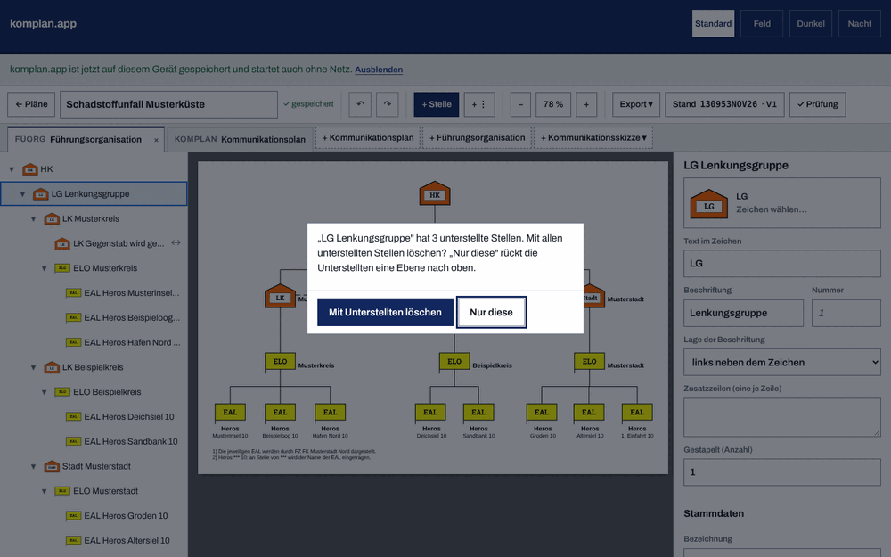
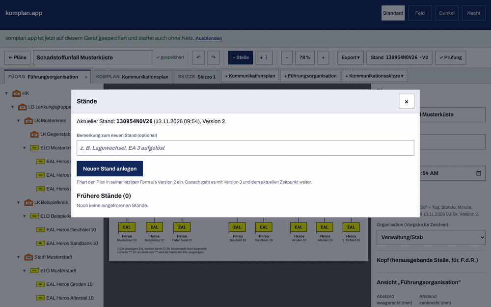
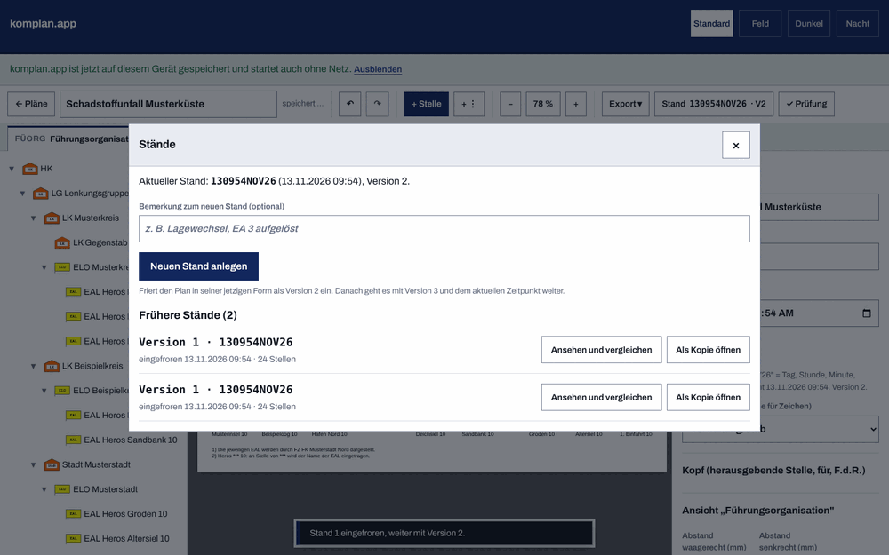
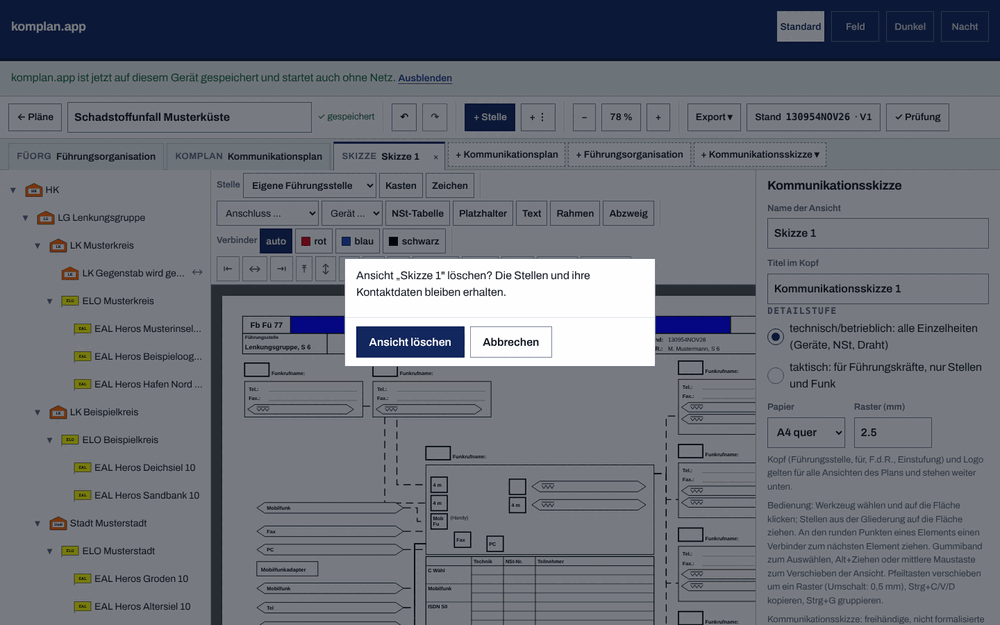
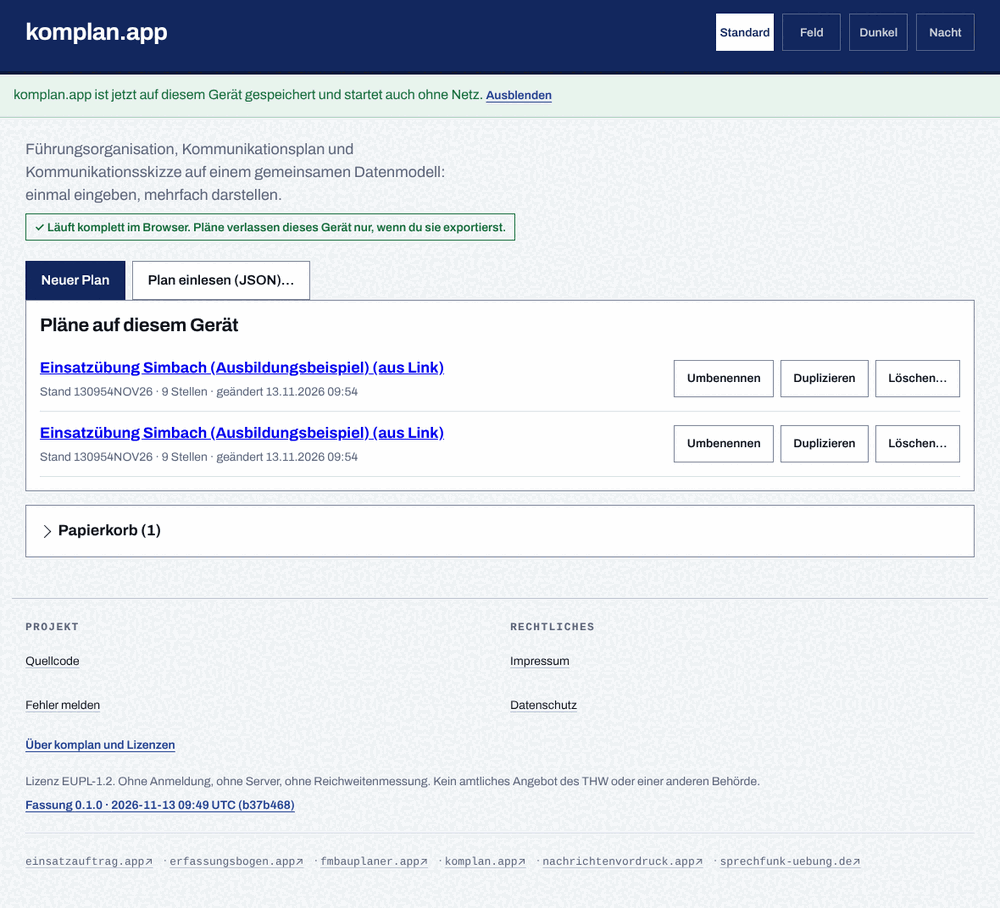
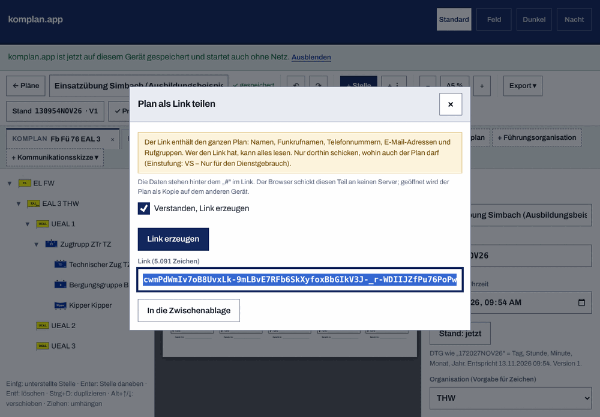

# Review-Runde 1: Zerstörende und folgenschwere Handlungen

- Reviewer-Skill: `thw-destructive-action-reviewer` (Kürzel ZH)
- Prüfgegenstand: komplan.app, main b37b468, lokal per vite preview
- Datum: 2026-11-13
- Viewports/Modi: Desktop 1440×900 (Editor, Stände, JSON), iPad quer 1180×820 mit Touch (Startseite, Papierkorb, Teil-Link erzeugen), Telefon 390×844 (Teil-Link öffnen); Modus Standard
- Durchgespielte Abläufe (Playwright, nur Vorlagen „Schadstoffunfall an der Küste“ und „Fb Fü 76“ Simbach):
  Stelle mit Unterstellten löschen (Entf, Esc, Enter), Blatt-Stelle mit Rücktaste löschen, Rückgängig vor und nach Neuladen,
  Ansicht/Skizze über „ד löschen und zurückholen, Stand anlegen und rückgängig machen, JSON exportieren und in dasselbe Gerät wieder einlesen,
  Teil-Link erzeugen, in zweitem Kontext öffnen, verwerfen, Browser-Zurück, im selben Kontext zweimal übernehmen,
  Plan in den Papierkorb, Enter im Bestätigungsdialog, Papierkorb öffnen, „Endgültig löschen…“ (abgebrochen), Wiederherstellen.

## Urteil aus Sicht der Rolle

Die meisten Löschwege sind ordentlich abgesichert: Plan-Löschen geht in einen Papierkorb mit 30 Tagen, Bestätigungen nennen den Namen, der Fokus liegt auf „Abbrechen“, Enter löscht also nichts, und im Editor fängt Strg+Z fast alles auf. Gefährlich sind zwei Stellen, an denen die App *etwas anderes tut, als der Helfer erwartet*: Der Dialog „Stelle mit Unterstellten löschen“ hat keinen Abbruch, Esc löscht trotzdem; und das Wiedereinlesen einer eigenen JSON-Sicherung nimmt dem Original still alle Stände weg. Beides ist ohne fremde Hilfe nicht zu durchschauen. Die Aufgaben selbst sind lösbar, aber mit Umwegen.

## P0

Keine Befunde, die im laufenden Einsatz unmittelbar zu nicht behebbarem Verlust führen; ZH-02 grenzt daran (siehe dort).

## P1

### ZH-01 Löschdialog „Stelle mit Unterstellten“ ohne Abbrechen: Esc und Enter löschen

- **Fundstelle:** Editor, Gliederung oder Zeichenfläche, Stelle mit Unterstellten wählen, Entf/Rücktaste oder Kontextmenü „Löschen…“.
- **Beobachtung:** Dialog „„LG Lenkungsgruppe“ hat 3 unterstellte Stellen. Mit allen unterstellten Stellen löschen?“ mit den Knöpfen „Mit Unterstellten löschen“ und „Nur diese“. Es gibt kein „Abbrechen“. Esc schließt den Dialog, danach war „LG Lenkungsgruppe“ gelöscht (17 → 16 Zeilen, Unterstellte eine Ebene hochgerückt). Der Fokus steht beim Öffnen auf „Nur diese“; Enter löscht ebenfalls. Im Code wird jede Antwort außer „Ja“ als „Nur diese“ gewertet (`src/app/editor.tsx`, `loeschen`).
- **Erwartung der Rolle:** Esc, Klick daneben oder „Nein, doch nicht“ bricht ab. Wer versehentlich Entf gedrückt hat, will raus, nicht zwischen zwei Löscharten wählen.
- **Auswirkung im Einsatz:** Der reflexhafte Ausweg (Esc) löscht die Stelle samt Kontaktdaten und baut die Struktur um. Die Kurzmeldung „Gelöscht. Strg+Z …“ verschwindet nach 3,5 s; wer sie übersieht, glaubt abgebrochen zu haben, und der Fehler fällt erst im gedruckten Plan auf. Nach Neuladen oder Wechsel zu „← Pläne“ ist Rückgängig weg (ZH-05).
- **Empfehlung:** Drei Knöpfe: „Mit Unterstellten löschen“, „Nur diese löschen“, „Abbrechen“; Esc und × = Abbrechen, Fokus auf Abbrechen. Im Text die Anzahl der betroffenen Stellen einschließlich tieferer Ebenen nennen.
- **Verifikation:** Entf auf Stelle mit Unterstellten, Esc → Zeilenzahl unverändert; Enter → unverändert.

### ZH-02 JSON-Sicherung wieder einlesen nimmt dem Original still alle Stände weg

- **Fundstelle:** Startseite „Plan einlesen (JSON)…“ mit einer Datei, die von einem Plan auf demselben Gerät exportiert wurde.
- **Beobachtung:** Plan mit zwei Ständen als JSON exportiert und auf demselben Gerät eingelesen. Die App legt richtigerweise eine Kopie „… (eingelesen)“ an, statt zu überschreiben. Danach zeigt die Kopie beide Stände, das Original aber „Frühere Stände (0) – Noch keine eingefrorenen Stände“, obwohl der Kopf weiter „V2“ zeigt. Ursache im Code: die Stände behalten beim Einlesen ihre IDs und überschreiben die gleichnamigen Einträge des Originals (`src/app/start.tsx`, `einlesen`).
- **Erwartung der Rolle:** „Als Kopie einlesen statt überschreiben“ heißt: am Original ändert sich nichts.
- **Auswirkung im Einsatz:** Typischer Ablauf: Sicherung exportieren, zur Kontrolle wieder einlesen, die doppelte „(eingelesen)“-Kopie wegwerfen. Spätestens nach „Endgültig löschen“ oder 30 Tagen Papierkorb ist die Stände-Historie des Originals unwiederbringlich weg, ohne dass es je eine Meldung gab. Die Nachvollziehbarkeit, wer wann welchen Stand hatte, geht verloren. Fast P0: der Verlust ist still, nur noch nicht sofort endgültig.
- **Empfehlung:** Beim Einlesen als Kopie auch den Ständen neue IDs geben; Original bleibt unberührt. Zusätzlich in der Meldung sagen, was angelegt wurde („Kopie mit 2 Ständen“).
- **Verifikation:** Plan mit 2 Ständen exportieren, einlesen; Original und Kopie zeigen je 2 Stände; Kopie endgültig löschen, Original weiter 2 Stände.

## P2

### ZH-03 Rückgängig nach „Neuen Stand anlegen“ erzeugt doppelte Versionsnummern

- **Fundstelle:** Stände-Dialog, „Neuen Stand anlegen“, danach Strg+Z im Editor, danach erneut „Neuen Stand anlegen“.
- **Beobachtung:** Strg+Z setzt den Zähler von V2 auf V1 zurück, der eingefrorene Stand bleibt aber gespeichert. Der zweite „Neuen Stand anlegen“ friert erneut „Version 1“ ein. Die Liste zeigt zweimal „Version 1 · 130954NOV26“ mit gleichem Zeitpunkt.
- **Erwartung der Rolle:** Ein Stand ist eingefroren; Rückgängig sollte entweder nicht hineinreichen oder den Stand mit zurücknehmen.
- **Auswirkung im Einsatz:** Zwei verschiedene Papierfassungen können dieselbe Versionsnummer tragen; bei Rückfragen („Habt ihr Version 1?“) ist nicht mehr eindeutig, welche gemeint ist.
- **Empfehlung:** „Stand anlegen“ nicht im Rückgängig-Verlauf führen (oder als Ganzes zurücknehmen); Versionsnummern nie doppelt vergeben.
- **Verifikation:** Ablauf wiederholen, Liste enthält keine doppelte Version.

### ZH-04 „ד am Reiter löscht die Ansicht; bei Skizzen verspricht der Dialog zu viel

- **Fundstelle:** Ansichten-Leiste, „ד am aktiven Reiter (FüOrg, Komplan, Skizze).
- **Beobachtung:** Das „ד sitzt wie ein Browser-Reiter-Schließen direkt am Reitertitel, löscht aber die Ansicht. Der Dialog sagt „Ansicht „Skizze 1“ löschen? Die Stellen und ihre Kontaktdaten bleiben erhalten.“ Bei einer Kommunikationsskizze gehen aber alle Elemente, Verbinder, Texte und die Anordnung verloren. Nach dem Löschen kommt keine Meldung mit Rückgängig-Hinweis (anders als bei Stellen). Strg+Z holt die Ansicht zurück, aber nur bis Neuladen/Planwechsel.
- **Erwartung der Rolle:** „ד = Reiter zu, kommt wieder. Der beruhigende Satz lässt eine Skizze harmlos aussehen.
- **Auswirkung im Einsatz:** Eine von Hand gezeichnete Fb-Fü-77-Skizze (viel Arbeit) wird nach beruhigendem Text gelöscht; wer danach zur Planliste geht, hat sie verloren.
- **Empfehlung:** Statt „ד ein beschriftetes „Ansicht löschen…“ im Reiter-Menü; bei Skizzen im Dialog sagen, was verloren geht („23 Elemente und Verbinder dieser Skizze“); nach dem Löschen Kurzmeldung mit „Rückgängig“-Knopf.
- **Verifikation:** Skizze löschen: Dialog nennt Elementzahl; Meldung mit Rückgängig erscheint.

### ZH-05 Rückgängig endet still bei Neuladen und Planwechsel; Hinweis „Strg+Z“ passt nicht zum Tablet

- **Fundstelle:** Editor nach Löschen einer Stelle (Rücktaste auf Blatt-Stelle löscht ohne Rückfrage), dann Neuladen oder „← Pläne“.
- **Beobachtung:** Nach Neuladen ist der Rückgängig-Knopf deaktiviert; die Löschung ist bereits automatisch gespeichert. Die Kurzmeldung nennt nur „Strg+Z“, auf dem iPad gibt es dafür den unbeschrifteten Knopf „↶“.
- **Erwartung der Rolle:** Ein Fehler von vor zwei Minuten lässt sich noch zurückholen, auch wenn zwischendurch die Seite neu geladen wurde.
- **Auswirkung im Einsatz:** Rückgängig ist die einzige Absicherung für Löschen ohne Rückfrage (Blatt-Stellen, Skizzen-Elemente, Ansichten). Nach Neuladen, Akkuwechsel oder Planwechsel ist der Weg zu; dann bleibt nur ein früherer Stand, falls einer angelegt wurde.
- **Empfehlung:** Kurzmeldung nach Löschen mit eigenem Knopf „Rückgängig“; den Verlauf (oder zumindest die letzten Löschungen) mit dem Plan speichern; alternativ vor dem Verlassen eines Plans mit ungesicherten Löschungen automatisch einen Stand anlegen.
- **Verifikation:** Stelle löschen, Seite neu laden, Löschung lässt sich zurückholen.

### ZH-06 Teil-Link mehrfach geöffnet: gleichnamige Dubletten neben dem Löschen-Knopf

- **Fundstelle:** Teil-Link auf einem Gerät öffnen, auf dem der Plan schon liegt; danach Startseite.
- **Beobachtung:** Jedes „Plan übernehmen und öffnen“ legt eine neue Kopie „… (aus Link)“ an, ohne Hinweis, dass der Plan schon vorhanden ist, und ohne Vergleich. Nach zweimaligem Öffnen stehen zwei völlig gleiche Einträge „Einsatzübung Simbach (Ausbildungsbeispiel) (aus Link)“ mit gleichem Stand und gleicher Zeit da. „Löschen…“ sieht aus wie „Umbenennen“/„Duplizieren“ und steht direkt daneben. Positiv: es wird nie überschrieben, Esc/Enter im Papierkorb-Dialog löschen nichts.
- **Erwartung der Rolle:** Ein neuer Link vom Stab ist „die neue Fassung“; man will wissen, ob sie neuer ist als die vorhandene, und beim Aufräumen sicher die richtige erwischen.
- **Auswirkung im Einsatz:** Beim Aufräumen der Dubletten wird leicht die falsche (ggf. die mit eigenen Ergänzungen) in den Papierkorb gelegt. Wer den Papierkorb nicht findet (zugeklappt, unten), hält sie für weg.
- **Empfehlung:** Beim Übernehmen erkennen, dass der Plan schon da ist, und anbieten: „Vorhandenen Stand X ersetzen (alter wird als Stand gesichert)“ / „Als Kopie“ / „Nur ansehen“; Kopien mit Datum/Uhrzeit benennen; „Löschen…“ optisch von den übrigen Aktionen absetzen; nach „In den Papierkorb“ Kurzmeldung mit „Wiederherstellen“.
- **Verifikation:** Link zweimal öffnen: Rückfrage erscheint; Kopien unterscheidbar; nach Löschen Meldung mit Wiederherstellen.

### ZH-07 Teil-Link: Hinweis „an keinen Server“ wirkt bei Messenger-Weitergabe zu beruhigend

- **Fundstelle:** Export → „Als Link teilen…“; Empfänger-Seite „Plan aus einem Link“.
- **Beobachtung:** Die Warnung ist deutlich (ganzer Plan, Namen, Telefonnummern, Rufgruppen; Einstufung „VS – Nur für den Dienstgebrauch“ wird genannt) und erst nach Häkchen gibt es den Link. Direkt darunter steht aber „Der Browser schickt diesen Teil an keinen Server“. Das stimmt für den Browser, nicht für den Weg: der Link liegt als Text vollständig beim Messenger- oder Mailanbieter, in Chatverläufen, Sicherungen und in der Browser-Chronik des Empfängers. Nach „Verwerfen“ auf dem Telefon führt Browser-Zurück wieder zum vollständigen Plan (Link bleibt in der Chronik). Der Hinweis „auf fremden Geräten danach wieder löschen“ erwähnt Chat und Chronik nicht. Ein VS-NfD-Plan lässt sich mit einem Häkchen als Link erzeugen, ohne gesonderte Rückfrage.
- **Erwartung der Rolle:** Klare Ansage, dass der Link selbst die Daten *ist* und wie eine Datei mit Kontaktdaten zu behandeln ist.
- **Auswirkung im Einsatz:** Annahme: unter Zeitdruck wird der Link in eine allgemeine Messenger-Gruppe gestellt, weil „geht ja an keinen Server“. Damit liegen Rufnummern und Rufgruppen dauerhaft in fremden Chatverläufen. Nicht zurückholbar.
- **Empfehlung:** Satz umformulieren: „Der Link enthält die Daten selbst. Wer ihn weiterleitet oder im Chatverlauf hat, hat den Plan.“ Bei gesetzter Einstufung eine eigene, ausdrückliche Bestätigung verlangen. Auf der Empfängerseite: „Link auch aus Chat und Browser-Verlauf löschen“; nach „Verwerfen“ den Chronik-Eintrag ersetzen statt neuen anzulegen.
- **Verifikation:** Textprüfung; Link öffnen, Verwerfen, Zurück → Plan erscheint nicht wieder.

## P3

### ZH-08 „Endgültig löschen“ verschweigt, dass auch alle Stände mitgehen

- **Fundstelle:** Startseite, Papierkorb, „Endgültig löschen…“; ebenso das automatische Aufräumen nach 30 Tagen.
- **Beobachtung:** Dialog „„…“ endgültig löschen? Das lässt sich nicht rückgängig machen.“ Laut Code werden alle eingefrorenen Stände mitgelöscht; der Dialog nennt sie nicht. Das automatische Löschen nach 30 Tagen geschieht beim Öffnen der Startseite ohne Meldung.
- **Auswirkung im Einsatz:** Gering, weil zweistufig (Papierkorb). Wer Stände als Dokumentation versteht, rechnet nicht mit deren Verlust.
- **Empfehlung:** Anzahl der Stände im Dialog nennen („und 3 eingefrorene Stände“); im Papierkorb je Plan „wird am … endgültig gelöscht“ anzeigen; Hinweis auf JSON-Export vor endgültigem Löschen.
- **Verifikation:** Dialog nennt Stände; Papierkorb zeigt Löschdatum.

### ZH-09 Nach „In den Papierkorb“ keine Rückmeldung, Papierkorb zugeklappt am Seitenende

- **Fundstelle:** Startseite nach dem Löschen eines Plans (iPad quer).
- **Beobachtung:** Der Plan verschwindet ohne Kurzmeldung; „Papierkorb (1)“ steht zugeklappt unter der Liste. Wiederherstellen funktioniert einwandfrei.
- **Auswirkung im Einsatz:** Beim versehentlichen Löschen fehlt der direkte Weg zurück; man muss wissen, dass es den Papierkorb gibt.
- **Empfehlung:** Kurzmeldung „In den Papierkorb gelegt“ mit Knopf „Wiederherstellen“.
- **Verifikation:** Plan löschen, Meldung mit Wiederherstellen erscheint und wirkt.

## Was gut funktioniert

- Plan-Löschen geht in einen Papierkorb (30 Tage), Bestätigung mit Namen; Fokus auf „Abbrechen“, Enter löscht nicht. Wiederherstellen ein Klick.
- JSON-Einlesen und Teil-Link überschreiben nie einen vorhandenen Plan, sondern legen Kopien an.
- Stände lassen sich nur „Als Kopie öffnen“; ein früherer Stand überschreibt den aktuellen Plan nie.
- Teil-Link: Warnung vor Kontaktdaten mit Einstufung, Link erst nach ausdrücklichem Häkchen, Längenwarnung für Messenger.
- Rückgängig/Wiederholen (bis 200 Schritte) deckt im laufenden Editor Löschen von Stellen, Ansichten und Skizzen-Elementen ab.

## Nicht geprüft

- Mehrere Browser-Tabs mit demselben Plan gleichzeitig (gegenseitiges Überschreiben beim Autosave).
- Verhalten bei vollem Speicher/Speicherfehler während des Löschens.
- Tatsächliche Link-Vorschau einzelner Messenger (nicht im Testumfeld verfügbar).

## Abschluss

- **Aufgabe geschafft:** mit Umwegen
- **Fremde Hilfe nötig:** nein (aber ZH-02 bleibt ohne Code-Kenntnis unentdeckt)
- **Größtes Missverständnis:** Esc im Löschdialog einer Stelle mit Unterstellten bricht nicht ab, sondern löscht die Stelle.
- **Größtes Einsatzrisiko:** Das Wiedereinlesen einer eigenen JSON-Sicherung entzieht dem Original still die Stände-Historie, die mit dem Aufräumen der Kopie endgültig verloren geht.
- **Top-Priorität für die nächste Iteration:** „Abbrechen“ im Dialog „Stelle mit Unterstellten löschen“ (Esc = Abbrechen) und neue Stand-IDs beim Einlesen als Kopie.
